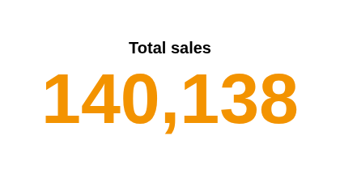
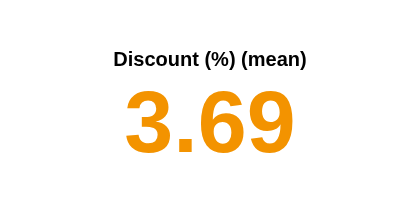
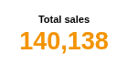

# KPI

One number, one title. The headline figure of a dashboard, recalculated as the viewer filters the report.

## The problem it solves

Most dashboards open with a handful of figures: total sales, orders, average basket, open cases. Each needs to be correct for whatever the viewer has filtered, and readable at a glance in a small tile.

The KPI view shows one measure, aggregated by Omniscope over all the records in the view, in large type with a title. With the title left empty, the measure names itself. In the illustrative orders above (invented figures) the total is the sum of 400 orders; below, the mean discount keeps its decimals:

## Where it earns its place

Omniscope's built-in KPI view is the one to use for headline figures, and its Content view builds richer KPIs: text mixed with formulas, number formatting and comparisons with earlier periods. This view is deliberately minimal, which makes it:

- **a quick headline** when a single figure with a title is all a tile needs;
- **a starting point for your own view**: one HTML file of about 130 lines, with no libraries, that reads Omniscope's auto-query result. Copy it and change the drawing to make a new view.

The examples below are illustrative.

| Team | Figure |
|---|---|
| Sales | Total sales, orders, average order value |
| Customer service | Open cases, mean satisfaction score |
| Operations | Units shipped, mean delivery time |
| Finance | Spend to date, number of invoices |

## How to use it in Omniscope

1. Bring the data into a workflow and connect it to a Report block.
2. Add a view and choose **KPI**.
3. Set **Measure**, for example the sum of Sales.
4. Optionally type a **Title text**.
5. Place several KPI views side by side for a row of headline figures; each follows the report's filters.

## Why do this in Omniscope

- **Calculated, not typed.** The figure is aggregated by Omniscope from the workflow's data each time it changes, and the total, mean and record count were checked against the source data.
- **Matches what the viewer filtered.** It follows every filter and selection in the report (filtering to one region gave 31,636 of 140,138), and shows "No data" rather than a stale figure when nothing is left.
- **Fits the tile.** The number is sized to the view, from a 140 by 70 tile to a full screen, so several KPI views make a row of headline figures.
- **A comparison if you want one.** The view shows one measure; its short source can be extended in the View Designer to add, say, the change against last period.

## Data and options

A numeric field to aggregate.

| Option | What it does |
|---|---|
| Measure | The figure, for example the sum of Sales or Record count |
| Title text | The title; empty shows the measure's name |

## Tested

Mock harness: the total, mean and record count checked against the source data (140,138; 3.69; 400), number formatting for small and large values, filtering to one region (31,636), changing the measure and title, a 900 by 500 pane and a 140 by 70 pane (the number fits), 20,000 records, empty data ("No data") and no measure ("Choose a measure").

