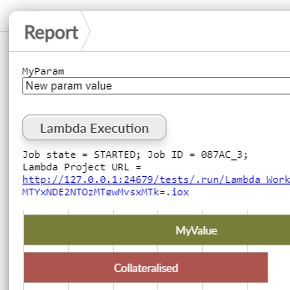

#  Lambda Workflow Execution

Inputs for project parameters and a button that executes workflow blocks in a new copy of the project, with the values typed in. The project itself, and its parameters, are left unchanged, so several viewers can run it at once with different values. This is what Omniscope calls a lambda execution.

The view calls the project's [Workflow REST API](https://help.visokio.com/support/solutions/articles/42000073133-workflow-execution-rest-apis): `GET <project>.iox/w/param/` to read the parameters; on the button, `POST <project>.iox/w/lambdaexecute` with the blocks, the parameter values and whether to delete the copy afterwards; then `GET <project>.iox/w/job/<job id>/state` on the original project once a second until the job ends.

## Use case

- Self-service exports or reports per customer, region or period: each request runs in its own copy, so requests do not wait for or overwrite each other.
- Running a model with a viewer's own inputs while the published report keeps its data.

## Data

None: the view does not read the report's data, and filters do not affect it. The values it shows are the project's parameters.

## Settings

- **Blocks to execute**: block names separated by commas, for example `Export summary`. Leave empty to execute the whole workflow.
- **Button text**: the text on the button (default "Execute").
- **Parameters to show**: parameter names separated by commas, in order. Leave empty to show them all.
- **Delete the copy when finished** (default off): delete the copy of the project and its execution data when the job ends. Off: the copy is kept and the view links to it ("Open the copy of the project").
- **Refresh this report when finished** (default off): when the job has finished, execute this report's own block, from source, so the report shows what the execution wrote (for example a file the report reads).
- **Take values from report variables** (default off): set each parameter from the report variable of the same name instead of from typed values. The inputs are then read-only and follow the variables; parameters with no variable of that name are marked and not set.
- **Show job state** (default on): shows the job's progress under the button. Errors are shown whether or not this is on.

## Values

Number parameters are sent as numbers (thousands separators are ignored; other text is refused with "Enter a number for ..."); other parameters are sent as typed, or as the variable's value.

## Requirements

The viewer's user needs the **Project parameters access via APIs** and **Workflow Execution via APIs** permissions on the Omniscope server (both off by default). Lambda executions run through the server's scheduler, so the server's edition must include it.

## Interaction

Type values, then press the button. It stays disabled, with a spinner, until the job ends. Values typed are kept when the report is filtered or the view resized. If Omniscope reloads the view while the job runs (it does when a block the view reads is executed, or a parameter it reads changes), the view picks the job up again and shows its progress and result. The result stays shown for two minutes after such a reload.

The view has nothing to select. A click on empty space clears the report's selection, as in other views; a click on an input, a link or the button does not.

## Related views

[Set Parameters and Execute](../setparamandexecute) changes the project's own parameters and executes the project itself; [Upload and Execute](../uploadandexecute) runs a lambda execution on a file the viewer uploads.

## Third-party libraries

None: the view is plain HTML and JavaScript and needs nothing beyond Omniscope's custom view API.
