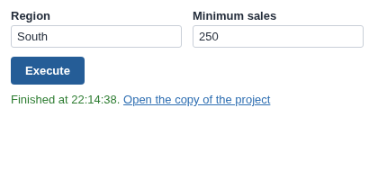

# Lambda Workflow Execution

Run the workflow with your own values, in a copy of the project, without changing the project.

## The problem it solves

Setting project parameters changes them for everyone: two viewers running a parameterised export at once overwrite each other's values. A lambda execution avoids that. Omniscope makes a new copy of the project, sets the parameters there, executes the blocks, and optionally deletes the copy afterwards.

The Lambda Workflow Execution view asks for the parameter values in the report, starts the lambda execution and follows the job; when the copy is kept it links to it. Above, an illustrative export for a chosen region.

## Where it earns its place

The examples below are illustrative.

| Team | Each run |
|---|---|
| Account management | A customer pack for the customer chosen |
| Finance | A cost-centre report for a period |
| Data team | A model run with a viewer's own assumptions |
| Operations | A route plan for one depot |

## How to use it in Omniscope

1. Create the project parameters and use them in the blocks to run, for example an export that writes a file named after the region.
2. Give the users who should run it the **Project parameters access via APIs** and **Workflow Execution via APIs** permissions.
3. In the report, add a view and choose **Lambda Workflow Execution**.
4. Set **Blocks to execute** and **Parameters to show**; tick **Delete the copy when finished** unless viewers need to open the copy.
5. Optionally tick **Take values from report variables** to send the report's current variable values instead of typed ones.

## Why do this in Omniscope

- **Isolated runs.** Every press runs in its own copy of the project, so parallel requests with different values do not overwrite each other's parameters, and the published report keeps its data.
- **From the report's own state.** With report variables as the source, the run uses exactly what the viewer has chosen in the report.
- **Nothing hidden.** The request the button sends is the documented `lambdaexecute` call, readable in the view's source in the View Designer, so the same run can also be scripted from outside the report.

## Data and options

No data is needed. The inputs are the project's own parameters.

| Option | What it does |
|---|---|
| Blocks to execute | Block names; empty runs the whole workflow |
| Parameters to show | Names, in order; empty shows all |
| Delete the copy when finished | Remove the copy and its data afterwards |
| Refresh this report when finished | Re-execute this report from source afterwards |
| Take values from report variables | Use the variables of the same names |
| Button text, Show job state | Label and progress |

## Tested

Mock harness with a stand-in for the Workflow REST API: the lambda request (blocks, typed and numeric values, delete flag); the job followed on the original project to Finished, with a link to the copy when it is kept; values taken from report variables, with missing variables marked and not sent; this report refreshed after a finished run but not after a failed one; typed values survive filtering; a 150 by 120 pane; no parameters; no settings; and 60 parameters; and a reload of the view in the middle of a run (the view resumes and shows the result).
