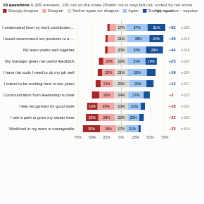

#  Likert Survey

Survey results on a rating scale, shown as the standard diverging layout: diverging stacked bars centred on the neutral answer, so the balance of positive and negative answers reads at a glance. Statements are sorted by net score (positive minus negative). The scale order is recognised automatically for common wordings (agreement, satisfaction, frequency, quality, likelihood, importance, ease), numeric scales such as 1 to 5, and 0 to 10 answers, which are shown as a Net Promoter Score.

## Use case

Employee engagement and pulse surveys, customer satisfaction and Net Promoter surveys, course and event feedback, patient experience, market research questionnaires; comparing departments, regions, cohorts or waves.

## Data

One row per answer, with the answer and (when one column holds several questions) the question. This is the "long" layout most survey tools export or that an Omniscope workflow can produce with a de-pivot. The view runs one aggregated query (counts per question, group and answer). Answers such as "Prefer not to say", "N/A" and "Don't know" are left out of the bars and reported. Filters from other views apply.

## Settings

- **Answers**: the rating given.
- **Questions** (optional): the question or statement.
- **Compare by** (optional): split each question by a group such as Department.
- **Answer order**: a comma-separated scale, from most negative to most positive, when the wording is not recognised.
- **Scale**: automatic, rating scale, or Net Promoter (0 to 10: detractors 0 to 6, passives 7 and 8, promoters 9 and 10).
- **Sort questions**: by net score (default) or alphabetically.

## Reading the chart

Each bar is 100% of the answers to a question (or group). Negative answers extend left of the centre line, positive answers right, and the neutral answer straddles it. The figure on the right is the net score: the share of positive answers minus the share of negative ones, in points (or the Net Promoter Score), with the number of answers.

## Interaction

Hover a segment for its count and share. Click a segment to select those answers (question, group and answer), or click a question to select all its answers, so other views show who gave them; click again or click empty space to clear.

## Motion

When the view first draws, and when its data, options or filters change, the response bars appear in turn. Hovering and selecting do not replay it. The animation is skipped when the viewer's system asks for reduced motion.

## Third-party libraries

Loaded from the jsDelivr CDN when the view opens, so the browser showing the report needs internet access:

- [D3](https://d3js.org) 7.9.0, ISC licence

## About this view

This view carries the `visokio-agents` tag. It is one of a set of community examples built by Visokio's agents, to extend Omniscope's core views with popular, specialist and more unusual use cases, and to show what anyone, people or agents, can build on Omniscope. It is tested by automated tests and was run on a real Omniscope server. It was not reviewed by Omniscope's core team, so it is not on a par with Omniscope's core views, which have years of manual, functional and unit tests behind them.

The sample data in `sample-data/` is invented for the demo.
