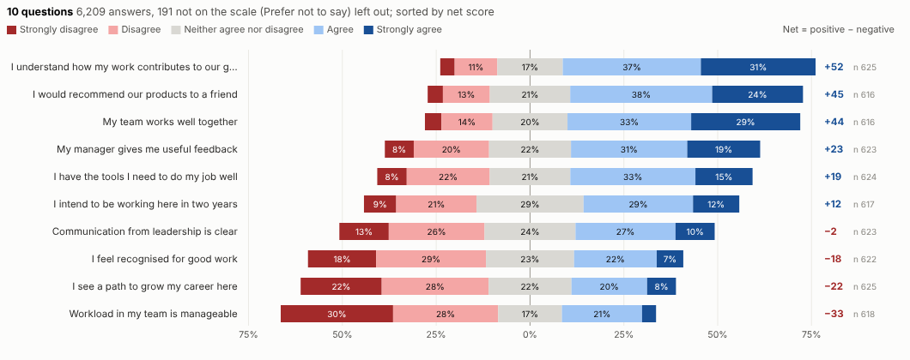
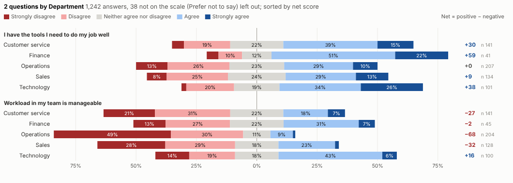
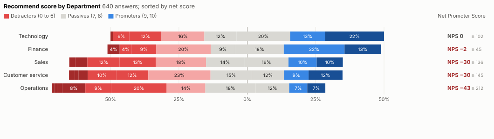
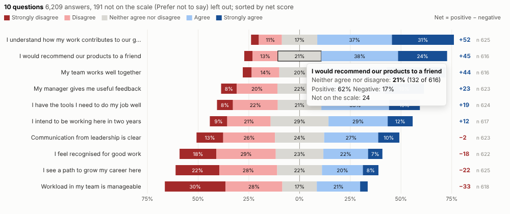
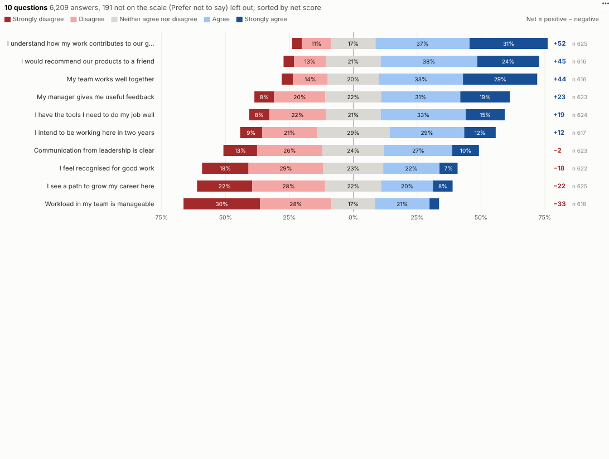

# Likert Survey

What do people really think? Survey results on a rating scale, centred on neutral, sorted by net score and split by any group, straight from the survey data in an Omniscope report.

## The problem it solves

Organisations run surveys constantly: engagement, customer satisfaction, Net Promoter, course feedback, patient experience. The answers sit on a rating scale, and the usual charts do them no favours. Pie charts per question, or stacked bars that start at zero, make it hard to see which statements people agree with and which they do not, and the order of the scale is often scrambled into alphabetical order.

The Likert Survey view draws the standard diverging chart: negative answers to the left, positive to the right, neutral in the middle, every statement sorted by net score. In the illustrative employee survey above, people understand how their work contributes and like their teams, but workload, career paths and recognition are the weak spots. Split by department to see where:

Answers on a 0 to 10 scale are recognised as a Net Promoter question:

## Where it earns its place

The examples below are illustrative.

| Survey | Compare by | Typical use |
|---|---|---|
| Employee engagement | Department, location, tenure | Action plans for the weakest areas |
| Customer satisfaction | Product, channel, region | Priorities for service improvement |
| Net Promoter | Segment, journey stage | Tracking promoters and detractors |
| Training and events | Course, trainer, session | Improving content and delivery |
| Patient or citizen experience | Service, site | Reporting and improvement |

## How to use it in Omniscope

1. Bring the survey export into a workflow; if each question is a column, de-pivot so each row is one answer with its question.
2. Connect it to a Report block, add a view and choose **Likert Survey**.
3. Set **Answers** and **Questions**, and optionally **Compare by**.
4. If the scale is not recognised, type it in **Answer order**, from most negative to most positive.
5. Click a segment to select the people who gave that answer and profile them in other views.

## Why do this in Omniscope

- **Answers joined to HR or customer data.** In the workflow the survey export can be de-pivoted to one row per answer and joined with HR, customer or operational data, then compared by any of its fields.
- **Scale aware.** The order and colours of the scale are recognised, non-answers are reported rather than mixed in, and net scores and the Net Promoter Score are verified by a separate calculation.
- **Volume, same results.** Tested with 400,000 answers to 40 statements in 8 groups, with identical results on a real Omniscope server.
- **Answer to respondents.** Selecting a segment shows who gave those answers in the other views, and how the neutral answer is split or scored can be changed in the view's code.

## Data and options

One row per answer.

| Option | What it does |
|---|---|
| Answers | The rating given |
| Questions | Optional question or statement |
| Compare by | Optional group |
| Answer order | Custom scale order |
| Scale | Automatic, rating scale or Net Promoter |
| Sort questions | By net score or alphabetically |

Tested with 400,000 answers to 40 statements in 8 groups.

## Tested

- Mock harness: scale order, net scores and the Net Promoter Score checked against an independent calculation, a custom order, hover, selecting a segment and a question, clearing, filtering to one department, a narrow layout, a field that is not a rating, empty data, unconfigured options, and 400,000 answers.
- Real Omniscope server: installed through the Edit View API and configured in a report; identical results.

