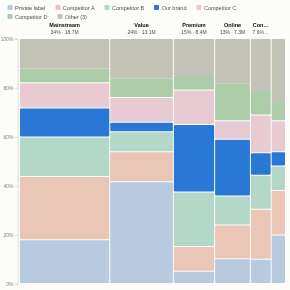

#  Marimekko

Marimekko (mekko, market map) chart: a 100% stacked bar chart whose column widths are proportional to each column's total. One picture shows how big each segment is and who wins within it. An optional highlight shows one series (for example your own brand) in a strong colour against muted competitors.

## Use case

Market and portfolio structure: share by segment and competitor, revenue by region and product line, spend by category and supplier, headcount by department and grade. Popular in strategy work, sales planning and investor material because size and mix appear together.

## Data

Rows with two categories and a positive numeric measure, for example Segment, Brand and Sales. Many rows per combination are aggregated.

## Settings

- **Columns**: the category across the chart; width is its share of the grand total.
- **Stack**: the category stacked inside each column; height is its share of that column.
- **Value**: the measure (for example sum of Sales).
- **Stack categories**: show the largest N (2 to 8, default 6); the rest are combined into Other.
- **Highlight**: name of a stack category to emphasise; it is drawn in the strongest colour and the others are muted.
- **Sort columns**: largest first or by name.
- **Show segment labels**: share (and name when there is room) inside each block.
- **Pane X / Pane Y**: one chart per region, year or channel.

## Interaction

Hover a block for its value, its share of the column and of the total. Click a block to select that combination, a column header to select the column, or a legend entry to select the series; other views filter or highlight to match. Click empty space to clear. Colours stay with their categories when filtering.

## Motion

When the view first draws, and when its data, options or filters change, the segments grow up, column by column. Hovering and selecting do not replay it. The animation is skipped when the viewer's system asks for reduced motion.

## Third-party libraries

Loaded from the jsDelivr CDN when the view opens, so the browser showing the report needs internet access:

- [D3](https://d3js.org) 7.9.0, ISC licence

## About this view

This view carries the `visokio-agents` tag. It is one of a set of community examples built by Visokio's agents, to extend Omniscope's core views with popular, specialist and more unusual use cases, and to show what anyone, people or agents, can build on Omniscope. It is tested by automated tests and was run on a real Omniscope server. It was not reviewed by Omniscope's core team, so it is not on a par with Omniscope's core views, which have years of manual, functional and unit tests behind them.

The sample data in `sample-data/` is invented for the demo.
