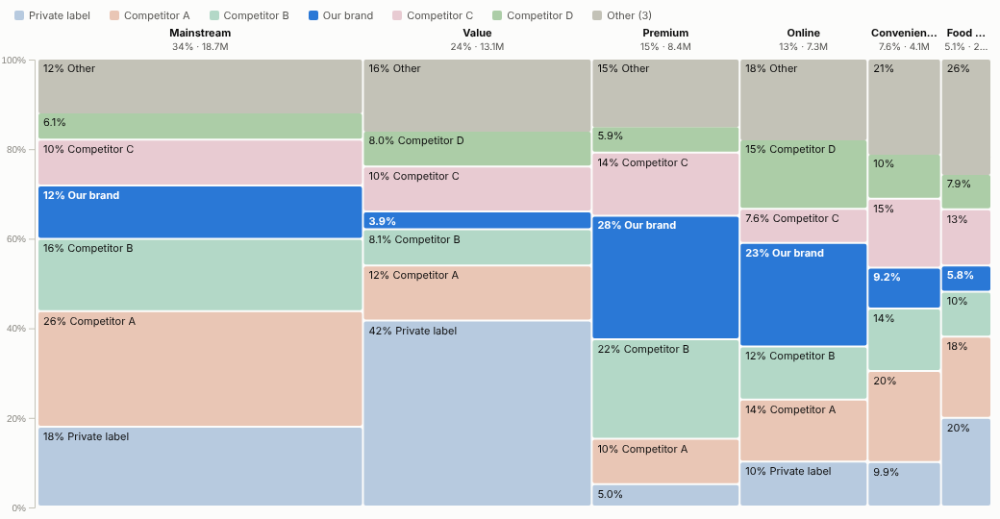
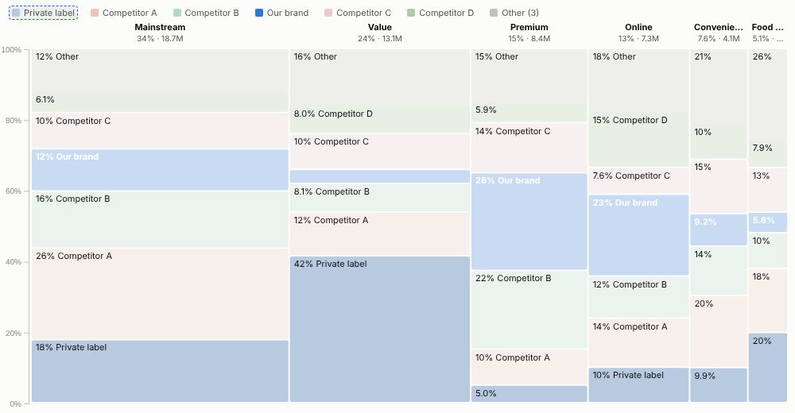
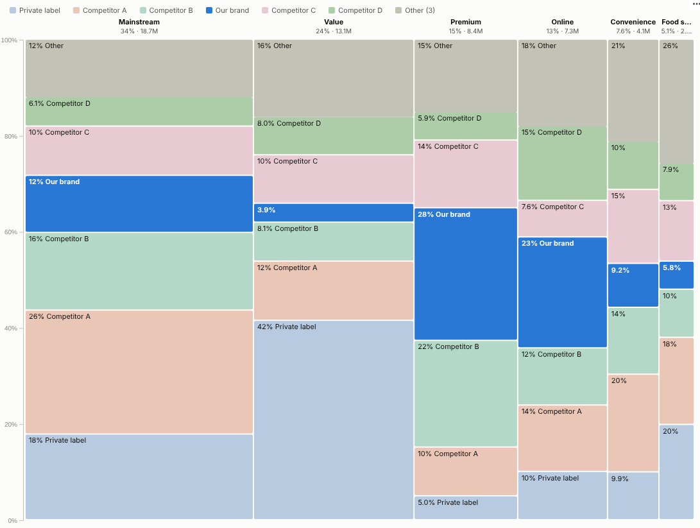

# Marimekko

The one-page market map: how big each segment is, who wins in each, and where your brand is strong or missing, in a single chart.

## The problem it solves

Strategy questions have two dimensions at once. How large is each market segment, and what share do we hold in it? A stacked bar chart shows the shares but treats every segment as the same size; a pie or treemap shows size but hides the mix. Teams end up with two charts and a lot of pointing.

A Marimekko chart answers both: column width is the segment's share of the whole market, and the blocks inside show who holds it. In the illustrative market above, "Our brand" is highlighted: it holds 28% of Premium and 23% of Online but only 4% of Value, the second-largest segment, which is where the growth conversation should start. Turning off the highlight shows every competitor in its own colour.

## Where it earns its place

The examples below are illustrative.

| Function | Columns | Stack | Question |
|---|---|---|---|
| Sales and marketing | Market segment, channel or region | Brand or competitor | Where are we under-represented in large segments? |
| Strategy and M&A | Sector or geography | Company | Which markets are concentrated or fragmented? |
| Finance | Business unit | Product line | Which units drive revenue, and with what mix? |
| Procurement | Spend category | Supplier | Where is spend concentrated with one supplier? |
| HR | Department | Grade or contract type | How does workforce mix differ between departments? |

## How to use it in Omniscope

1. Connect sales, market or spend data to a Report block (for example market research data joined to your own sales in the workflow).
2. Add a view and choose **Marimekko**.
3. Set **Columns** (for example Segment), **Stack** (for example Brand) and **Value** (for example sum of Sales).
4. Type your brand in **Highlight** to show it against muted competitors, and choose how many **Stack categories** to show.
5. Click a block, a column or a legend entry to select it for the rest of the report; filter by region or quarter to see how the map changes.

## Why do this in Omniscope

- **No yearly slide.** Drawn from the workflow, the market map follows each refresh and re-cuts by region, period or channel with a filter.
- **Own and market data on one basis.** Internal sales are joined with syndicated or survey data in the workflow and summed per combination (tested with 20,000 rows).
- **Block to detail.** Selecting a block filters the tables and trends beside it, so "why so small in Value?" is answered on the same page.
- **Labels in the code.** Highlight and segment labels are options; growth figures on each column, for example, can be added to the view's source.

## Data and options

Two categories and a positive measure; many rows per combination are summed.

| Option | What it does |
|---|---|
| Columns, Stack, Value | The two categories and the measure |
| Stack categories | Largest N shown; the rest grouped as Other |
| Highlight | Emphasises one series |
| Sort columns, Show segment labels | Presentation |
| Pane X, Pane Y | One chart per region, period or channel |

Tested with 20,000 rows, 50 columns and 40 series.

## Tested

- Mock harness: highlighted and full-colour versions, block, series and column selection, clearing, filtering to one region, a small view, empty data, unconfigured options, and 20,000 rows.
- Real Omniscope server: installed through the Edit View API and configured in a report.

