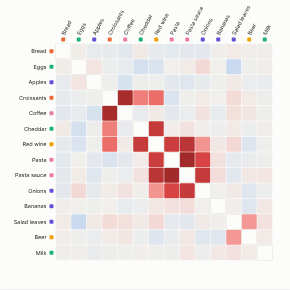

#  Market Basket

Market basket analysis from order lines. Give it a basket identifier (transaction, order or invoice) and an item (product, SKU or category): the view counts how often each pair of items shares a basket, compares that with chance, and shows the result as an affinity matrix with a ranked list of rules such as "87% of baskets with pasta sauce also have pasta". Items bought together are clustered next to each other, so the natural "missions" in the data stand out as red blocks.

## Use case

Cross-sell and merchandising: which products to place, promote or bundle together, which recommendations to make online, which items lose sales when they are out of stock. Beyond retail: services bought together by a customer, procedures performed in the same episode, parts replaced in the same repair, courses taken in the same term.

## Data

Order lines: one row per item in a basket, with a basket ID and an item. Duplicate lines for the same item in a basket count once. The view fetches up to 300,000 lines through the Query API; filters from other views apply.

## Settings

- **Baskets**: the transaction, order or invoice ID.
- **Items**: the product, SKU or category.
- **Item colour** (optional): colour item labels by a category such as Department.
- **Rank rules by**: lift (strength of association), confidence (share of baskets with A that also have B) or support (share of all baskets with both).
- **Order items**: clustered by affinity (default) or most frequent first.
- **Items shown**: the number of most frequent items in the matrix (default 25, up to 60).
- **Minimum support %**: pairs must appear in at least this share of baskets (default 0.5%, and never fewer than 3 baskets) to be coloured or listed as a rule.
- **Lines used**: maximum number of lines fetched (default 300,000).

## Reading the matrix

Each cell is a pair of items. Its colour is the lift: how much more often the two share a basket than if they were bought independently. Red means more often than chance (lift above 1), grey about the same, blue less often (lift below 1, often substitutes). Pale cells have too few baskets to judge. The panel shows the number of baskets, lines and distinct items, and the top rules.

Lift, confidence and support are the standard measures of association-rule mining. For a rule A → B: support is the share of baskets containing both; confidence is the share of baskets with A that also contain B; lift is the confidence divided by the share of baskets containing B.

## Interaction

Hover a cell for the pair's counts and measures, or an item for its frequency. Click an item to focus the rules list on it and select its lines; click a cell or a rule to select the baskets that contain both items (up to 3,000 baskets), so other views can show, for example, which stores or days those baskets came from. Click empty space to clear.

## Motion

When the view first draws, and when its data, options or filters change, the matrix cells and labels fade in. Hovering and selecting do not replay it. The animation is skipped when the viewer's system asks for reduced motion.

## Third-party libraries

Loaded from the jsDelivr CDN when the view opens, so the browser showing the report needs internet access:

- [D3](https://d3js.org) 7.9.0, ISC licence

## About this view

This view carries the `visokio-agents` tag. It is one of a set of community examples built by Visokio's agents, to extend Omniscope's core views with popular, specialist and more unusual use cases, and to show what anyone, people or agents, can build on Omniscope. It is tested by automated tests and was run on a real Omniscope server. It was not reviewed by Omniscope's core team, so it is not on a par with Omniscope's core views, which have years of manual, functional and unit tests behind them.

The sample data in `sample-data/` is invented for the demo.
