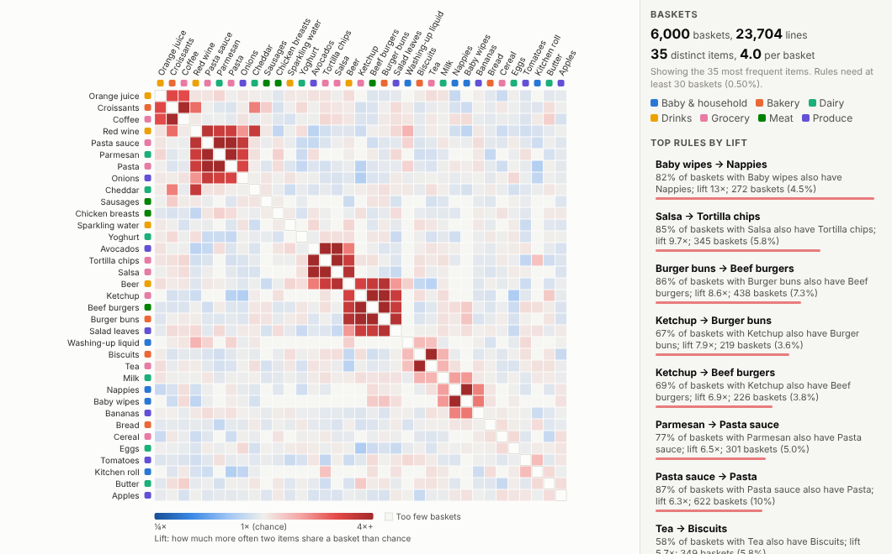
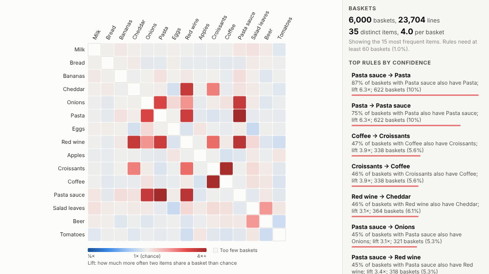
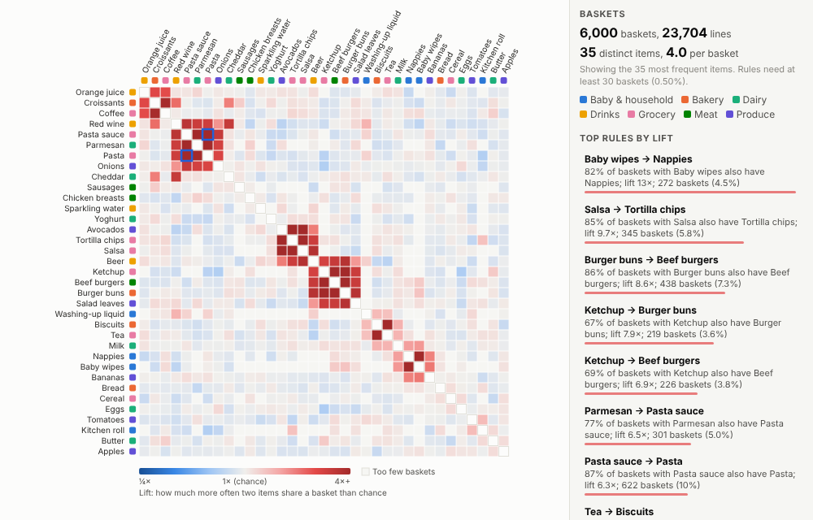
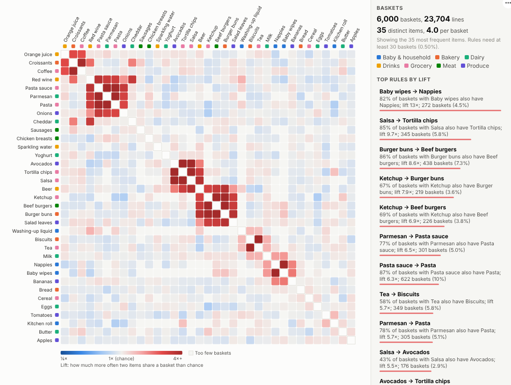

# Market Basket

Find out what sells with what. Point it at your order lines and see which products are bought together, how strongly, and in which baskets, with rules your merchandising and marketing teams can act on.

## The problem it solves

Every retailer and distributor has the data to answer "what do customers buy together?": every till receipt and online order is a basket. The answer drives store layout, promotions, bundles, online recommendations and range decisions. But the analysis usually lives in a data science notebook or a separate tool, and the output is a static table of rules that nobody outside the analytics team explores.

The Market Basket view puts it in an Omniscope report. It counts every pair of items across the baskets, compares that with what chance would predict (the lift), clusters items bought together next to each other and lists the strongest rules in plain language. In the illustrative grocery data above, the shopping "missions" stand out as red blocks: pasta night, burgers, Mexican, baby, tea and biscuits, coffee and croissants. Everyday items like milk and bread go with everything, so their lift stays close to 1.

Switch to confidence, the measure for "customers who bought this also bought":

## Where it earns its place

The examples below are illustrative.

| Business | Basket | Typical questions |
|---|---|---|
| Grocery and convenience retail | Till receipt | Which items to place or promote together, what to bundle |
| E-commerce | Order | Which recommendations to show, which add-ons to suggest |
| Wholesale and distribution | Invoice | Which products to cross-sell to which accounts |
| Financial services | Customer | Which products customers hold together, the next best offer |
| Healthcare | Episode | Which procedures and tests occur together |
| Field service | Repair job | Which parts are replaced together, what to stock in the van |

## How to use it in Omniscope

1. Bring your order lines into a workflow (database, files or an API) with one row per item per basket.
2. Connect it to a Report block, add a view and choose **Market Basket**.
3. Set **Baskets** to the order or transaction ID and **Items** to the product; optionally set **Item colour** to a department or category.
4. Adjust **Items shown** and **Minimum support %** to the size of your range and data.
5. Click a cell or a rule to select those baskets; other views in the report show which stores, days or customers they came from.

## Why do this in Omniscope

- **Rules for any slice.** Filter to one store, one month or one customer segment and the matrix and rules are recalculated for those baskets.
- **Lift checked, at volume.** Lift is checked against planted associations and the clustering against the items that belong together, with about 370,000 lines from 80,000 baskets.
- **Rule to baskets.** Clicking a rule selects the baskets behind it, so the other views show which stores or days they came from.
- **Plain language, open code.** Rules are written out with the counts behind them for category managers, and a measure beyond lift, confidence and support can be added to the view.

## Data and options

Order lines: a basket ID and an item per row.

| Option | What it does |
|---|---|
| Baskets, Items | The basket ID and item fields |
| Item colour | Optional category to colour items by |
| Rank rules by | Lift, confidence or support |
| Order items | Clustered by affinity, or most frequent first |
| Items shown | Number of most frequent items in the matrix |
| Minimum support % | Minimum share of baskets for a pair to count |
| Lines used | Maximum lines fetched |

Tested with about 370,000 lines from 80,000 baskets and 2,000 distinct items.

## Tested

- Mock harness: lift values checked against the planted associations, clustering checked to place associated items together, pair and item selection, hover, focus, clearing, filtering to one store, a narrow layout, empty data, unconfigured options, fields that do not form baskets, and about 370,000 lines.
- Real Omniscope server: installed through the Edit View API and configured in a report.

