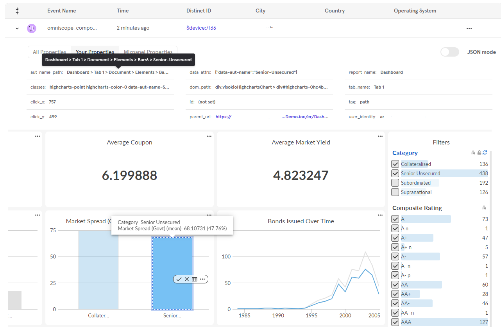

#  Mixpanel tracker

Records how people use a report, in your own Mixpanel project: an event when someone opens the report, and an event for every click on the report page (on built-in views, filters, tabs and toolbar buttons), with Omniscope's name for what was clicked, the report and tab, and who clicked.

**This view sends information about the report and its viewers to Mixpanel, a third-party analytics service.** It sends nothing until you set a Mixpanel project token. Before adding it to a report, check that recording viewers' use of the report is allowed for your organisation and your viewers, and tell them (the view shows a one-line notice by default).

## Use case

Report authors and administrators who want to know which reports, tabs and views are used, by whom, and what people click on, to improve a dashboard or measure adoption.

## Data

None. The view reads no fields; put it anywhere in the report, in a small pane. The tracking covers the whole report page it sits in.

## Settings

- **Mixpanel project token**: from your Mixpanel project's settings. Nothing is loaded or sent until it is set.
- **API host**: where events go. `https://api-eu.mixpanel.com` (the default) for a project with EU data residency, `https://api.mixpanel.com` for US, `https://api-in.mixpanel.com` for India, or your own proxy. It must start with `https://`.
- **Track clicks** (on by default): an event for every click on the report page. Clicks inside other custom views, which run in their own frames, are not seen. Off: only the event when the report opens.
- **Send user identity** (on by default): add the signed-in Omniscope user's identity (their user name or email address) to every event. Off: events carry no user identity, only Mixpanel's own random device ID.
- **Show notice** (on by default): the line "Use of this report, including clicks, is recorded with Mixpanel." in the view ("Opening this report is recorded with Mixpanel." with Track clicks off). Off: the view is blank.

A changed token or host applies after the report is reloaded.

## What is sent to Mixpanel

Every event goes from the viewer's browser to the API host. Mixpanel's library adds its usual details to each one: a random device ID kept in the viewer's browser (in a cookie, which by default covers the Omniscope server's parent domain and its other subdomains, and in local storage), the browser, operating system and screen size, the address of the view's frame, and a location worked out by Mixpanel from the viewer's IP address.

**`omniscope_custom_view_loaded`**, once when the report opens:

| Property | What it holds |
|---|---|
| `user_identity` | The Omniscope user's identity (empty with Send user identity off) |
| `parent_url` | The full address of the report page, including the server, folder, project and report names and the tab |
| `report_name`, `tab_name` | The report and tab, taken from that address |
| `api_host` | The API host setting |

**`omniscope_component_click`**, for each click in the report (with Track clicks on):

| Property | What it holds |
|---|---|
| `user_identity`, `parent_url`, `report_name`, `tab_name` | As above |
| `aut_name_path` | Omniscope's names (`data-aut-name`) for the clicked element and the elements around it, for example `Filters > North` |
| `data_attrs` | All `data-*` attributes of the clicked element (or the nearest element around it that has any) |
| `dom_path`, `tag`, `id`, `classes` | The element's position in the page structure, its tag, id and CSS classes |
| `click_x`, `click_y` | Where on the screen the click was |

Omniscope's element names are often labels the viewer sees, and in filters, legends and lists they can be **field names and data values from the report** (`North` above is a value of a Region field). So assume that the events can contain values from your data, as well as the names of folders, projects, reports and tabs.

Not sent: the report's data as such, text typed into the report, screenshots or recordings of the screen. The view turns off Mixpanel's automatic event capture and session recording, and it turns off its automatic page views.

## Interaction

None: the view is a notice or blank. A click on it clears the selection in the report, as a click on empty space in any view does. The tracking needs the custom view to run on the same server address as the report, which is how Omniscope serves custom views.

## Third-party libraries

- **Mixpanel JavaScript library** (`mixpanel-browser`) 2.84.0, Apache License 2.0, loaded from jsDelivr (`https://cdn.jsdelivr.net/npm/mixpanel-browser@2.84.0/dist/mixpanel.min.js`) with Mixpanel's loader snippet, only once a token is set. Sending events to Mixpanel is subject to your agreement with Mixpanel.
