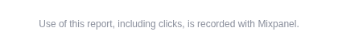
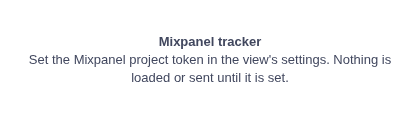

# Mixpanel tracker

Usage analytics for a report, in your own Mixpanel project: who opens it, which tabs they use and what they click.

## The problem it solves

A report is built to be used, and its author rarely knows how it is: which tabs people open, which filters they touch, which views nobody clicks. Server logs say a report was opened, not what happened in it.

The Mixpanel tracker is a view you add to a report, usually in a small pane. Once you give it a Mixpanel project token, it sends an event to Mixpanel when someone opens the report, and one for every click in it, labelled with Omniscope's name for what was clicked (a view, a filter value, a tab, a toolbar button), the report and tab, and the signed-in user. In Mixpanel you can then chart usage by report, tab, element and user.

**It sends information about your report and its viewers to a third party, Mixpanel.** The README lists every property sent. Clicked elements' names can include field names and data values shown in the report, for example a value clicked in a filter. Check that recording viewers' use of the report is allowed for your organisation, and tell them: by default the view shows a one-line notice. Until a token is set, it loads nothing and sends nothing:

## Where it earns its place

The examples below are illustrative.

| Who | Question |
|---|---|
| Report author | Which tabs and views are used, and which could go? |
| Analytics lead | How many people use the sales dashboard each week, and who are they? |
| Trainer | Which filters do new users find, and which do they miss? |

## How to use it in Omniscope

1. In Mixpanel, copy the project token from the project's settings, and note whether the project stores data in the EU, the US or India.
2. In the report, add a view and choose **Mixpanel tracker**. Make its pane small: it shows only a notice.
3. Paste the token into **Mixpanel project token**, and set **API host** for your project's region (EU by default).
4. Choose whether to **Track clicks**, **Send user identity** and **Show notice**.
5. Reload the report. Open Mixpanel's live events: `omniscope_custom_view_loaded` and `omniscope_component_click` arrive as you use the report.

## Why do this in Omniscope

- **The whole report from one view.** One small view records clicks across the report page, on built-in views, filters, tabs and toolbars, so nothing else in the report needs changing. (Clicks inside other custom views, which run in their own frames, are not recorded.)
- **Omniscope's own names.** Each click carries the element names Omniscope gives its interface (for example `Filters > North`), plus the report and tab, so events can be grouped by what was used rather than by screen position.
- **Yours to change.** It is a custom view; in the View Designer you can drop properties you don't want sent, or add events of your own.

## Data and options

No fields: the view reads no data.

| Option | What it does |
|---|---|
| Mixpanel project token | Your project; nothing is sent until it is set |
| API host | Where events go: EU (default), US, India, or a proxy |
| Track clicks | An event per click in the report; off: only when the report opens |
| Send user identity | The Omniscope user on every event; off: anonymous apart from Mixpanel's device ID |
| Show notice | The one-line notice in the view |

## Tested

Mock harness, with a stand-in for Mixpanel's library that records instead of sending: nothing loaded without a token; the settings passed to Mixpanel (host, automatic capture, session recording and page views off); the opening event with the user and report address; a click elsewhere on the page recorded with its Omniscope names, element id, position and user; Track clicks off (no click events), Send user identity off, the notice hidden; an http:// host refused; a changed token (asks for a reload); Mixpanel's library unreachable; a 120 by 30 pane; empty data and 20,000 records (the view reads none). Mixpanel's real library from jsDelivr was also loaded once in the harness with the same settings.
