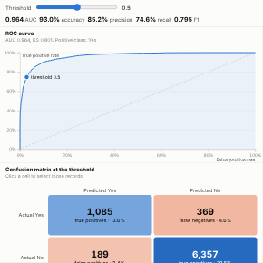

#  Model Evaluation

Evaluate a binary classification model in a report: ROC curve with AUC and KS, cumulative gains with lift, score distributions for each actual class, and a confusion matrix with accuracy, precision, recall, specificity and F1. One threshold, set with a slider or by dragging a line, drives every panel. Clicking a confusion-matrix cell selects those records, for example every false negative.

## Use case

Checking and explaining models that score records: churn, fraud, credit default, lead conversion, defect prediction. Data scientists use it to choose a threshold; business owners use it to see what a threshold means ("flag 16% of customers to catch 75% of churners").

## Data

One row per scored record with the actual outcome (two classes, such as Yes/No or 1/0) and the model's score or probability, for example the output of Omniscope's Prediction block. Scores are binned by the Query API (a histogram grouping), so the view works on large tables.

## Settings

- **Actual outcome**: the true class.
- **Predicted score**: the model's probability or score for the positive class (higher means more likely positive).
- **Positive value**: which outcome is positive; leave empty to detect it (1, Yes, True, or the rarer class).
- **Threshold**: starting threshold (default 0.5 for probabilities); change it live in the view.
- **Score resolution**: number of score bins for the curves (default 100).

## Interaction

Move the threshold with the slider or by dragging the line in the score distribution. Click a confusion-matrix cell to select those records (for example Actual Yes and score below the threshold); other views filter or highlight to match. Filters from other views (for example a segment) recalculate every metric.

## Motion

When the view first draws, and when its data, options or filters change, the ROC, gains and distribution charts draw in and the confusion matrix appears. Hovering and selecting do not replay it. The animation is skipped when the viewer's system asks for reduced motion.

## Third-party libraries

Loaded from the jsDelivr CDN when the view opens, so the browser showing the report needs internet access:

- [D3](https://d3js.org) 7.9.0, ISC licence

## About this view

This view carries the `visokio-agents` tag. It is one of a set of community examples built by Visokio's agents, to extend Omniscope's core views with popular, specialist and more unusual use cases, and to show what anyone, people or agents, can build on Omniscope. It is tested by automated tests and was run on a real Omniscope server. It was not reviewed by Omniscope's core team, so it is not on a par with Omniscope's core views, which have years of manual, functional and unit tests behind them.

The sample data in `sample-data/` is invented for the demo.
