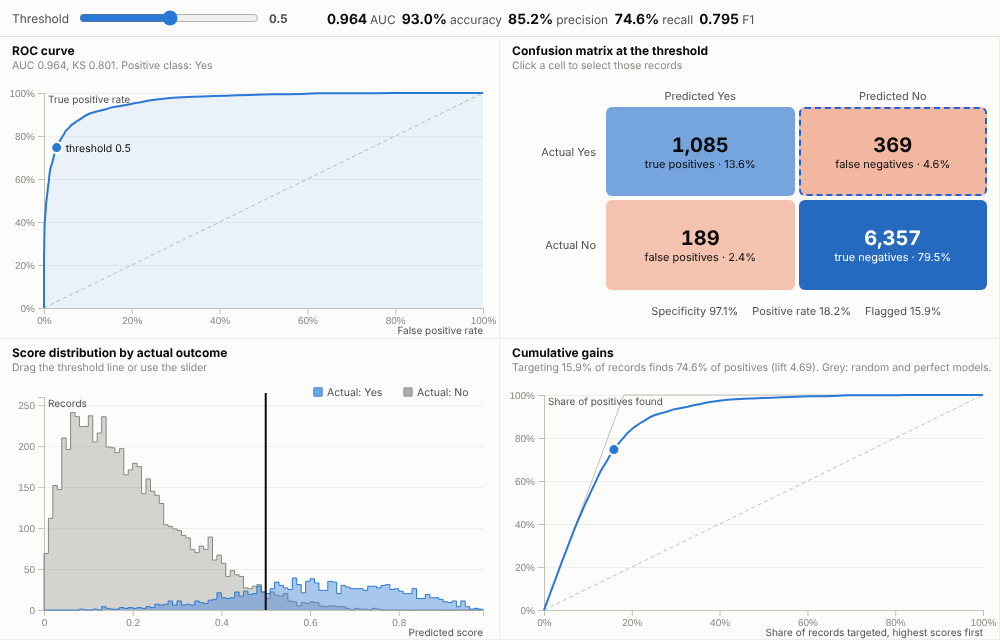
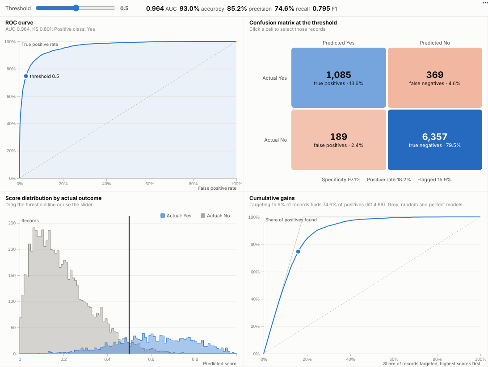

# Model Evaluation

See how good a model really is, and what any threshold means in practice: ROC, gains, distributions and the confusion matrix, all live, all linked to the records.

## The problem it solves

A model's AUC goes into a slide and the business is asked to trust it. The questions that matter come later: if we contact everyone above 0.5, how many customers is that, how many churners do we catch, and how many do we bother for nothing? Who are the churners the model missed? Answering usually means going back to a notebook.

The Model Evaluation view puts the standard diagnostics in one report view and connects them. One threshold drives the ROC point, the gains curve, the score distributions and the confusion matrix, so moving it shows the trade-off in business terms. In the illustrative churn model above, a threshold of 0.5 flags 15.9% of customers and finds 74.6% of churners, with 189 false alarms. Click the false-negative cell and the rest of the report lists the 369 churners the model missed, ready for the next question: why?

## Where it earns its place

The examples below are illustrative.

| Use | Actual outcome | Score | Question |
|---|---|---|---|
| Customer retention | Churned | Churn probability | How many customers should the retention team call? |
| Fraud and financial crime | Confirmed fraud | Risk score | What alert volume catches enough fraud? |
| Credit risk | Defaulted | Probability of default | Where should the approval cut-off be? |
| Marketing and sales | Converted | Propensity score | Which share of leads should sales work first? |
| Quality and maintenance | Failed | Failure risk | Which machines or batches to inspect? |

## How to use it in Omniscope

1. In a workflow, train or apply a model (for example with the **Prediction** block, or scores from an external model) so each record has an actual outcome and a score. Keep a hold-out set for honest evaluation.
2. Connect the scored data to a Report block, add a view and choose **Model Evaluation**.
3. Set **Actual outcome** and **Predicted score**; set **Positive value** if it is not detected automatically.
4. Move the threshold to see the trade-off; click confusion-matrix cells to select false positives or false negatives and examine them in other views.
5. Filter by segment or period elsewhere in the report to check that the model holds up for every group.

## Why do this in Omniscope

- **Scored and evaluated in one workflow.** Scoring, hold-out splits and joins happen upstream, for example with the Prediction block, and the evaluation updates whenever the model is re-run.
- **Missed churners by name.** A click on the false-negative cell selects the actual customers, so errors are investigated rather than counted.
- **Checked per segment.** Filter by segment, region or channel and every metric recalculates, exposing a model that works overall but poorly for one group.
- **Room for other metrics.** Scores are binned by the Query API (tested with 300,000 scored records), and a cost-weighted threshold, for instance, could be added to the view's code.

## Data and options

One row per scored record: actual outcome (two classes) and a numeric score.

| Option | What it does |
|---|---|
| Actual outcome, Predicted score | The truth and the model output |
| Positive value | Which class is positive (detected if empty) |
| Threshold | Starting decision threshold |
| Score resolution | Number of score bins |

Tested with 300,000 scored records.

## Tested

- Mock harness: a strong and a weaker model, selecting the false negatives, changing the threshold, clearing, filtering to one segment, a narrow layout, a single-class subset (message), empty data, unconfigured options, and 300,000 records with numeric 1/0 outcomes.
- Real Omniscope server: installed through the Edit View API and configured in a report.

