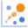
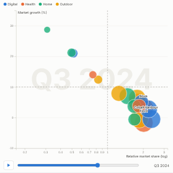

#  Motion Bubbles

Animated bubble chart (motion chart): each bubble is an item placed by two measures and sized by a third, and the chart plays through time with smooth interpolation, a play/pause button and a slider. Trails show where selected or hovered bubbles have been. Reference lines turn it into a quadrant chart, such as a growth-share matrix.

## Use case

Showing how items move over time in two dimensions: products on a growth-share matrix, stores on conversion against basket size, customers on frequency against value, countries or regions on any two indicators. Suited to presentations, where the movement tells the story.

## Data

Rows with an item field, a time field and two numeric measures; optionally a size measure and a colour category. For example Quarter, Product, Relative market share, Market growth and Revenue.

## Settings

- **Bubbles**: one bubble per value. Selection filters on this field.
- **Time**: the frames. A date field picked in Omniscope is grouped by year by default; set it to unique values or quarter in the field's options.
- **X axis / Y axis**: the two measures; **Log X axis / Log Y axis** for ratios and wide ranges.
- **Size**: optional measure for bubble area; **Colour by**: optional category (eight colours).
- **X reference line / Y reference line**: dashed lines, for example 1 and 10 for the growth-share quadrants.
- **Labels**: label the N largest bubbles (default 8). **Trails for selected bubbles**.
- **Seconds per period**, **Play automatically**, **Loop**.

## Interaction

Play, pause or drag the slider (positions are interpolated between periods). Hover a bubble for its values and trail; click to select it (shift-click to add, or click a legend entry to select a category). Other views filter or highlight to match; click empty space to clear. Axes are fixed across the whole period so movement is comparable.

## Third-party libraries

Loaded from the jsDelivr CDN when the view opens, so the browser showing the report needs internet access:

- [D3](https://d3js.org) 7.9.0, ISC licence

## About this view

This view carries the `visokio-agents` tag. It is one of a set of community examples built by Visokio's agents, to extend Omniscope's core views with popular, specialist and more unusual use cases, and to show what anyone, people or agents, can build on Omniscope. It is tested by automated tests and was run on a real Omniscope server. It was not reviewed by Omniscope's core team, so it is not on a par with Omniscope's core views, which have years of manual, functional and unit tests behind them.

The sample data in `sample-data/` is invented for the demo.
