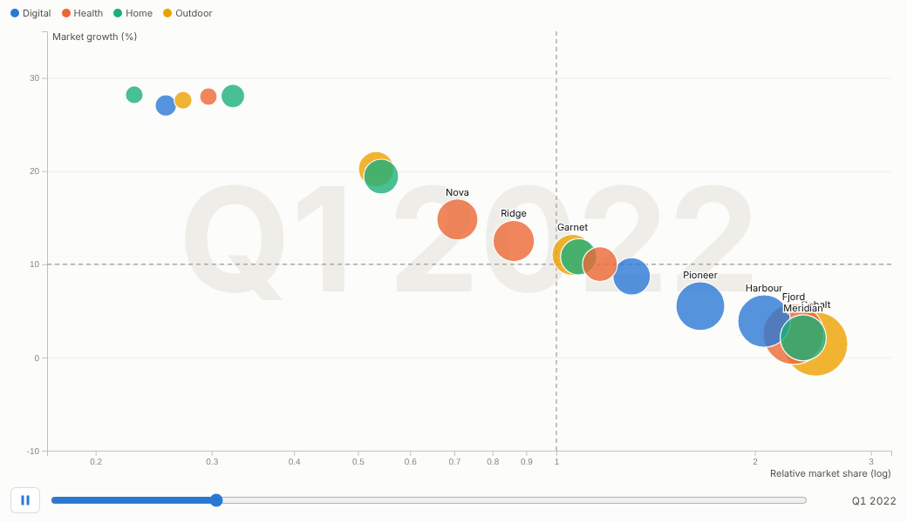
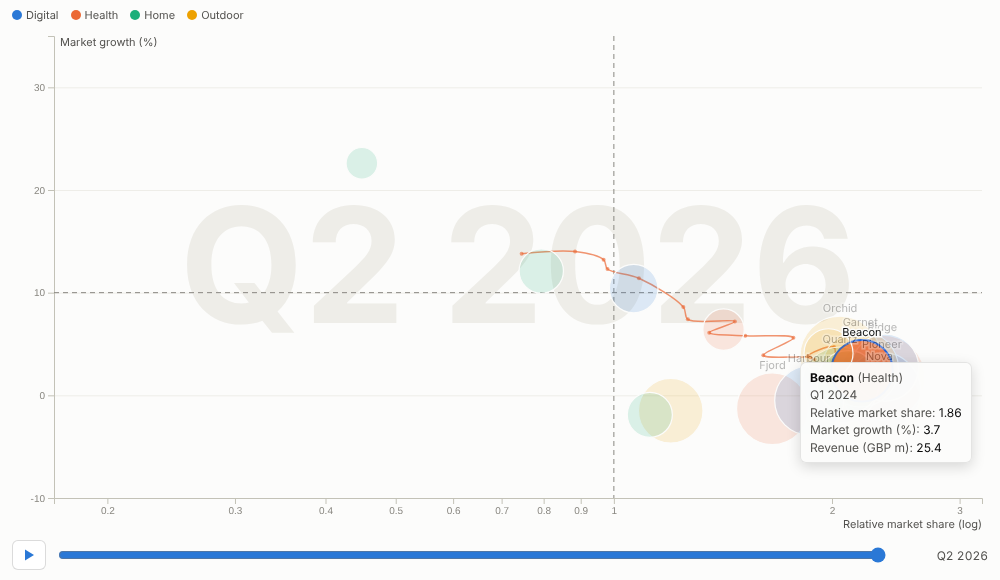
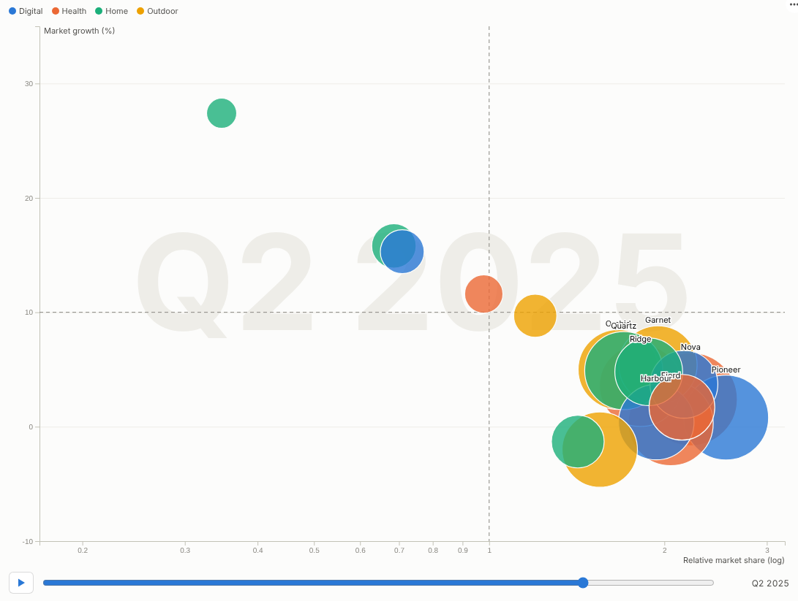

# Motion Bubbles

Watch your portfolio move. Every product, store or customer as a bubble, travelling through two dimensions over time, with trails that show where each one came from.

## The problem it solves

Strategy reviews ask how things have moved, not just where they are: which products have become stars, which stores have improved conversion without sacrificing basket size, which customers are drifting from loyal to occasional. A static scatter chart shows one moment; a set of them per quarter makes the audience do the animation in their heads.

Motion Bubbles plays the movement. Two measures place each bubble, a third sets its size and a category colours it; the chart animates smoothly from period to period with the date large in the background. Hover or select a bubble and its trail appears. In the illustrative portfolio above, plotted as a growth-share matrix (relative market share on a log scale against market growth, with reference lines at 1 and 10%), products enter as question marks, become stars and settle as cash cows, and the trail of any product shows its journey.

## Where it earns its place

The examples below are illustrative.

| Use | Bubbles | X, Y, size |
|---|---|---|
| Portfolio strategy | Products, brands, business units | Relative share, market growth, revenue |
| Retail performance | Stores | Conversion, average basket, sales |
| Customer value | Customer segments or accounts | Frequency, value, number of customers |
| Operations | Sites, lines | Cost per unit, output, headcount |
| Public sector and economics | Areas, regions | Two indicators, population |

## How to use it in Omniscope

1. Connect data with an item, a period and the measures to a Report block (for example quarterly product data joined to market data in the workflow).
2. Add a view and choose **Motion Bubbles**.
3. Set **Bubbles**, **Time** (for a date, choose unique values or quarters), **X axis**, **Y axis**, and optionally **Size** and **Colour by**.
4. For a quadrant chart, add **X reference line** and **Y reference line**; use a log axis for ratios.
5. Press play in the meeting; pause on a quarter, select a bubble to show its trail and its detail elsewhere in the report.

## Why do this in Omniscope

- **Next quarter extends it.** The animation runs on the workflow's data, so next quarter's figures add a frame after the refresh.
- **Product data joined to market data.** Quarterly product figures are joined to market growth in the workflow and shown in a growth-share layout (tested with 1,000 bubbles over 40 periods).
- **Pause, select, follow.** During a presentation, pause on a quarter and select a product: its trail appears and the rest of the report follows; a filter to one business unit replays the motion for that subset.
- **Quadrants your way.** Reference lines and log axes are options; quadrant labels or another layout can be written into the view's code.

## Data and options

An item, a period and two measures; optionally size and colour.

| Option | What it does |
|---|---|
| Bubbles, Time | Items and frames |
| X axis, Y axis, Log axes | Position and scales |
| Size, Colour by | Bubble area and colour |
| Reference lines | Quadrant lines |
| Labels, Trails, Seconds per period, Play automatically, Loop | Display and playback |

Tested with 1,000 bubbles over 40 periods.

## Tested

- Mock harness: the growth-share matrix with log axis and reference lines, selection with a trail, play and pause, clearing, filtering to one business unit, a small view, linear axes without size or colour, empty data, unconfigured options, and 1,000 bubbles over 40 periods.
- Real Omniscope server: installed through the Edit View API and configured in a report.

