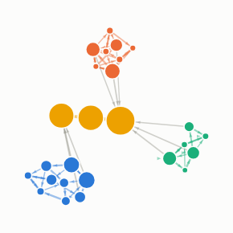

#  Network Analyser

Link analysis in a report view. Draws a network from any table of From and To pairs and analyses it in the browser: detects communities (Louvain method), ranks nodes by betweenness, PageRank, degree or weighted degree, focuses on a node's neighbourhood, and finds the shortest path between two nodes.

## Use case

Finding structure in relationships: rings of accounts that pass money between themselves, the brokers that connect otherwise separate groups, single points of failure in a supply chain or an IT estate, and informal teams in communication data.

## Data

One row per link (or many rows per pair, which are aggregated):

- a **From** field and a **To** field holding the two ends of each link (text or numbers; the same item can appear in either);
- optionally a numeric field for **Link weight**, for example an amount or a count.

## Settings

- **From / To**: the two ends of each link. Selection filters on these fields.
- **Link weight**: optional measure for link strength (summed per pair). Without it every pair counts once.
- **Minimum link weight**: drop weaker links before analysing (0 keeps everything).
- **Directed links**: treat From to To as a direction (arrows, directed PageRank and paths).
- **Size nodes by**: Betweenness (brokers), PageRank (influence), Degree (connections) or Weighted degree (volume). Also drives the ranking list and labels.
- **Colour nodes by**: detected Community, or a single colour. The eight largest communities get their own colour.
- **Labels / Number of labels**: label the most central nodes, all nodes, or none.
- **Show analysis panel**: statistics (nodes, links, communities, modularity, density), node search, the top ten by the chosen centrality, communities, and the shortest-path finder.

## Interaction

- Scroll to zoom, drag the background to pan, drag a node to move it.
- Hover a node for its connections, total weight, betweenness, PageRank, community and rank.
- Click a node to select its links and focus on its neighbourhood; shift-click to add. Click empty space to clear.
- Click a community in the panel to select the links inside it.
- Shortest path: pick two nodes in the panel and press Find path.

Betweenness is exact up to 1,500 nodes and estimated from a sample of 400 source nodes above that. Up to 20,000 links (the manifest's data limit).

## Third-party libraries

Loaded from the jsDelivr CDN when the view opens, so the browser showing the report needs internet access:

- [D3](https://d3js.org) 7.9.0, ISC licence

## About this view

This view carries the `visokio-agents` tag. It is one of a set of community examples built by Visokio's agents, to extend Omniscope's core views with popular, specialist and more unusual use cases, and to show what anyone, people or agents, can build on Omniscope. It is tested by automated tests and was run on a real Omniscope server. It was not reviewed by Omniscope's core team, so it is not on a par with Omniscope's core views, which have years of manual, functional and unit tests behind them.

The sample data in `sample-data/` is invented for the demo.
