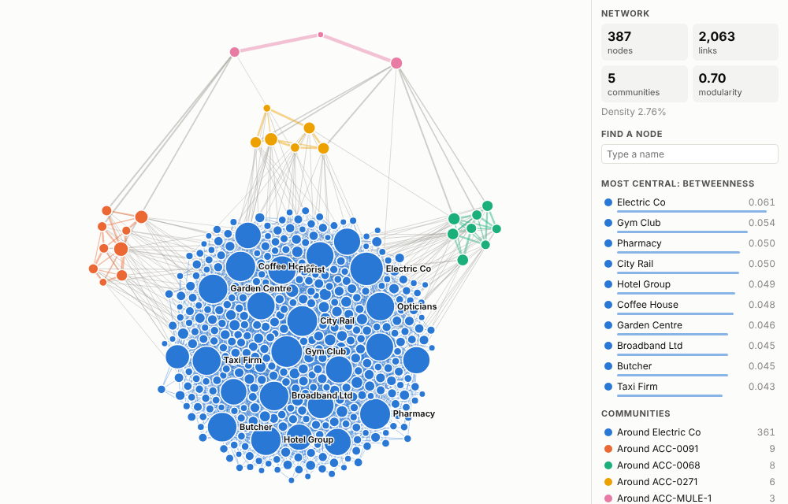
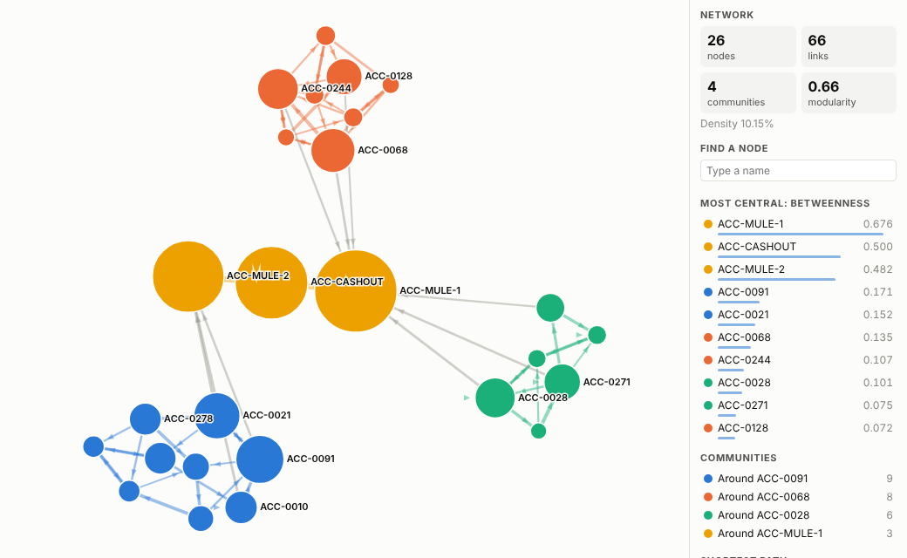
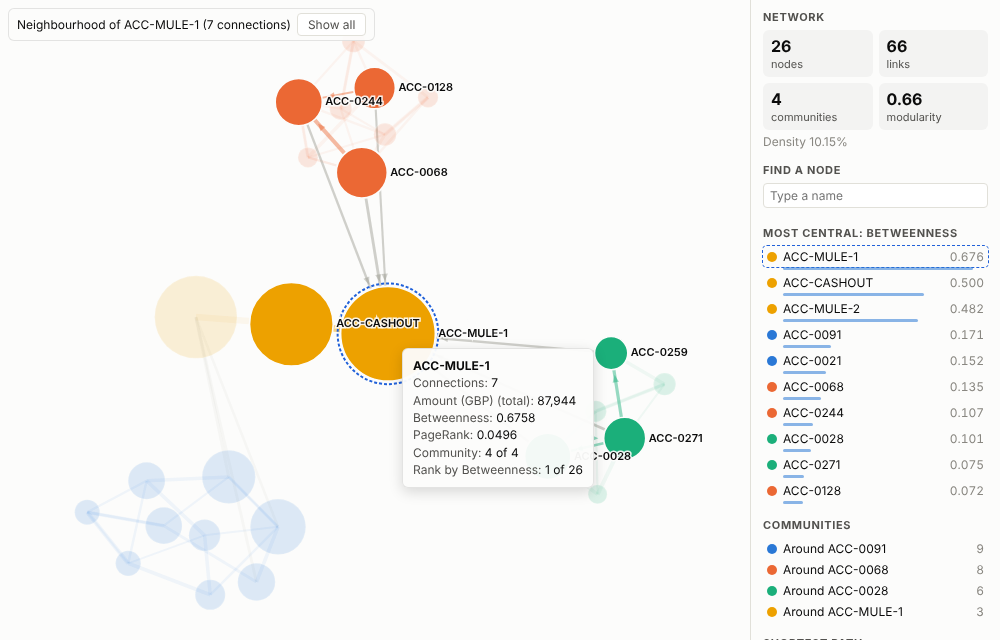
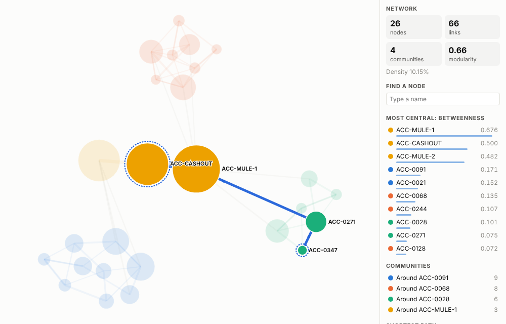
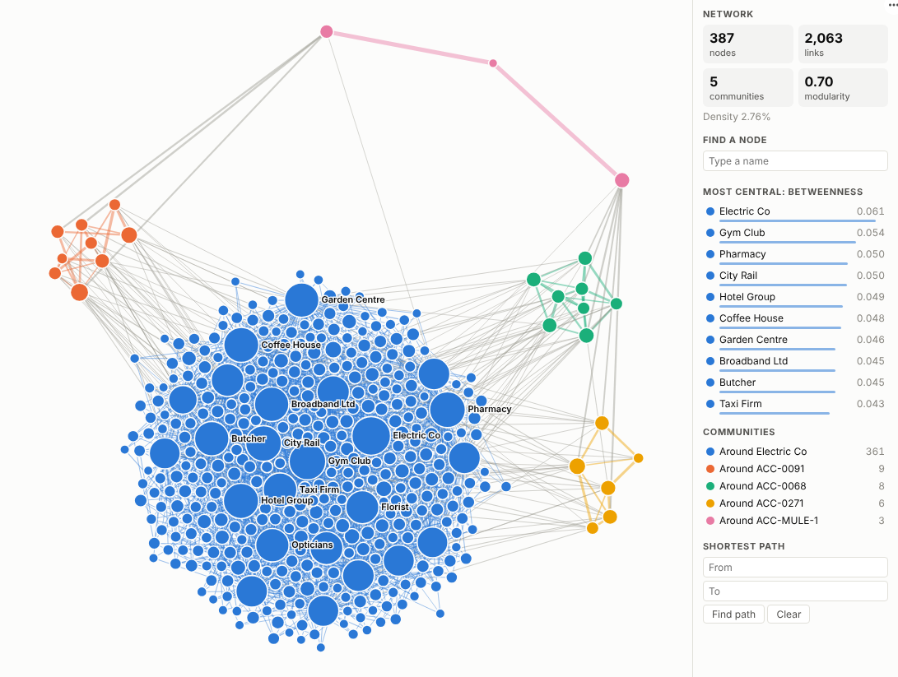

# Network Analyser

Turn any table of who-pays-whom, who-supplies-whom or who-talks-to-whom into a living network, with the communities, brokers and paths found for you.

## The problem it solves

Relationship data hides its most important facts in its structure. A list of payments will not tell you that nine accounts send money round in a circle, that two accounts are the only bridge between those rings and a cash-out account, or that one supplier sits on the path to half your production. Tables and bar charts treat each row on its own; the answer lives in how the rows connect.

The Network Analyser draws the network and then does the analysis a specialist would do in a graph tool. It detects communities, scores every node for how much it brokers between others (betweenness), how influential it is (PageRank) and how connected it is, and finds the shortest path between any two nodes. It does this inside the Omniscope report, on governed data, and a click on a node or a community filters every other view on the page.

The illustrative payments data above has 361 everyday accounts and merchants, and three small, tightly knit rings of accounts at the edge. Raising the minimum link weight to £1,500 removes the everyday spending and leaves only the rings and the accounts that link them:

## Where it earns its place

The examples below are illustrative.

| Industry | Question | From, To, weight | What to look at |
|---|---|---|---|
| Banking and payments | Are there rings of accounts moving money in circles, and who are the mules? | Payer, payee, amount | Small dense communities; high betweenness between them; path to the cash-out account |
| Insurance | Do claims share the same garages, doctors, phones or addresses? | Claim, shared attribute, count | Communities that join many claims through a few attributes |
| Supply chain and manufacturing | Which suppliers are single points of failure? | Supplier, customer or part, spend | Highest betweenness; what disconnects if a node is removed |
| IT and operations | Which services does everything depend on? | Calling service, called service, requests | PageRank and betweenness on a directed network |
| HR and organisational design | How do teams actually work together, and who connects them? | Sender, recipient, messages | Communities against the org chart; brokers between departments |

## How to use it in Omniscope

1. Bring the relationship data into a workflow (a database, files or an API) and connect it to a Report block. Use workflow blocks to join or tidy it; the **Network Analysis** block can add further metrics if needed.
2. Add a view and pick **Network Analyser**.
3. Set **From** and **To** to the two ends of each link, and optionally **Link weight** (for example the sum of Amount).
4. Choose what node size means (betweenness for brokers, PageRank for influence) and, for large or noisy data, raise **Minimum link weight**.
5. Explore: hover for metrics, click a node to focus on its neighbourhood, click a community in the panel to select it, or use the path finder. Other views on the page filter to the selected links.

## Why do this in Omniscope

- **From the bank extract to the rings, in one workflow.** The payments are cleaned and joined to account details in the workflow that feeds the report, and the network is drawn from its output, so there is no second copy to export to a graph tool and keep in step.
- **A ring selected, its payments listed.** Click a suspicious community and the table, map and timeline beside it narrow to the payments inside it, with their dates and channels.
- **This week's rings against last week's.** Communities, betweenness and PageRank are recomputed from the links on every refresh, and betweenness is exact up to 1,500 nodes, so two runs can be compared on equal terms.
- **Room for your own measure.** The view's HTML and JavaScript open in the View Designer; add a centrality of your own beside betweenness and PageRank, or change how communities are coloured.

## Data and options

One row per link; the same node can appear in From or To. Required: From and To. Optional: a numeric weight.

| Option | What it does |
|---|---|
| From, To | The two ends of each link; selection filters on these fields |
| Link weight | Strength of each link, summed per pair |
| Minimum link weight | Drops weaker links before analysis |
| Directed links | Arrows, directed PageRank and directed paths |
| Size nodes by | Betweenness, PageRank, degree or weighted degree; also drives labels and rankings |
| Colour nodes by | Detected community or a single colour |
| Labels, Number of labels, Show analysis panel | Presentation settings |

Betweenness is exact up to 1,500 nodes and sampled above that. Tested with 4,000 nodes and 8,000 links.

## Tested

- Mock harness: full payments data, filtered rings, community selection, node focus with tooltip, shortest path, directed PageRank with all labels, filtering, resizing, empty data, unconfigured options, and 4,000 nodes.
- Real Omniscope server: installed through the Edit View API and configured in a report.

