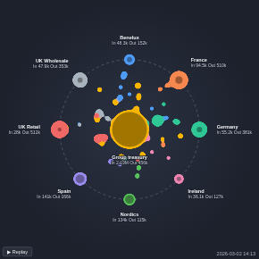

#  Orbital Transaction Flow

Transactions replayed as dots flying between the senders and receivers that made them. One node sits at the centre (a treasury, a hub account, a main warehouse) and the others are placed around it on an orbit. As each transaction lands, the sender's outer ring grows with what it has sent and the receiver's inner disc with what it has received, so by the end of the replay the sizes show who moved how much, and the replay itself shows when.

## Use case

Flows between a small set of parties over time: intercompany transfers through a group treasury, payments between accounts, stock moved between a central warehouse and its stores, messages between teams. It suits a story ("watch the day's sweeps arrive at the treasury") more than precise comparison; pair it with a table or bar chart for the figures.

## Data

One record per transaction, with a sender, a receiver, a time and a numeric size, for example:

| Transfer ID | Time | From | To | Amount (£) |
|---|---|---|---|---|
| TR-1001 | 2026-03-02T08:02:45 | Germany | Group treasury | 45371.45 |

The view queries the data itself and shows up to 3,000 transactions and up to 60 senders and receivers around the centre. Above either limit it shows a message saying which setting to change: group Transaction time by an interval, filter the report, or choose fields with fewer values.

## Settings

Transactions:

- **Sender**, **Receiver**: fields naming who sends and who receives each transaction.
- **Transaction time**: when each transaction happened; they fly in this order. With **Unique values** every transaction flies on its own. With a **histogram** (for example per hour) the transactions between the same sender and receiver in each interval are combined into one dot. Omniscope makes a date picked into this option a yearly histogram at first; change it with the option's Configure menu.
- **Transaction size**: sizes the dots and adds up into the totals, for example the sum of Amount. Record count counts transactions instead. Transactions whose size is zero, negative or empty are left out, as are those with no sender or receiver.
- **Transaction identifier** (optional): keeps two transactions with the same time, sender and receiver apart. Not used with a histogram.

Layout:

- **Centre node** (optional): the sender or receiver placed at the centre, typed exactly as in the data. If it is empty, the busiest one (largest total sent and received) goes to the centre. The others are placed around the orbit in alphabetical order.

Animation:

- **Duration (seconds)**: how long one replay takes, from 1 to 100 (default 10).
- **Replay on every refresh**: off by default; see below.
- **Show transaction details**: a box at the top left with the time, sender, receiver and size of each transaction as it flies, then the number of transactions and their total.

**Pane X**, **Pane Y**: one orbit per value.

## How the replay works

- The view replays every transaction when it opens and when **Replay** (bottom left) is pressed. The time of the latest transaction to set off is shown at the bottom right.
- When the data is refreshed with the same settings and filters, only the transactions later than the last one shown fly in, so a regularly refreshed source works as a live feed.
- When a setting or a filter changes, the new totals are shown at once without a replay. With **Replay on every refresh** on, every refresh, filter or setting change replays all the transactions.
- When the system asks for reduced motion, the view shows the totals without flying dots.

Node sizes follow the totals: a node's radius grows with the square root of its total, so its area is in proportion. The centre node uses the same scale but is capped in size, as it is often far larger than the rest. Each node keeps its colour whatever the filters (colours follow the node's name); the centre is always amber.

## Interaction

Hover a node for its totals sent and received and the number of transactions. Click a node to select every transaction it sent or received (Sender = node OR Receiver = node) in the other views; nodes with no transactions to or from it fade. Click it again, or click empty space, to clear the selection.

## Third-party libraries

Loaded from the jsDelivr CDN when the view opens, so the browser showing the report needs internet access:

- [D3](https://d3js.org) 7.9.0, ISC licence

The sample data in `sample-data/` is invented for the demo.
