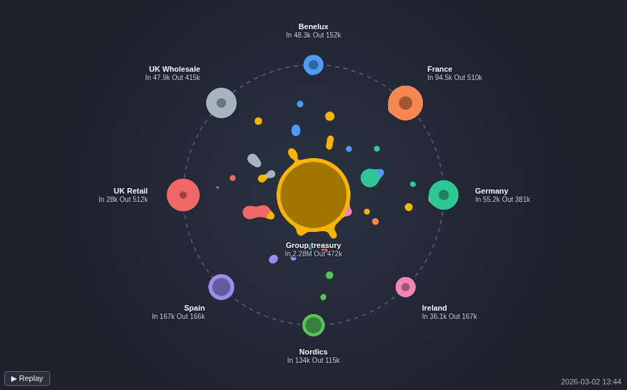
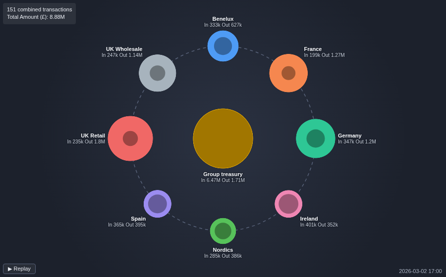
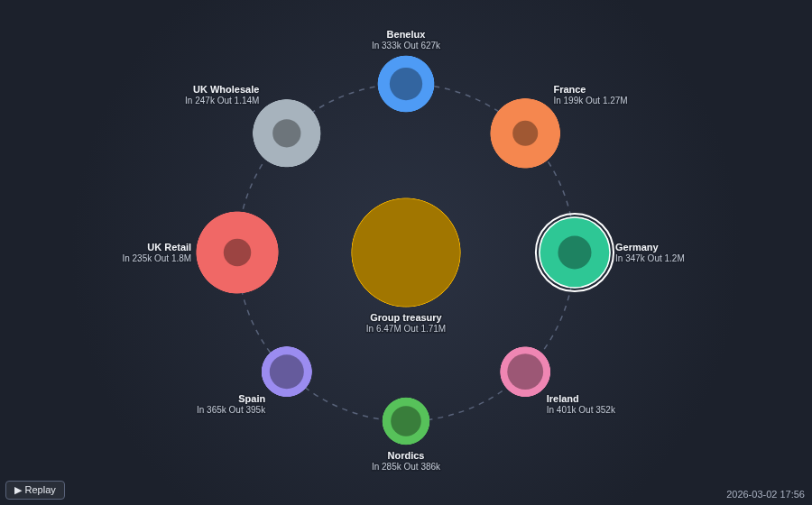

# Orbital Transaction Flow

A day of transactions replayed in seconds. Each one flies from sender to receiver, and the nodes grow with what they have sent and received.

## The problem it solves

A table of payments, transfers or shipments says exactly what happened, but not how it unfolded: which parties are busy early, where money gathers, which flows run one way. A network diagram shows who is connected to whom, but loses the order of events.

The Orbital Transaction Flow replays the transactions in time order around a centre node. In the illustrative group above (invented figures), eight subsidiaries sweep surplus cash to the group treasury through the day, the treasury funds them, and a few pay each other directly. By the end the treasury has received £6.47M and sent out £1.71M, and UK Retail is the largest sender. Grouping the time per hour combines transfers between the same two companies in each hour into one dot, and the details box follows each one:

## Where it earns its place

Omniscope's Sankey view shows the totals flowing between parties, and its Network view shows the structure of a network as a still picture that suits many nodes. Use this view when there are a few tens of parties around one hub and the order and timing of the flows is part of the story: a briefing, a wall screen, or a source that refreshes through the day.

The examples below are illustrative.

| Team | Centre | Around it | Each dot |
|---|---|---|---|
| Treasury | Group treasury | Subsidiaries | A transfer |
| Payments | A settlement account | Counterparties | A payment |
| Logistics | Central warehouse | Stores | A shipment |
| Support | First-line desk | Specialist teams | A ticket hand-over |

## How to use it in Omniscope

1. Bring the transactions into a workflow and connect them to a Report block.
2. Add a view and choose **Orbital Transaction Flow**.
3. Set **Sender** and **Receiver** to the two party fields, **Transaction size** to, for example, the sum of Amount, and **Transaction time** to the date field. Set the time to **Unique values** to fly every transaction, or to a histogram per hour or day to combine them.
4. Optionally type the **Centre node**, and set **Duration (seconds)**.
5. Click a node to select its transactions in the rest of the report.

## Why do this in Omniscope

- **The replay is the report's data.** The transactions come straight from the workflow, follow the report's filters, and a click on a node filters the table or chart beside it to that party's transactions, with no export of the data to an animation tool.
- **The totals add up.** Each node's Sent and Received totals are the sums of the transactions Omniscope's query engine returns, the same engine as a built-in table, so they match a table of the same data grouped by sender or receiver (the view leaves out transactions with a zero or negative size).
- **Live when the data is.** Refresh the source and only the new transactions fly in, so a regularly refreshed workflow becomes a live feed of activity on a wall screen.
- **A custom view you can change.** Its code is one open HTML file: change the colours, the orbit layout or the dot paths in the View Designer.

## Data and options

One record per transaction: sender, receiver, time and a size. Up to 3,000 transactions and 60 parties.

| Option | What it does |
|---|---|
| Sender, Receiver | Who sends and who receives |
| Transaction time | Replay order; a histogram combines transactions per interval |
| Transaction size | Dot size and the node totals |
| Transaction identifier | Keeps identical transactions apart |
| Centre node | The node at the centre; empty picks the busiest |
| Duration (seconds) | Length of one replay |
| Replay on every refresh | Replay on any change, not only new transactions |
| Show transaction details | A box describing each transaction |

## Tested

Mock harness: 240 transfers, every node's Sent and Received totals checked against the source data after the replay (£6.47M received by the treasury), hourly grouping (151 combined transactions, total £8.88M), the busiest node chosen as centre when Centre node is empty, Record count as the size, the tooltip's figures, selecting a node's transactions and clearing by clicking it again and by clicking away, filtering to one sender (colours unchanged, totals shown at once), the Replay button, a settings change without a replay and with Replay on every refresh, a 220 by 160 pane, 2,500 transactions between 40 parties, the limits on transactions and parties, empty data and unconfigured options.

