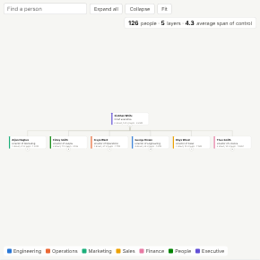

#  Org Chart

Interactive organisation chart built from a people table: each person's card shows name, title, a department colour, direct reports, team size and an optional value (for example cost) rolled up for each manager. Expand and collapse teams, search for anyone, zoom and pan, and click a card to select that person's whole team.

## Use case

HR and workforce planning (structure, spans of control, layers, cost by team), restructures and integrations, onboarding ("who is who"), and any parent-child hierarchy: cost centres, product hierarchies, account structures, asset trees.

## Data

One row per person (or unit) with an ID and the ID of their manager (parent); the top has no manager. Optional fields: name, title, a category for colour, a number to show and roll up. Several people without a manager are shown under a single "Organisation" root. Cycles are broken safely.

## Settings

- **Person** and **Reports to**: the ID field and the manager ID field (the hierarchy).
- **Card title**, **Card subtitle**: the two lines on each card (for example Name and Job title).
- **Colour by**: category for the colour strip (for example Department; eight colours).
- **Card value**: optional number shown on each card; managers show their team total.
- **Layout**: top down or left to right.
- **Levels open**: how many levels are expanded on opening (default 2).

## Interaction

Click a card's round button to expand or collapse that team; use Expand all, Collapse and Fit. Search by name. Hover a card for details (manager, direct reports, team size, value). Click a card to select that person and everyone below them (up to 3,000 people); other views filter or highlight to match. Click empty space to clear. The header shows headcount, number of layers and average span of control.

## Third-party libraries

Loaded from the jsDelivr CDN when the view opens, so the browser showing the report needs internet access:

- [D3](https://d3js.org) 7.9.0, ISC licence

## About this view

This view carries the `visokio-agents` tag. It is one of a set of community examples built by Visokio's agents, to extend Omniscope's core views with popular, specialist and more unusual use cases, and to show what anyone, people or agents, can build on Omniscope. It is tested by automated tests and was run on a real Omniscope server. It was not reviewed by Omniscope's core team, so it is not on a par with Omniscope's core views, which have years of manual, functional and unit tests behind them.

The sample data in `sample-data/` is invented for the demo.
