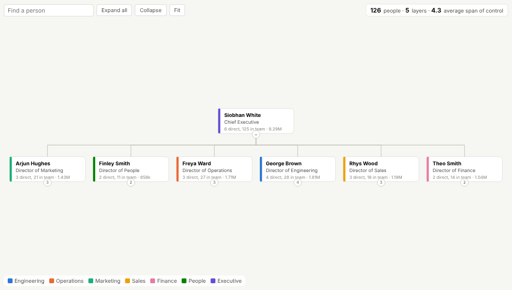
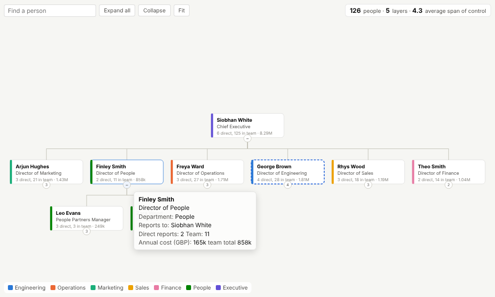
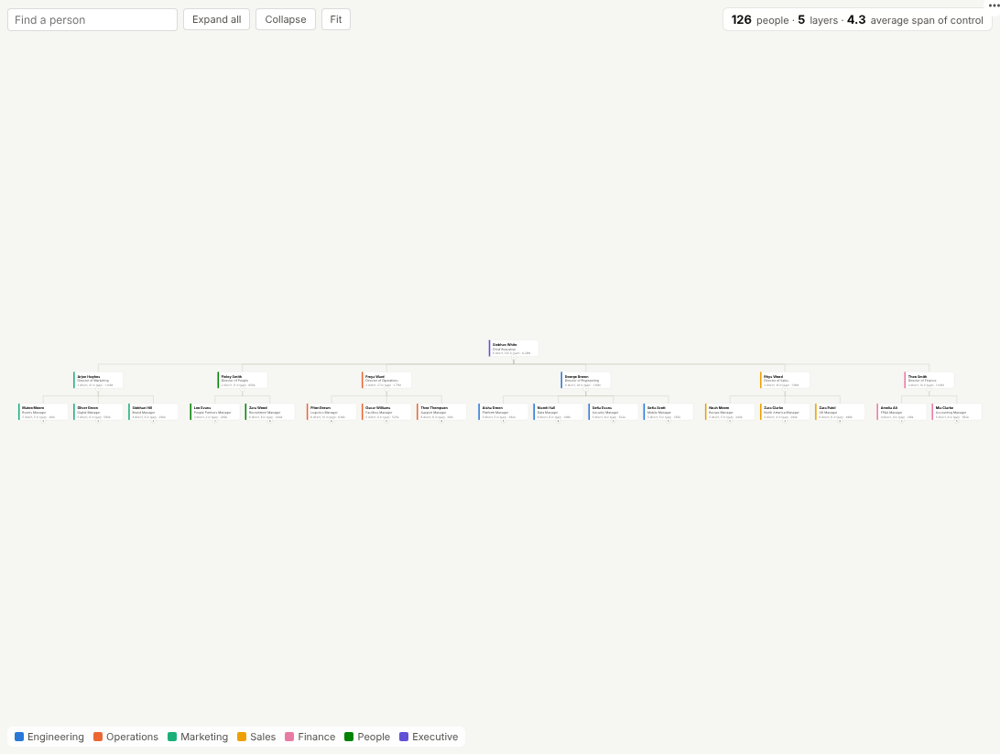

# Org Chart

The organisation as people actually see it: cards, teams and reporting lines, built live from your HR data, with team size and cost rolled up at every level.

## The problem it solves

Org charts are usually drawn by hand in slides, out of date the day after a reorganisation, and disconnected from the numbers. Meanwhile the HR system holds the truth as a table of employee and manager IDs, which nobody can read as a structure. Questions such as "how big is this director's team?", "what does that team cost?" or "where are spans of control too wide?" need both the picture and the data.

The Org Chart view draws the structure straight from the table. Each card shows the person, their title, a department colour, their direct reports, their whole team and an optional value rolled up the tree. Teams expand and collapse, a search box finds anyone, and clicking a card selects that person and everyone below them, so the rest of the report (headcount by location, cost by grade, attrition) shows that team. The header keeps the structural measures in view: headcount, layers and average span of control.

## Where it earns its place

The examples below are illustrative.

| Use | Hierarchy | Rolled-up value |
|---|---|---|
| HR and workforce planning | Employee and manager | Annual cost, FTE, open roles |
| Restructures and integrations | Current and proposed positions | Cost, headcount by grade |
| Finance | Cost centre and parent cost centre | Budget, actual spend |
| Sales | Account and parent account | Revenue, pipeline |
| Asset management | Asset and parent system | Maintenance cost, incidents |

## How to use it in Omniscope

1. Bring the people table into a workflow (an HR system export, a database or a spreadsheet) and join any values to show, such as cost or open roles. Connect it to a Report block.
2. Add a view and choose **Org Chart**.
3. Set **Person** (the ID field) and **Reports to** (the manager ID field), then **Card title** (for example Name), **Card subtitle** (Job title), **Colour by** (Department) and optionally **Card value**.
4. Expand teams, search for people, and click a card to select a whole team for the rest of the report.
5. Schedule the workflow so the chart follows every joiner, leaver and move.

## Why do this in Omniscope

- **Drawn from the HR extract, after the clean-up.** The workflow fixes manager IDs and joins cost and headcount, and the chart is rebuilt from the people table on each refresh; schedule it and joiners, leavers and moves appear without anyone redrawing boxes.
- **Team totals that agree with the people table.** Team size and cost roll up from the same rows the other views use, and clicking a director's card narrows every other view to that whole team.
- **Today's structure beside the proposed one.** Build a table of proposed positions in the workflow and show it in a second tab against the current chart.
- **People data under the report's permissions.** The table stays in the workflow, and each audience sees only what the report allows.
- **Cards you can redesign.** The card drawing is open in the View Designer; add a grade badge or a third line of text if your organisation needs it.

## Data and options

One row per person: ID and manager ID; optionally name, title, a colour category and a value.

| Option | What it does |
|---|---|
| Person, Reports to | The ID and manager ID fields |
| Card title, Card subtitle | Card text |
| Colour by | Department or other category (eight colours) |
| Card value | Number shown and rolled up per manager |
| Layout, Levels open | Direction and initial depth |

Tested with a 5,000-person hierarchy.

## Tested

- Mock harness: the invented 126-person company, expanding a team, search, selecting a director's whole team, hover, clearing, filtering out remote staff, a small view, the fully expanded left-to-right layout, empty data, unconfigured options, and 5,000 people.
- Real Omniscope server: installed through the Edit View API and configured in a report.

