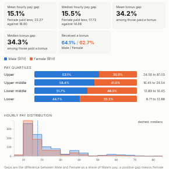

#  Pay Gap

The gender pay gap (or any pay gap between two groups) from employee-level data, with the measures used in gender pay gap reporting in Great Britain: the mean and median hourly pay gap, the mean and median bonus gap, the share of each group receiving a bonus, and the share of each group in each pay quartile. A distribution chart shows where the gap comes from, and an optional breakdown shows the gap within each department, grade or location.

## Use case

Annual gender pay gap reporting and the analysis behind it; ethnicity, disability or other pay gap analysis (choose the groups to compare); reward and HR reviews; checking whether a gap comes from pay within roles or from who holds the senior roles.

## Data

One row per employee with the group (for example Gender), hourly pay and optionally the bonus paid in the period and a field to break down by. Records in other groups (such as "Not stated") or without hourly pay are left out and counted. The view fetches up to 300,000 employees through the Query API; filters from other views apply.

## Settings

- **Groups**: the field with the two groups to compare, e.g. Gender.
- **Hourly pay**: hourly pay per employee.
- **Bonus** (optional): bonus paid in the period; zero or blank means none.
- **Break down by** (optional): department, grade, location or similar.
- **Reference group**, **Compared group**: by default Male (or Men) is the reference and Female (or Women) the compared group, as in UK reporting; set them for other comparisons.

## The measures

Each gap is the reference group's figure minus the compared group's, as a share of the reference group's figure, so a positive gap means the compared group is paid less. Bonus gaps use only those who received a bonus. Pay quartiles rank everyone by hourly pay and split them into four groups of (nearly) equal size; the bars show each group's share of each quartile. People on the same pay at a quartile boundary are not spread evenly between the groups, as the official guidance suggests. The calculations are simple and transparent: check the official guidance for which staff, pay elements and periods to include before publishing. A pay gap is not the same as unequal pay for equal work: the breakdown shows where to look, but it is not an equal pay review.

## Interaction

Hover a quartile segment for its counts and pay range. Click a segment to select those people (that group within that pay range), or a row of the breakdown to select that department or grade; click again or click empty space to clear.

## Motion

When the view first draws, and when its data, options or filters change, the tiles appear and the quartile bars fill. Hovering and selecting do not replay it. The animation is skipped when the viewer's system asks for reduced motion.

## Third-party libraries

Loaded from the jsDelivr CDN when the view opens, so the browser showing the report needs internet access:

- [D3](https://d3js.org) 7.9.0, ISC licence

## About this view

This view carries the `visokio-agents` tag. It is one of a set of community examples built by Visokio's agents, to extend Omniscope's core views with popular, specialist and more unusual use cases, and to show what anyone, people or agents, can build on Omniscope. It is tested by automated tests and was run on a real Omniscope server. It was not reviewed by Omniscope's core team, so it is not on a par with Omniscope's core views, which have years of manual, functional and unit tests behind them.

The sample data in `sample-data/` is invented for the demo.
