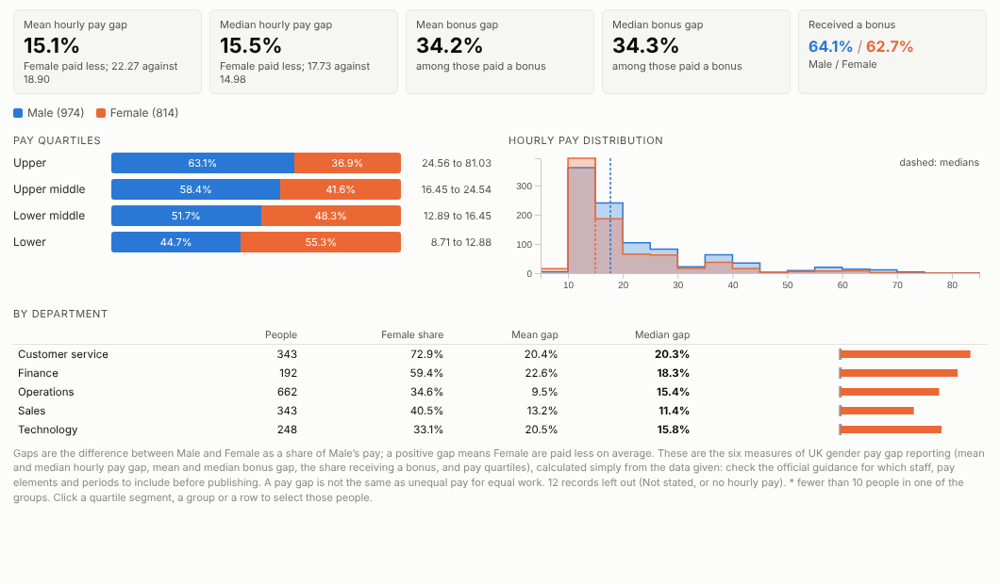
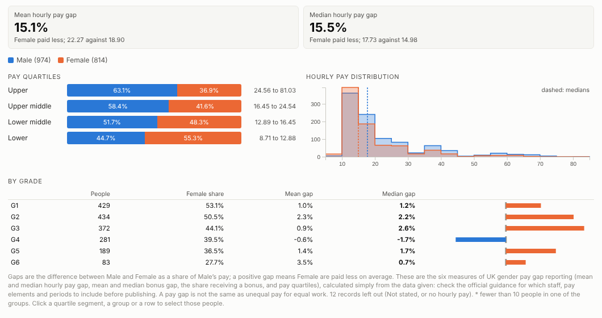
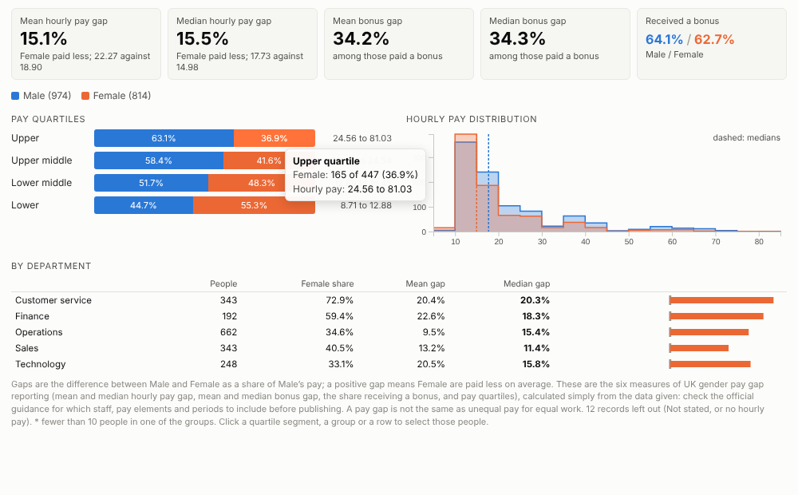
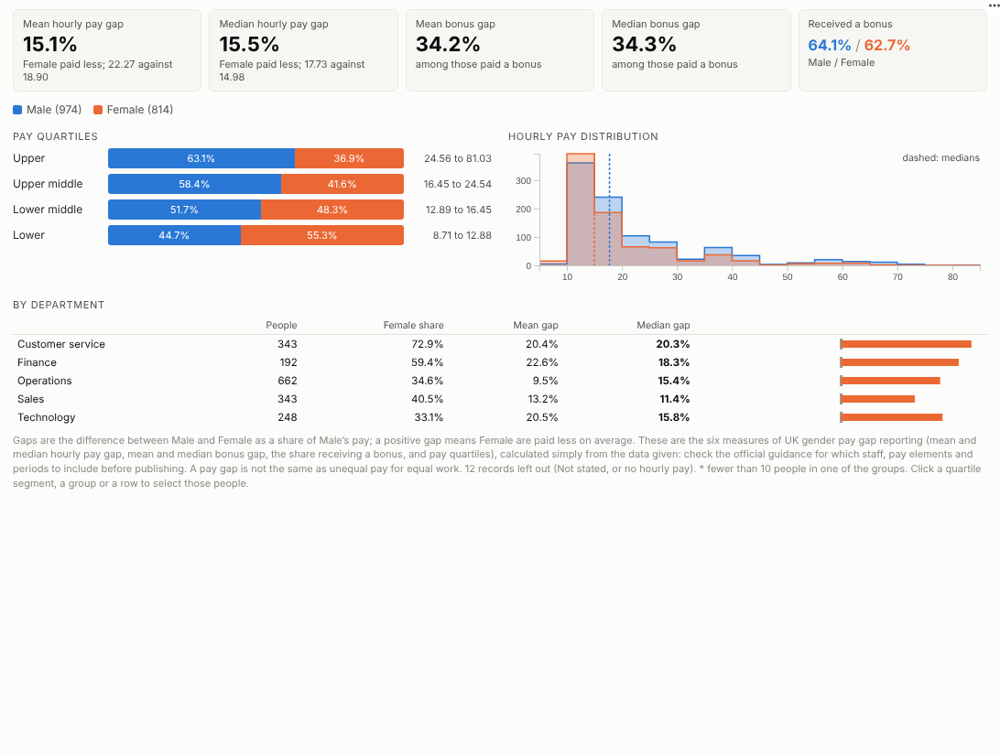

# Pay Gap

Understand your pay gap, not just report it. The gender pay gap measures reported in Great Britain, from employee data, with the quartiles, the distribution and a breakdown that shows where the gap comes from.

## The problem it solves

In Great Britain, employers with 250 or more employees publish their gender pay gap every year: the mean and median hourly pay gap, the mean and median bonus gap, the share of men and women receiving a bonus, and the share of men and women in each pay quartile. Many organisations calculate these in a spreadsheet once a year, and stop there. The more useful question, why the gap exists and what would close it, needs the same numbers broken down by department, grade and working pattern, and that is where spreadsheets get painful.

The Pay Gap view calculates all six measures live from employee data and shows where the gap comes from alongside them. In the illustrative company above, the median gap is about 15%, and the quartiles show why: men hold almost two thirds of the top quartile. Broken down by grade, the gap within each grade is small, so in this invented data the gap comes mostly from who holds the senior roles rather than from different pay for the same grade. A small gap within a grade does not by itself show equal pay for equal work, which needs an equal pay review:

## Where it earns its place

The examples below are illustrative.

| Team | Comparison | Typical use |
|---|---|---|
| HR and reward | Gender | Annual reporting and the narrative behind it |
| Diversity and inclusion | Ethnicity, disability | Voluntary pay gap analysis |
| Finance and leadership | Gender by business unit | Targets and progress tracking |
| Public sector | Gender by grade and location | Statutory reporting and action plans |

## How to use it in Omniscope

1. Bring employee pay data into a workflow (payroll extract, HR system), with one row per employee and hourly pay calculated as the guidance requires.
2. Connect it to a Report block, add a view and choose **Pay Gap**.
3. Set **Groups**, **Hourly pay** and optionally **Bonus** and **Break down by**.
4. Switch the breakdown between department, grade and working pattern to find where the gap comes from.
5. Click a quartile or a group to select those people and look at them in other views.

## Why do this in Omniscope

- **Payroll extract to the six reported measures.** Hourly pay is calculated and employees grouped in the workflow, and the report shows the mean and median pay gaps, the bonus gaps and the quartiles; next year's extract goes through the same steps.
- **Figures you can check.** Every figure is recomputed from the employee records on each refresh, and the tests compare the mean and median gaps, the bonus gap and the top quartile with an independent calculation.
- **Where the gap comes from, without a new workbook.** Switch the breakdown between department, grade and working pattern, or click a quartile to see those employees in the other views.
- **Any two groups, your formula.** The reference and compared groups are settings, and the gap formula is a few readable lines of the view's script if your organisation reports it differently.
- **Kept to the people who should see it.** Pay data stays in your own Omniscope, and the report is shared under its usual permissions.

## Data and options

One row per employee.

| Option | What it does |
|---|---|
| Groups | The two groups to compare |
| Hourly pay | Hourly pay per employee |
| Bonus | Optional bonus paid in the period |
| Break down by | Optional department, grade or location |
| Reference group, Compared group | Which group the gap is measured against |

Tested with 200,000 employees in 50 sites.

## Tested

- Mock harness: the mean and median pay gaps, the median bonus gap, the bonus share and the top quartile checked against an independent calculation, a swapped reference group, hover, selecting a quartile and a department, clearing, filtering to full-time staff, a narrow layout, a single group, empty data, unconfigured options, and 200,000 employees.
- Real Omniscope server: installed through the Edit View API and configured in a report; identical figures.

