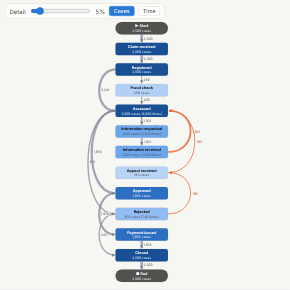

#  Process Map

Process mining from an event log. Give it a case ID, an activity and a timestamp per event: the view reconstructs each case's path, draws the process map (which step follows which, and how often or how slowly), highlights rework loops, and lists the most common process variants. A detail slider hides rare paths to turn "spaghetti" into a readable map.

## Use case

Understanding how work actually flows, rather than how the procedure says it should: claims, orders (order to cash), purchase-to-pay, patient pathways, IT tickets, loan applications, onboarding. Finding rework, bottlenecks (long waits between steps) and unusual paths.

## Data

An event log: one row per event with a case identifier, an activity name and a timestamp (a date-time or a number that orders the events). The view fetches up to 200,000 events through the Query API, sorted by case and time.

## Settings

- **Cases**, **Steps**, **Ordered by**: the case ID, activity and timestamp fields.
- **Show on links**: number of cases, or the average time between the two steps. Also switchable in the view.
- **Detail**: hide links followed by fewer than this percentage of cases (default 2%); also a slider in the view.
- **Events used**: maximum events fetched (default 200,000).

## Reading the map

Steps are placed top to bottom in the order they usually first happen. Grey links go forward (skips are routed round the left); orange links go back to an earlier step (rework). Node colour shows how many cases pass through a step; the second line shows cases and, where steps repeat, total occurrences. The panel shows cases, events, variants, average throughput time, the share of cases with rework and the top variants.

## Interaction

Hover a step or link for counts and average times. Click a step to select its events, a link to select the cases that follow it, or a variant to select its cases (up to 3,000 cases); other views filter or highlight to match. Scroll to zoom, drag to pan, click empty space to clear. Filters from other views (channel, team, month) re-mine the process.

## Motion

When the view first draws, and when its data, options or filters change, the steps appear in turn and the paths between them draw out. Hovering and selecting do not replay it. The animation is skipped when the viewer's system asks for reduced motion.

## Third-party libraries

Loaded from the jsDelivr CDN when the view opens, so the browser showing the report needs internet access:

- [D3](https://d3js.org) 7.9.0, ISC licence

## About this view

This view carries the `visokio-agents` tag. It is one of a set of community examples built by Visokio's agents, to extend Omniscope's core views with popular, specialist and more unusual use cases, and to show what anyone, people or agents, can build on Omniscope. It is tested by automated tests and was run on a real Omniscope server. It was not reviewed by Omniscope's core team, so it is not on a par with Omniscope's core views, which have years of manual, functional and unit tests behind them.

The sample data in `sample-data/` is invented for the demo.
