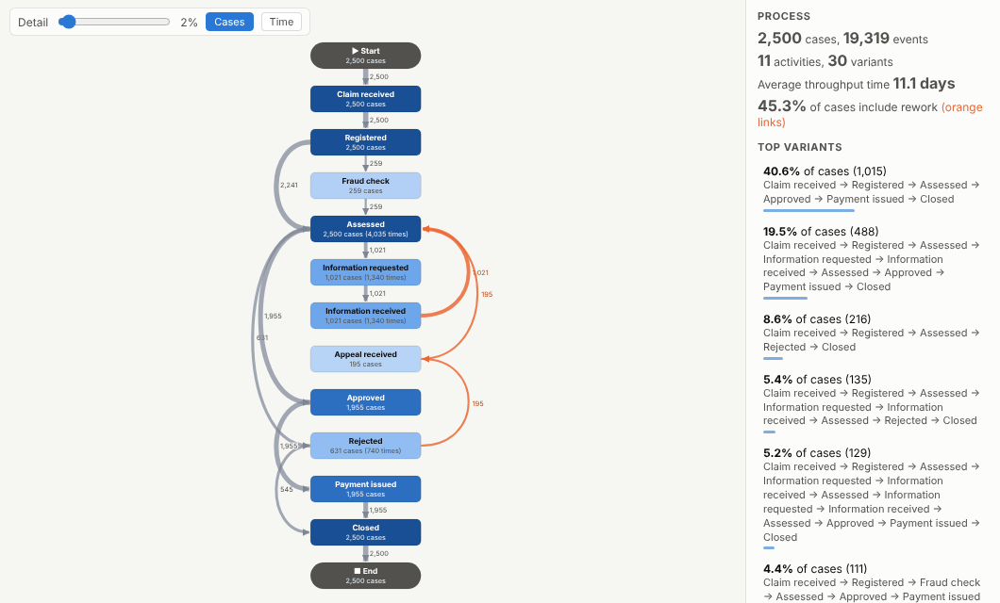
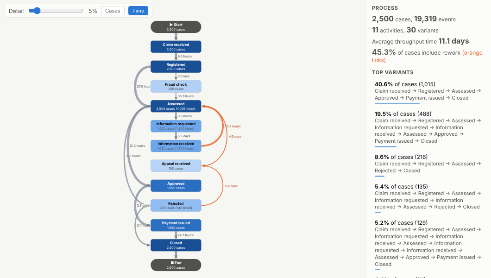
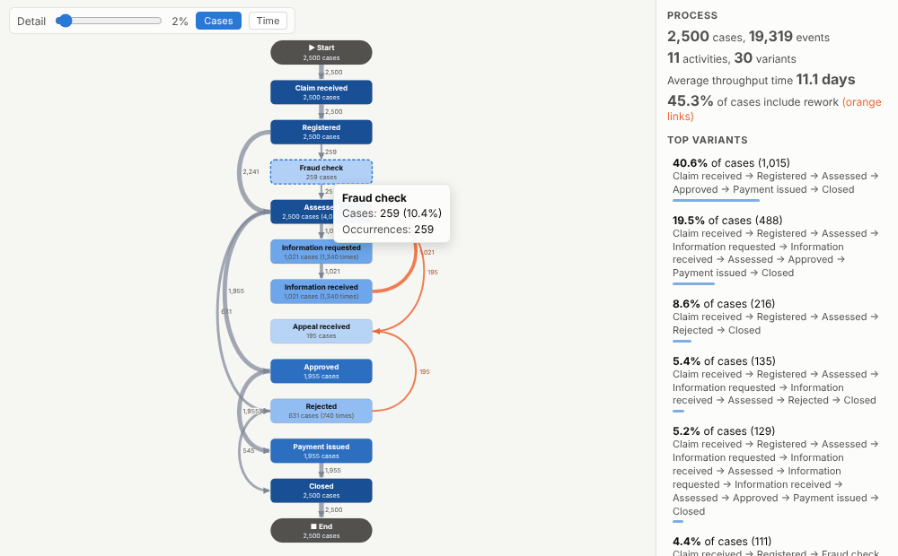
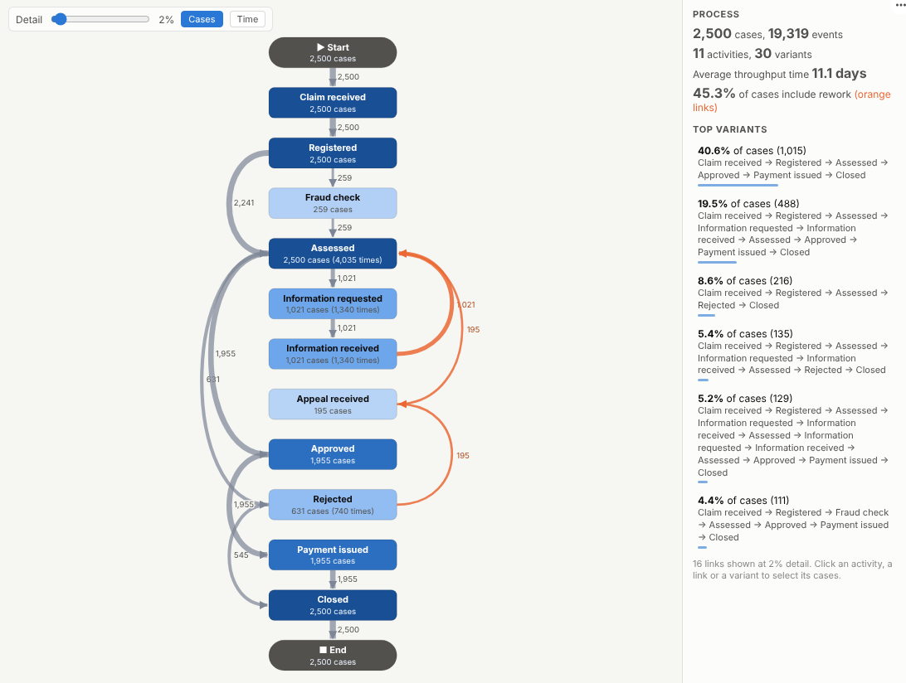

# Process Map

See how work really flows. Point it at an event log and get the process map, the rework loops, the slow handovers and the most common paths, mined live from your systems' data.

## The problem it solves

Every organisation has a documented process and a real one. Claims bounce back for more information, orders loop through credit checks, tickets get reassigned, and nobody can say how often, how long it takes, or where the time goes. The data to answer this already exists: every system records who did what, to which case, when. Process mining turns that event log into a map of the actual process, and it is often done apart from the rest of the analytics.

The Process Map view does it inside an Omniscope report. It rebuilds each case's path from the events, draws the directly-follows map with counts or average times on every link, colours rework in orange and lists the variants. In the illustrative claims process above, about 45% of claims include rework (requests for more information, appeals), and the most common path covers only 41% of claims. Switch the labels to time and the slow steps stand out:

## Where it earns its place

The examples below are illustrative.

| Process | Case | Typical findings |
|---|---|---|
| Insurance claims | Claim | Information requests and appeals that add days |
| Order to cash | Order or invoice | Credit holds, partial deliveries, late payment loops |
| Purchase to pay | Purchase order | Approvals bypassed, invoices before goods receipt |
| Healthcare pathways | Patient episode | Waits between referral, diagnostics and treatment |
| IT service management | Ticket | Reassignments and reopened tickets |

## How to use it in Omniscope

1. Bring the event data into a workflow (system audit tables, database logs, exported histories) and shape it into one row per event with case, activity and timestamp; Append and Field Organiser blocks help combine sources.
2. Connect it to a Report block, add a view and choose **Process Map**.
3. Set **Cases**, **Steps** and **Ordered by**.
4. Move the **Detail** slider until the map is readable; switch between cases and time on the links.
5. Click a rework link or a variant to select those cases and look at them by team, channel or month elsewhere in the report.

## Why do this in Omniscope

- **Audit tables from several systems, one event log.** Append and Field Organiser blocks combine the sources into one row per event, and the map is mined again from that output on every refresh, so improvement work can be tracked week by week.
- **Rework tied to teams and channels.** Case attributes such as team, channel and value arrive through the same workflow, so a click on an orange rework link shows which teams and channels those cases belong to.
- **Re-mined for each slice.** Filter to one channel or month elsewhere on the page and the paths, variants and rework share are recomputed from that slice's events, not just hidden.
- **Your definition of rework.** A link back to an earlier step counts as rework; that rule is a few lines of JavaScript in the View Designer, ready to change if your process has legitimate loops.

## Data and options

An event log: case ID, activity and timestamp per event.

| Option | What it does |
|---|---|
| Cases, Steps, Ordered by | Case ID, activity and timestamp fields |
| Show on links | Number of cases or average time |
| Detail | Hide links followed by fewer than this percentage of cases |
| Events used | Maximum events fetched |

Tested with about 200,000 events from 40,000 cases.

## Tested

- Mock harness: the claims process by cases and by time, selecting a step and a variant, simplifying with the detail slider, link hover, clearing, filtering to one channel, a narrow layout, empty data, unconfigured options, and about 200,000 events.
- Real Omniscope server: installed through the Edit View API and configured in a report.

