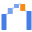
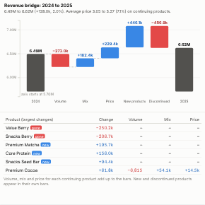

#  Price Volume Mix

Revenue bridge that explains the change between two periods: how much came from selling more or fewer units (volume), from selling a different mix of products (mix), from price changes (price), from new products and from discontinued ones. Shown as a waterfall, with a table of each product's contribution.

## Use case

Commercial and finance reviews: explaining revenue growth or decline to leadership, checking whether price increases stuck, separating mix effects from genuine volume growth, budget-versus-actual and year-on-year bridges for manufacturers, retailers, wholesalers and distributors.

## Data

Row-level sales with a product (or SKU) field, a period field (for example Year or Quarter), units and revenue. The view runs one Query API query (units and revenue summed by period and product) and computes the bridge.

## Calculation

For products sold in both periods, with base average price P0 (base revenue divided by base units):

- **Volume** = change in total units x P0.
- **Mix** = current units valued at each product's base price, minus current units at P0.
- **Price** = current revenue minus current units valued at base prices.
- **New products** = current revenue of products with no base sales; **Discontinued** = minus the base revenue of products with no current sales.

Base revenue plus the five effects equals current revenue exactly, and each product's volume, mix and price contributions add up to the bars.

## Settings

- **Products**, **Period**, **Volume**, **Revenue**: the fields.
- **Base period** / **Current period**: values of Period to compare; by default the latest two.
- **Products in table**: how many products to list, largest changes first.

## Interaction

Hover a bar for an explanation of the effect. Click a bar to select its sales (for example the new products, or both periods' sales for the base or current total), or click a product row to select that product; other views filter or highlight to match. Filters from other views (region, channel, customer) recalculate the bridge.

## Motion

When the view first draws, and when its data, options or filters change, the bridge steps appear from left to right. Hovering and selecting do not replay it. The animation is skipped when the viewer's system asks for reduced motion.

## Third-party libraries

Loaded from the jsDelivr CDN when the view opens, so the browser showing the report needs internet access:

- [D3](https://d3js.org) 7.9.0, ISC licence

## About this view

This view carries the `visokio-agents` tag. It is one of a set of community examples built by Visokio's agents, to extend Omniscope's core views with popular, specialist and more unusual use cases, and to show what anyone, people or agents, can build on Omniscope. It is tested by automated tests and was run on a real Omniscope server. It was not reviewed by Omniscope's core team, so it is not on a par with Omniscope's core views, which have years of manual, functional and unit tests behind them.

The sample data in `sample-data/` is invented for the demo.
