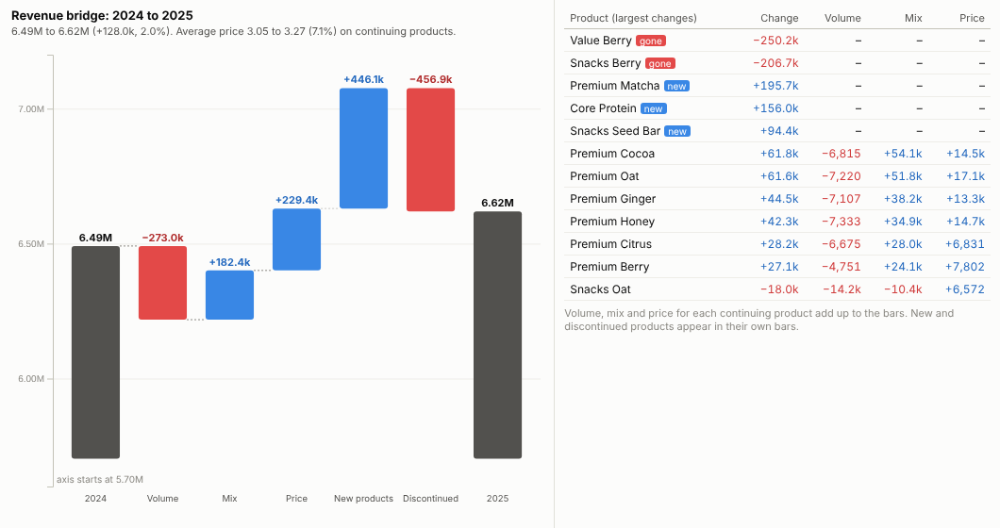
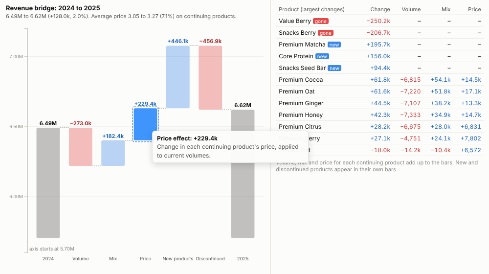
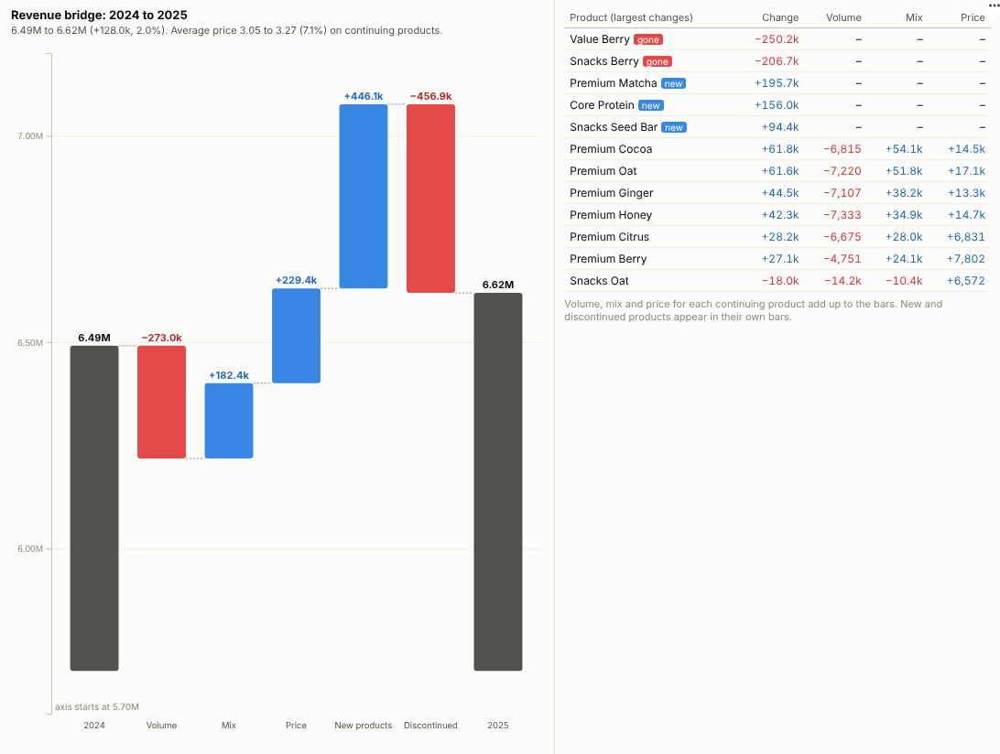

# Price Volume Mix

Revenue went up 2%. Was that price, volume, mix or new products? The bridge answers in one picture, and the table shows which products did it.

## The problem it solves

A single growth figure hides very different stories. Revenue up 2% could be a healthy business selling more, or a shrinking one held up by price rises; it could be customers trading up to premium lines, or a few launches masking decline elsewhere. Commercial and finance teams answer this with a price-volume-mix analysis, often in a spreadsheet that is rebuilt every month.

The Price Volume Mix view computes the standard decomposition live from sales data and draws it as a waterfall: base revenue, then the volume, mix, price, new-product and discontinued-product effects, then current revenue. A table shows each product's contribution, and the numbers always add up. In the invented manufacturer above, total revenue rose 2%, but units fell (a 273k volume drag) while price (+229k) and a shift towards premium lines (+182k) more than made up for it; three launches roughly offset two discontinued products.

## Where it earns its place

The examples below are illustrative.

| Business | Products | Typical question |
|---|---|---|
| Food, drink and consumer goods | SKUs, brands | Did our price increase stick, or did we lose volume? |
| Retail and wholesale | Categories, products | Is growth coming from more baskets or from trading up? |
| Industrial and B2B | Product lines, part numbers | How much of the margin change is mix? |
| Software and subscriptions | Plans, add-ons | How much growth is price, seats or plan mix? |
| Hospitality and travel | Room types, fare classes | Rate against occupancy, and the effect of upgrades |

## How to use it in Omniscope

1. Connect row-level sales (date or period, product, units, revenue) to a Report block; add a Year or Quarter field in the workflow if needed.
2. Add a view and choose **Price Volume Mix**.
3. Set **Products**, **Period**, **Volume** and **Revenue**; choose the **Base period** and **Current period** or leave them on the latest two.
4. Hover each bar for what it means; click a bar or a product to select those sales and see them by customer, region or channel in other views.
5. Filter by region or customer group to get the bridge for that slice, for example price realisation by channel.

## Why do this in Omniscope

- **The monthly bridge without the monthly rebuild.** Row-level sales are loaded and a Year or Quarter field is added in the workflow, and the bridge is recalculated from those rows at each refresh.
- **Effects that add up, every time.** Base revenue plus the five effects equals current revenue exactly, and each product's contributions sum to the bars; the tests check both.
- **Price realisation by channel in one filter.** Filter by region, channel or customer and the bridge is recomputed for that slice; click the price or mix bar to list the sales behind it.
- **Finance's own definitions.** The volume, mix and price formulas are a short block of open code; change how mix is valued in the View Designer if your company defines it differently.

## Data and options

Row-level sales with product, period, units and revenue.

| Option | What it does |
|---|---|
| Products, Period, Volume, Revenue | The fields |
| Base period, Current period | Periods to compare (default: latest two) |
| Products in table | Number of products in the breakdown |

Tested with 200,000 rows and 2,000 products.

## Tested

- Mock harness: the 2024 to 2025 bridge (effects verified to add up to the change, product mix contributions verified to add up to the mix bar), price bar and product selection, clearing, filtering to one region, a narrow layout, chosen periods (2023 to 2025), a single period (message), unconfigured options, and 200,000 rows.
- Real Omniscope server: installed through the Edit View API and configured in a report.

