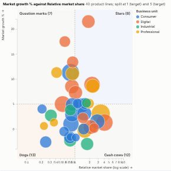

#  Quadrant Matrix

The two-by-two matrix of consultants and planners: items placed by two measures, split into four quadrants at the medians, the averages or targets you set, with the quadrants named. Bubble size and colour add a third and fourth dimension, the largest items are labelled without overlaps, and a click on a quadrant selects everything in it.

## Use case

Portfolio reviews (growth-share or "BCG" style matrices), prioritisation (effort against impact), importance-performance analysis of survey results, customer or supplier segmentation (value against risk), project or initiative ranking, any "where should we focus" discussion.

## Data

Items and two measures, aggregated by Omniscope (up to a few thousand items). Optional: a third measure for bubble size and a grouping for colour.

## Settings

- **Items**: one point per value, e.g. Product line.
- **Across**, **Up**: the two measures.
- **Bubble size**, **Colour by** (optional).
- **Split across at**, **Split up at**: median (default), average or a target value, with **Across target** and **Up target**.
- **Quadrant names**: none, growth-share (Stars, Question marks, Cash cows, Dogs), effort and impact (Quick wins, Major projects, Fill-ins, Thankless tasks), importance and performance (Concentrate here, Keep up the good work, Possible overkill, Low priority), or custom names for each corner. The presets assume higher values to the right and up (for effort and impact, put effort across and impact up; for importance and performance, performance across and importance up).
- **Log scale across**: for ratios such as relative market share.
- **Labels**: label the largest points where there is room.

## Interaction

Hover a bubble for its values, or a quadrant for its count and total size. Click a bubble to select that item, or a quadrant to select all its items, so other views filter or highlight to match; click again or click empty space to clear.

## Motion

When the view first draws, and when its data, options or filters change, the points pop in. Hovering and selecting do not replay it. The animation is skipped when the viewer's system asks for reduced motion.

## Third-party libraries

Loaded from the jsDelivr CDN when the view opens, so the browser showing the report needs internet access:

- [D3](https://d3js.org) 7.9.0, ISC licence

## About this view

This view carries the `visokio-agents` tag. It is one of a set of community examples built by Visokio's agents, to extend Omniscope's core views with popular, specialist and more unusual use cases, and to show what anyone, people or agents, can build on Omniscope. It is tested by automated tests and was run on a real Omniscope server. It was not reviewed by Omniscope's core team, so it is not on a par with Omniscope's core views, which have years of manual, functional and unit tests behind them.

The sample data in `sample-data/` is invented for the demo.
