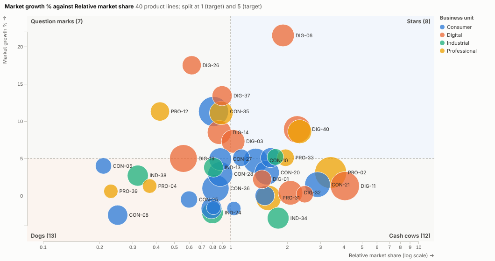
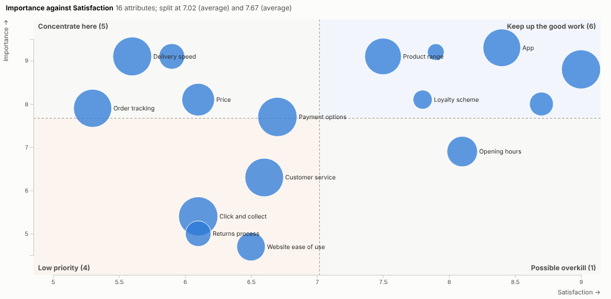
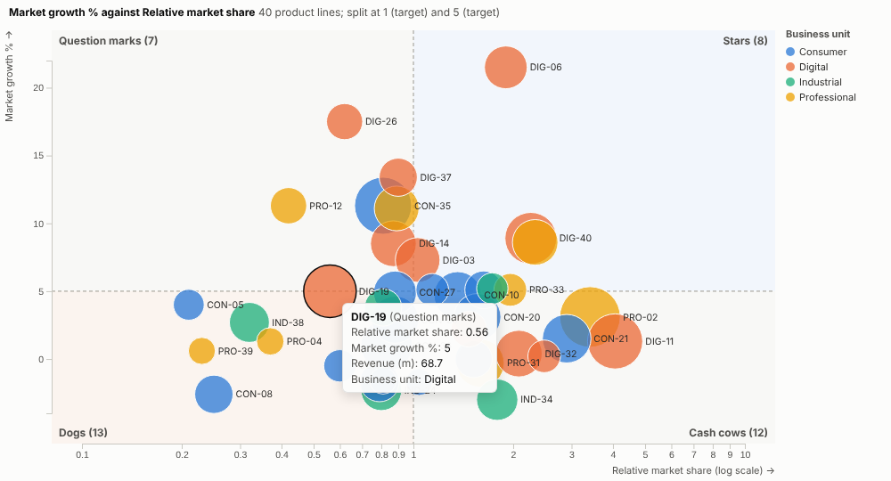
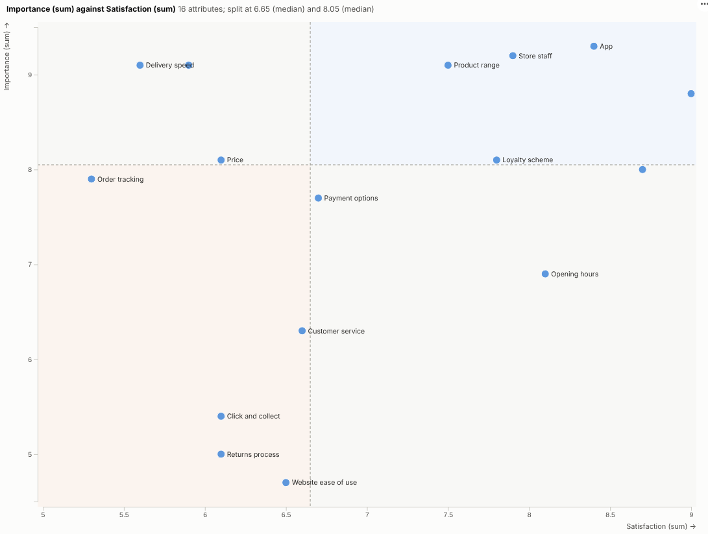

# Quadrant Matrix

Where should we focus? Any two measures, four named quadrants, and every item in its place, from live data in an Omniscope report.

## The problem it solves

The two-by-two matrix is a common tool in business: growth against share for a product portfolio, effort against impact for a list of initiatives, importance against satisfaction for survey results, value against risk for suppliers. It is often drawn by hand in a slide, from numbers copied out of a report, and redrawn every quarter. A plain scatter chart has the points but not the quadrants, the split lines or the names.

The Quadrant Matrix view draws it, with the split lines and names, from live data. In the illustrative portfolio above, split at a relative share of 1 and 5% market growth and sized by revenue, the eight Stars and the twelve Cash cows are obvious, and so is the long tail of small Dogs. The same view does an importance-performance analysis of survey results, split at the averages:

## Where it earns its place

The examples below are illustrative.

| Matrix | Across | Up | Quadrant names |
|---|---|---|---|
| Growth-share portfolio | Relative market share | Market growth | Stars, Cash cows, Question marks, Dogs |
| Prioritisation | Effort | Impact | Quick wins, Major projects, Fill-ins, Thankless tasks |
| Importance-performance | Satisfaction | Importance | Concentrate here, Keep up the good work |
| Supplier segmentation | Spend | Supply risk | Your own names |
| Customer value | Revenue | Margin | Your own names |

## How to use it in Omniscope

1. Bring the items and their measures into a workflow (products, initiatives, survey attributes, suppliers).
2. Connect it to a Report block, add a view and choose **Quadrant Matrix**.
3. Set **Items**, **Across** and **Up**, and optionally **Bubble size** and **Colour by**.
4. Choose where to split each axis and a set of **Quadrant names**, or type your own.
5. Click a quadrant to select its items and list them in a table view.

## Why do this in Omniscope

- **Fed by the scoring workflow.** The two measures are calculated, joined and cleaned in the workflow, so items move between quadrants when the data refreshes and next quarter's matrix is already drawn.
- **Splits at your targets.** Split at medians, averages or real targets, with your own quadrant names; the tests check quadrant membership against the source data.
- **From a corner to a list.** Click a quadrant and a table view lists its items; filter to a business unit and the splits and counts update.
- **Another framework in a few lines.** The named presets are a small list in the view's script; add your organisation's own two-by-two in the View Designer.

## Data and options

Items and two measures, optionally size and colour.

| Option | What it does |
|---|---|
| Items, Across, Up | The points and their position |
| Bubble size, Colour by | Optional third and fourth dimensions |
| Split across at, Split up at | Median, average or target |
| Quadrant names | Presets or custom names |
| Log scale across | For ratios |
| Labels | Label the largest points |

## Tested

- Mock harness: quadrant membership checked against the source data, median splits, target splits, custom names, hover, selecting an item and a whole quadrant, clearing, filtering to one business unit, a narrow layout, empty data and unconfigured options.
- Real Omniscope server: installed through the Edit View API and configured in a report.

