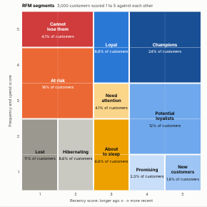

#  RFM Segments

Customer segmentation by recency, frequency and monetary value (RFM), straight from transaction data. The view asks the server for each customer's last purchase, number of purchases and total spend, scores every customer 1 to 5 on each against the rest, and places them in eleven named segments, from Champions to Lost, on the familiar recency by frequency-and-spend grid. Each segment comes with its size, its share of spend, its typical behaviour and a suggested action.

## Use case

CRM and marketing: deciding who to reward, who to win back, who to nurture and who to stop mailing; sizing the value at risk; tracking how the customer base moves between segments over time. Works for retail, e-commerce, subscriptions with one-off purchases, B2B accounts, donors and members.

## Data

Transactions: one row per purchase (or order line) with a customer ID, a date and a value. Optionally an order ID, so several lines of one order count as one purchase. The view runs one aggregated query (one row per customer, up to 200,000 customers), so large transaction tables stay on the server. Recency is measured to the latest purchase in the data. Filters from other views apply.

## Settings

- **Customers**: the customer or account ID.
- **Dated by**: the purchase date.
- **Spend**: the purchase value.
- **Count purchases by** (optional): the order ID; without it, every record counts as a purchase.
- **Customers used**: maximum number of customers fetched (default 200,000).

## Reading the grid

Columns are the recency score (1: longest since the last purchase, 5: most recent). Rows are the average of the frequency and spend scores. Scores rank customers against each other in fifths, and customers with equal values always get the same score. Each coloured region is a segment: blues for healthy customers, amber and red for those slipping away, greys for lapsed. The panel lists every segment with its customers, share of spend, average days since the last purchase, purchases and spend, and a suggested action (common practice, not a rule).

## Interaction

Hover a cell for its customers, spend and averages. Click a cell or a segment in the panel to select those customers (up to 3,000), so other views in the report show who they are, where they are and what they bought. Click empty space to clear.

## Motion

When the view first draws, and when its data, options or filters change, the grid cells and segment labels appear in turn. Hovering and selecting do not replay it. The animation is skipped when the viewer's system asks for reduced motion.

## Third-party libraries

Loaded from the jsDelivr CDN when the view opens, so the browser showing the report needs internet access:

- [D3](https://d3js.org) 7.9.0, ISC licence

## About this view

This view carries the `visokio-agents` tag. It is one of a set of community examples built by Visokio's agents, to extend Omniscope's core views with popular, specialist and more unusual use cases, and to show what anyone, people or agents, can build on Omniscope. It is tested by automated tests and was run on a real Omniscope server. It was not reviewed by Omniscope's core team, so it is not on a par with Omniscope's core views, which have years of manual, functional and unit tests behind them.

The sample data in `sample-data/` is invented for the demo.
