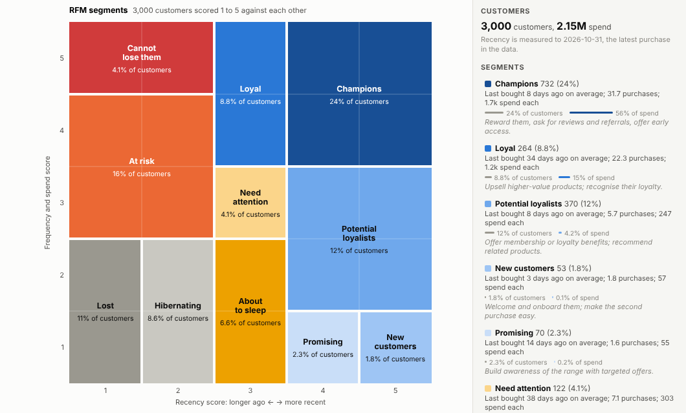
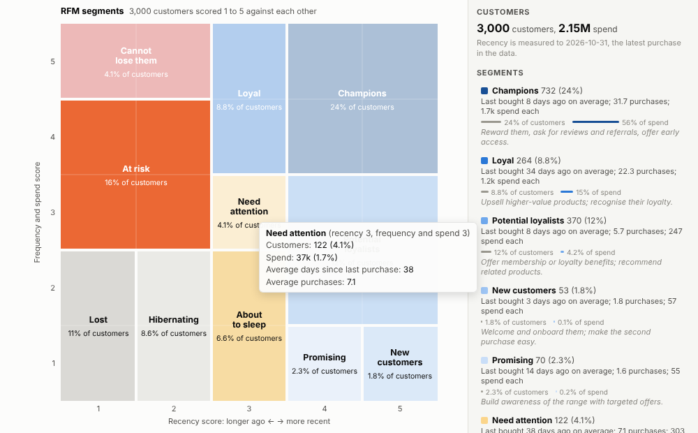
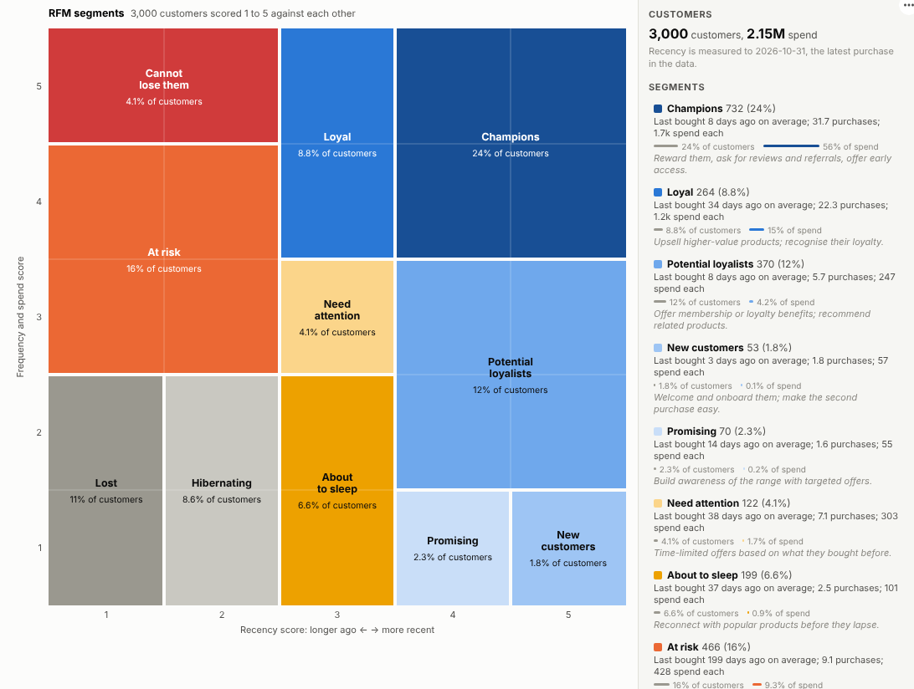

# RFM Segments

Know which customers to reward, which to win back and which you have already lost. RFM segmentation from your transaction data, live in a report, with the value of every segment and what to do about it.

## The problem it solves

Not all customers are worth the same, and they do not stay the same. Some buy often and recently, some used to buy a lot and have gone quiet, some bought once and never came back. RFM (recency, frequency, monetary value) is the long-established way to sort them, and it is widely used in marketing. It is usually produced as a one-off spreadsheet or a data science script, and goes out of date as soon as it is made.

The RFM Segments view computes it live in an Omniscope report from ordinary transactions. The server aggregates each customer's last purchase, purchase count and spend; the view scores and segments them and shows the result on the standard grid. In the illustrative online shop above, Champions are about a quarter of customers but more than half of spend, while one in six customers is At risk: they used to buy often but have not bought for months.

## Where it earns its place

The examples below are illustrative.

| Business | Customer | Typical use |
|---|---|---|
| Retail and e-commerce | Shopper or loyalty card | Win-back and reward campaigns, mailing selection |
| B2B distribution | Account | Account management priorities, churn warning |
| Hospitality and travel | Guest | Offers for lapsed and frequent guests |
| Charities | Donor | Upgrade, retention and reactivation appeals |
| Membership and clubs | Member | Renewal and engagement programmes |

## How to use it in Omniscope

1. Bring transactions into a workflow (order lines, invoices, donations) with a customer ID, a date and a value.
2. Connect it to a Report block, add a view and choose **RFM Segments**.
3. Set **Customers**, **Dated by** and **Spend**, and optionally **Count purchases by** an order ID.
4. Click a segment to select its customers; other views show who they are, and a table view can export them for a campaign.
5. Filter by region, channel or product to segment just that part of the customer base.

## Why do this in Omniscope

- **Segments that move as customers buy.** Transactions are cleaned in the workflow and the segments are recalculated whenever it refreshes; put it on the scheduler and the campaign lists stay current.
- **One aggregated query, however many order lines.** Each customer's last purchase, purchase count and spend are summed by Omniscope's query engine, so the transactions never leave it (tested with 300,000).
- **Segment sizes that reconcile.** The tests check every segment's customer count against an independent calculation.
- **Segment to campaign list.** Select Cannot lose them and the rest of the report profiles those customers, ready for a table view to export.
- **Your segment map.** The eleven segments, their place on the grid and the suggested actions are one table at the top of the view's code; rename a segment or rewrite an action in the View Designer.

## Data and options

Transactions with a customer, a date and a value.

| Option | What it does |
|---|---|
| Customers | Customer or account ID |
| Dated by | Purchase date |
| Spend | Purchase value |
| Count purchases by | Optional order ID |
| Customers used | Maximum customers fetched |

Tested with 300,000 transactions from about 80,000 customers.

## Tested

- Mock harness: every segment's customer count checked against an independent calculation, hover, segment and cell selection, clearing, filtering to one region, a narrow layout, counting records instead of orders, empty data, unconfigured options, and 300,000 transactions.
- Real Omniscope server: installed through the Edit View API and configured in a report; identical segment counts.

