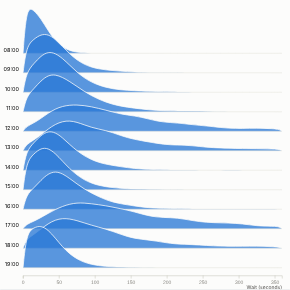

#  Ridgeline

Ridgeline (joy plot) chart: one smoothed distribution per category, stacked with a little overlap so dozens of distributions compare at a glance. Medians are marked and labelled. The binning is done by the Query API (a histogram grouping), so it works on large tables.

## Use case

Comparing the shape of a measure across groups, not only its average: wait or delivery times by hour, site or carrier; prices by region; test scores by school; sensor readings by machine; order values by channel. It shows spread, skew, long tails and two-peaked groups that a bar chart of averages hides.

## Data

Row-level data: one row per event with a category and a numeric value (for example Hour and Wait seconds). No aggregation needed.

## Settings

- **Rows**: one ridge per value of this field.
- **Distribution of**: the numeric field.
- **Detail**: number of bins across the range (default 60), rounded to a tidy bin width.
- **Smoothing**: Gaussian smoothing in bins (0 shows the raw histogram).
- **Overlap**: how far each ridge rises into the row above.
- **Order rows by**: natural order, median (either way) or number of records.
- **Maximum rows**: limit, keeping the rows with most records.
- **Same height for every row**: scale each ridge to its own peak to compare shapes when group sizes differ.
- **Show medians**: tick and value for each row.
- **Trim extreme values**: set the range from the quartiles (three interquartile ranges beyond them) so outliers do not squash the chart.

## Interaction

Hover for the number of records in each bin and the row's median, mean and count. Click a row label or ridge to select that category; drag across the chart to select a value range (for example waits over two minutes). Other views filter or highlight to match; click empty space to clear.

## Motion

When the view first draws, and when its data, options or filters change, the ridges appear row by row. Hovering and selecting do not replay it. The animation is skipped when the viewer's system asks for reduced motion.

## Third-party libraries

Loaded from the jsDelivr CDN when the view opens, so the browser showing the report needs internet access:

- [D3](https://d3js.org) 7.9.0, ISC licence

## About this view

This view carries the `visokio-agents` tag. It is one of a set of community examples built by Visokio's agents, to extend Omniscope's core views with popular, specialist and more unusual use cases, and to show what anyone, people or agents, can build on Omniscope. It is tested by automated tests and was run on a real Omniscope server. It was not reviewed by Omniscope's core team, so it is not on a par with Omniscope's core views, which have years of manual, functional and unit tests behind them.

The sample data in `sample-data/` is invented for the demo.
