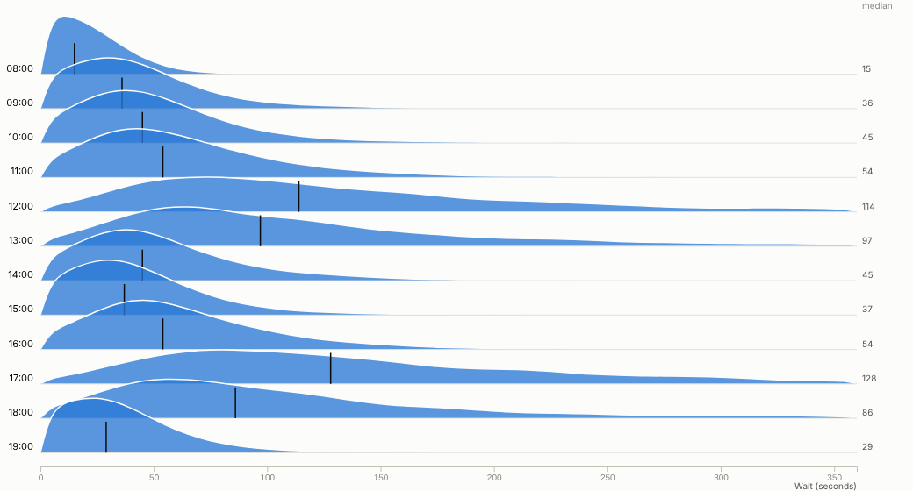
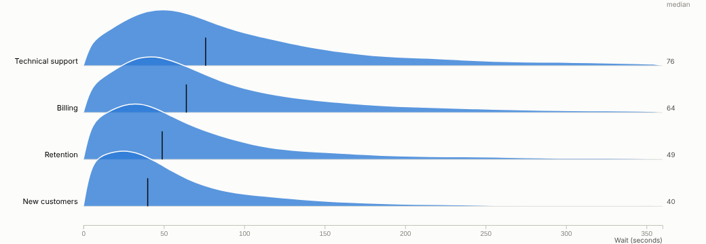
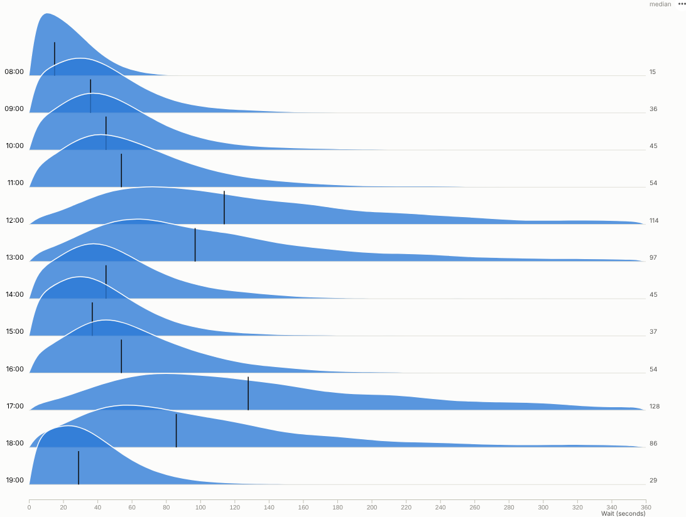

# Ridgeline

Averages hide the story. See the whole distribution for every group at once: where most values fall, how long the tail is, and which groups behave differently.

## The problem it solves

"Average wait time is 90 seconds" sounds fine until you learn that one caller in sixteen waits more than four minutes, and almost all of them call at lunchtime or in the early evening. Service levels, delivery promises, prices and risk all live in the shape of a distribution, not in its mean. Box plots help but hide shape; one histogram per group needs a page of small charts.

The Ridgeline view stacks one smoothed distribution per group, slightly overlapping, with the median marked. In the illustrative contact-centre data above, waits at 08:00 are short and tight; from 12:00 and again at 17:00 the median roughly doubles and the tail stretches past five minutes. That points to a staffing question that an average would not raise. The same view by team, each ridge scaled to its own peak, shows that Technical support has both the longest median and the longest tail:

## Where it earns its place

The examples below are illustrative.

| Industry | Rows | Distribution of | Question |
|---|---|---|---|
| Contact centres and service | Hour, team, channel | Wait time, handling time | When and where do long waits happen? |
| Logistics | Carrier, depot, service | Delivery time | Which carrier's promises are least reliable? |
| Retail and e-commerce | Channel, region, category | Order value, discount | Do online customers spend differently, or just more often? |
| Healthcare | Site, specialty, month | Time to treatment, length of stay | Which specialties have the longest tails? |
| Manufacturing and IoT | Machine, shift, batch | Temperature, cycle time, defect size | Which machine is drifting or two-peaked? |

## How to use it in Omniscope

1. Connect row-level data (calls, deliveries, orders, readings) to a Report block.
2. Add a view and choose **Ridgeline**.
3. Set **Rows** (for example Hour or Team) and **Distribution of** (for example Wait seconds).
4. Adjust **Detail**, **Smoothing** and **Overlap**; sort rows by median to rank groups; switch on **Same height for every row** to compare shapes.
5. Drag across the chart to select a value range, for example every call that waited more than two minutes, and see who, when and why in the rest of the report.

## Why do this in Omniscope

- **Binned by the query engine, not sampled.** The histogram is computed by the Query API on the whole table each time (tested with 200,000 rows), so nothing is exported or thinned out.
- **This week's distribution, not last quarter's average.** The calls or deliveries are prepared in the workflow and the ridges redraw with it, ready for the weekly operations review.
- **Drag across the tail to see who waited.** Selecting a value range picks out those records in every other view, and filters from other views re-bin every ridge.
- **Another smoothing if you need one.** The binning and Gaussian smoothing are in the view's JavaScript, so a different kernel or a shaded quartile band is an edit in the View Designer.

## Data and options

Row-level data: a category and a numeric value per row.

| Option | What it does |
|---|---|
| Rows, Distribution of | The groups and the numeric field |
| Detail, Smoothing, Overlap | Bin count, smoothing and ridge height |
| Order rows by, Maximum rows | Row order and limit |
| Same height for every row | Compare shapes across groups of different size |
| Show medians, Trim extreme values | Medians and an outlier-resistant range |

Tested with 200,000 rows in 40 groups.

## Tested

- Mock harness: wait time by hour, by team normalised and sorted by median, hover, row and range selection, clearing, filtering to one weekday, a small view, the raw histogram, empty data, unconfigured options, and 200,000 rows.
- Real Omniscope server: installed through the Edit View API and configured in a report.

