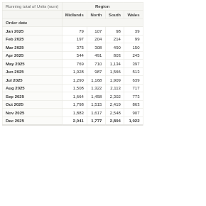

#  Running Pivot

A pivot table of running totals: the measure for each row and column, added up down the rows, so each cell shows the total so far. Rows are typically periods (months, weeks, days) and columns the things to compare (regions, products, channels); the last row holds each column's total.

## Use case

Year-to-date and month-to-date figures side by side: sales to date by region, cumulative sign-ups by channel, spend to date against each budget line, units shipped to date per warehouse. It shows how each column builds up over the period, and which one reaches a figure first.

## Data

A field for the rows, usually a date, and a measure that adds up: a sum or a record count (a running total of means or maxima has no useful meaning). Omniscope aggregates the measure for each row and column; the view then adds the values down each column.

## Settings

- **Measure**: the value to add up, for example the sum of Sales.
- **Rows**: the order of the running total, for example Order date as a monthly histogram. Several fields nest (Year, then Month); the total runs through all of them without restarting.
- **Columns** (optional): one column of running totals per value, for example Region. Several fields nest under shared headings. Without Columns there is a single column.

Date histograms are labelled by their period: 2025, Q1 2025, Jan 2025, Week of 2025-01-06, or the day. Rows and columns are sorted by value: numbers and dates in order, text alphabetically (numbers within text in numeric order), blanks last. Up to 2,000 rows and 200 columns are shown; beyond that the view asks for fewer values.

## Interaction

Click a row's name to select that row's records in the report, a column heading to select the column's, or a value to select both (the records of that row and column, not the total so far). Click it again, or click empty space, to clear. The table scrolls when it is bigger than the view.

## Third-party libraries

None: the view builds an HTML table and needs nothing beyond Omniscope's custom view API.

The sample data in `sample-data/` is invented for the demo.
