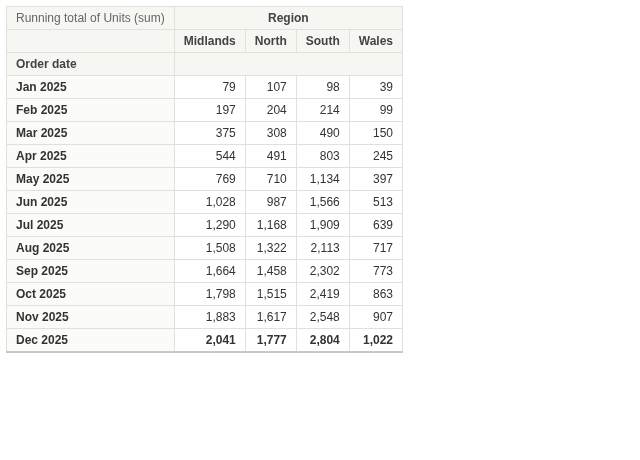
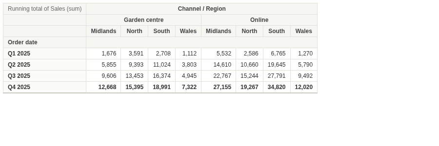
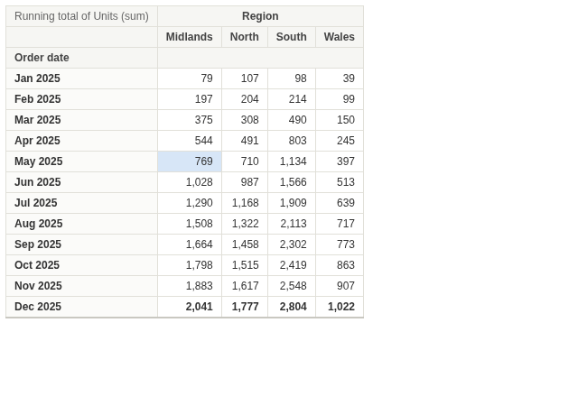

# Running Pivot

Totals to date, period by period, side by side: a pivot table whose cells add up down each column.

## The problem it solves

"How much have we sold so far this year, in each region?" is one of the most common questions in a report, and a normal pivot table answers a different one: how much in each month. The running total has to be worked out row by row, and redone whenever the filter changes.

The Running Pivot view does it in the table. Pick the periods as Rows, the things to compare as Columns, and a measure; each cell shows the total from the first row down to that one. In the illustrative orders above (invented figures), the South passes 1,000 units by May and ends the year with 2,804. Columns can nest, and rows can be quarters:

## Where it earns its place

Omniscope's Pivot view shows the value for each row and column, with subtotals. This view shows the running total instead, which is what year-to-date reporting, budget burn-down and cumulative counts need.

The examples below are illustrative.

| Team | Rows | Columns | Measure |
|---|---|---|---|
| Sales | Month | Region | Sum of sales |
| Marketing | Week | Channel | Count of sign-ups |
| Finance | Month | Budget line | Sum of spend |
| Operations | Day | Warehouse | Sum of units shipped |

## How to use it in Omniscope

1. Bring the data into a workflow with a date and a measure, and connect it to a Report block.
2. Add a view and choose **Running Pivot**.
3. Set **Measure**, for example the sum of Units, and **Rows**, for example Order date; on the Rows field choose a histogram by month.
4. Optionally set **Columns**, for example Region.
5. Click a row, column heading or value to select those records in the other views.

## Why do this in Omniscope

- **Totals to date that match the report.** Each period's figure comes from Omniscope's aggregation of the workflow's output, the same values a Pivot view of the same data shows, and the running totals are recomputed on every refresh and filter.
- **Filtered with the dashboard.** Filter another view to one product or channel and the totals to date are for that product or channel; click a row or column to filter the others in turn.
- **A small table you can adapt.** The view is one HTML file with no libraries: in the View Designer you could restart the total each year, add a percentage of the final total, or colour the cells.

## Data and options

A field for the rows, usually a date, and a measure that adds up.

| Option | What it does |
|---|---|
| Measure | The value added up down each column |
| Rows | The order of the running total; several fields nest |
| Columns | Optional: one column per value; several fields nest |

## Tested

Mock harness: monthly running totals by region checked against the source data (each region's year total), quarters with two nested column fields (total 147,636.65), record count before and after filtering to one region, selecting a row, a column and a single value, clicking again and clicking empty space to clear, a 200 by 120 pane (the table scrolls), 20,000 records over 500 days and 10 stores (final totals add up to 1,010,000), empty data and no Rows.
