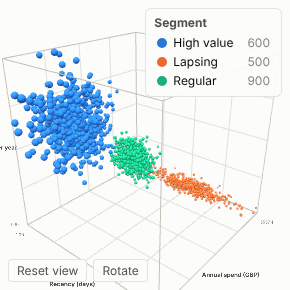

#  3D Scatter

Interactive three-dimensional scatter plot built with three.js. Each point is one item (a customer, a product, a sensor reading) placed by three numeric measures, optionally coloured by a category or a value and sized by a fourth measure. Drag to rotate, scroll to zoom, right-drag to pan.

## Use case

Seeing structure that a 2D chart hides: clusters and segments (for example the output of the Clustering or Reduce Dimensions blocks), outliers in three variables at once, and how groups separate in space. Typical examples are customer segmentation on recency, frequency and spend; product portfolios on price, margin and volume; and process monitoring on temperature, pressure and vibration.

## Data

One row per item, or many rows per item that are aggregated. You need:

- a field that identifies each point (text or number), for example `Customer ID`;
- three numeric fields for the X, Y and Z positions.

Optional: a category field for colour, a numeric field for colour shading, a numeric field for size.

## Settings

- **Points**: one point per unique value of this field. Selection filters on this field.
- **X axis / Y axis / Z axis**: numeric measures for the three positions (the aggregation, for example mean or sum, is used when several rows share a point).
- **Colour by category**: optional field; the first eight categories get their own colour and the rest show as Other. Click a legend entry to select that category (shift-click to add).
- **Colour by value**: optional measure that shades points light to dark. Ignored when a colour category is set.
- **Size**: optional measure; point area is proportional to the value.
- **Point size**: multiplier for all points (default 1).
- **Background**: light or dark.
- **Auto rotate**: slowly spin the scene.
- **Show axes and grid**: bounding box, back-plane grid and min/max labels.

## Interaction

- Hover a point for a tooltip with its values.
- Click a point to select it (shift or ctrl-click to add or remove). Click empty space to clear.
- Selections filter or highlight other views as usual; filtering other views updates this one, and category colours stay the same while filtering.
- **Reset view** restores the camera; **Rotate** toggles spinning.

Up to 20,000 points are drawn (the manifest's data limit). Requires WebGL, which all current browsers support.

## Motion

When the view first draws, and when its data, options or filters change, the points grow out from the centre of the cube. Hovering and selecting do not replay it. The animation is skipped when the viewer's system asks for reduced motion.

## Why this rather than the core Scatter view

The core **Scatter** view already plots in 3D, and it is the better choice for most data: it is fully integrated with the report. Use this view for an orbiting three.js scene with depth cues and up to about 15,000 points, for example to show the segments from a clustering block.

As a community view it is less integrated than a core view: it doesn't support every report feature (rectangle selection, for example), and it isn't covered by Omniscope's core tests.

## Third-party libraries

Loaded from the jsDelivr CDN when the view opens, so the browser showing the report needs internet access:

- [three.js](https://threejs.org) 0.147.0, MIT licence

## About this view

This view carries the `visokio-agents` tag. It is one of a set of community examples built by Visokio's agents, to extend Omniscope's core views with popular, specialist and more unusual use cases, and to show what anyone, people or agents, can build on Omniscope. It is tested by automated tests and was run on a real Omniscope server. It was not reviewed by Omniscope's core team, so it is not on a par with Omniscope's core views, which have years of manual, functional and unit tests behind them.

The sample data in `sample-data/` is invented for the demo.
