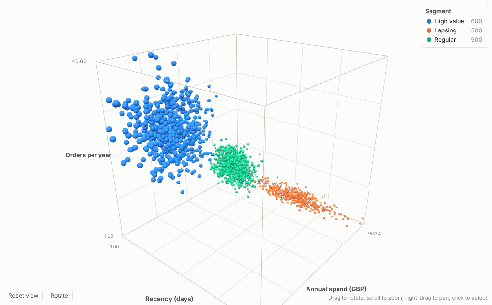
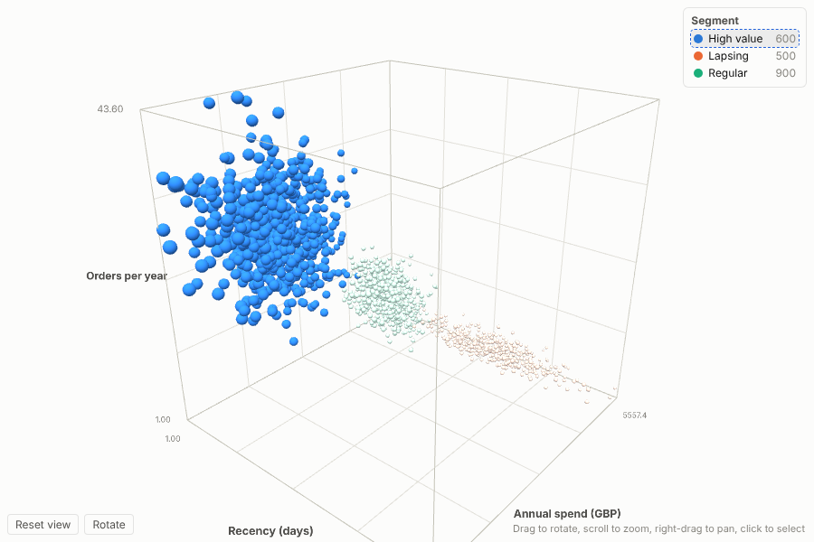
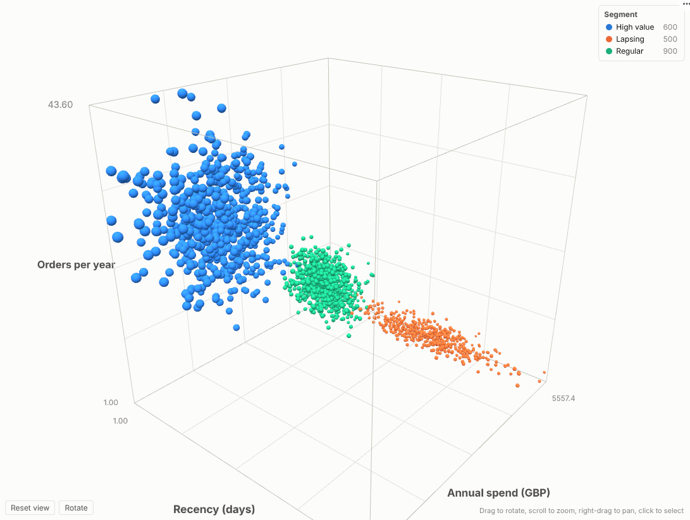

# 3D Scatter

See your segments in three dimensions: rotate, zoom and click through thousands of customers, products or readings, coloured by segment and sized by value, inside any Omniscope report.

## The problem it solves

Most segmentation, risk and process questions involve at least three numbers at once. A 2D scatter forces you to drop one of them, or to spread the story across several charts that the audience has to stitch together in their heads. Clusters that are perfectly separate in three dimensions can overlap completely when flattened to two.

The 3D Scatter puts all three measures on screen together, adds a fourth as point size and a fifth as colour, and lets the viewer turn the picture until the structure is obvious. Because it is an Omniscope view, a click on a point or a segment selects those records, so every other chart, table and KPI on the page answers the follow-up question: who are these customers, what do they buy, where are they?

## Where it earns its place

The examples below are illustrative.

| Industry | Question | X, Y, Z | Colour and size |
|---|---|---|---|
| Retail and e-commerce | Which customers are drifting away, and how valuable are they? | Recency, orders per year, annual spend | Segment from a Clustering block; size by lifetime value |
| Manufacturing | Where is the safe operating window, and which batches fall outside it? | Temperature, pressure, vibration | Production line; colour by value for yield |
| Financial services | How do holdings trade off return, volatility and liquidity? | Return, volatility, days to liquidate | Asset class; size by position value |
| Life sciences | Which compounds combine potency, selectivity and solubility? | The three assay results, or three components from Reduce Dimensions | Series or scaffold; size by quantity available |

## How to use it in Omniscope

1. Load the data in a workflow and connect it to a Report block. Optionally add a **Clustering** or **Reduce Dimensions** block first; their outputs (cluster labels, components) are exactly what this view is designed to show.
2. In the report, add a view and choose **3D Scatter** from the view picker.
3. Set **Points** to the field that identifies each item (for example Customer ID), then pick numeric fields for **X axis**, **Y axis** and **Z axis**.
4. Optionally set **Colour by category** (a segment or cluster field) or **Colour by value**, and **Size**.
5. Drag to rotate, scroll to zoom and hover for details. Click a point or a legend entry to select; the rest of the report filters or highlights to match.

## Why do this in Omniscope

- **Clusters computed and drawn in one project.** Clustering or Reduce Dimensions run as workflow blocks and the view shows their output; re-run the workflow and the scene updates, with no CSV export to a notebook.
- **The same figures as the tables beside it.** The points come from the workflow output the rest of the report reads, so a customer's position matches their row in the table.
- **Selection both ways.** Click a point or a legend entry to filter the other views; filter elsewhere and the scene follows, with category colours kept.
- **A three.js scene you can change.** The scene is built in open code; add axis titles, another point shape or a camera path in the View Designer.

## Data and options

One row per point (or several rows aggregated per point). Required: an identifying field and three numeric fields.

| Option | What it does |
|---|---|
| Points | One point per unique value; selection filters on this field |
| X axis, Y axis, Z axis | Numeric measures for position |
| Colour by category | Up to eight categories get their own colour; more fold into Other. Colours stay attached to categories while filtering |
| Colour by value | Light-to-dark shading by a numeric measure |
| Size | Point area proportional to a measure |
| Point size, Background, Auto rotate, Show axes and grid | Presentation settings |

Up to 20,000 points; uses WebGL (three.js).

## Tested

- Mock harness: normal data, a selected segment, a clicked point with tooltip, dark background, filtering, resizing, empty data, unconfigured options, and 15,000 points.
- Real Omniscope server: installed through the Edit View API and configured in a report; see the server screenshot below.

