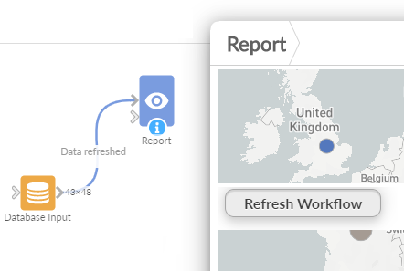

#  Sequential Workflow Execution

A button in a report that executes workflow blocks one after another, in the order given: each block starts only when the one before has finished, and a failure stops the rest. Use it when the steps must happen in a set order, for example load, then clean, then publish.

The view calls the project's [Workflow REST API](https://help.visokio.com/support/solutions/articles/42000073133-workflow-execution-rest-apis): for each block in turn, `POST <project>.iox/w/execute` with that one block, then `GET <project>.iox/w/job/<job id>/state` once a second until the job ends.

## Use case

- Steps with side effects that must run in order: write a file, then a block that reads it back; update a database table, then refresh a report from it.
- Running a long chain in visible stages, so the viewer sees which step is running and where it stopped.

## Data

None: the view does not read the report's data, and filters do not affect it.

## Settings

- **Blocks to execute** (required): the block names in order, separated by commas, for example `Load orders, Clean, Summarise`.
- **Button text**: the text on the button (default "Execute").
- **Refresh from source** (default on): applies to each block's execution. On: each block reloads its data from the sources. Off: data already loaded upstream is reused where possible.
- **Show job state** (default on): shows the progress under the button ("Block 2 of 3, Clean: Running"). Errors are shown whether or not this is on.

## How the order is kept

Each block is a separate execution. The next one is requested only when the previous job's state is Finished (`COMPLETED`). If a block fails, is cancelled or cannot be started (for example a name that is not in the workflow), the view stops and says which block, for example "Stopped at block 2 of 3, Clean: Failed"; the later blocks are not executed.

Omniscope also executes any upstream blocks a named block needs, so with Refresh from source on, an upstream source may be reloaded more than once.

## Requirements

The viewer's user needs the **Workflow Execution via APIs** permission on the Omniscope server (off by default).

## Interaction

Press the button to start. It stays disabled, with a spinner, until the last block has finished or the sequence has stopped. Without any blocks set, the button is disabled and the view asks for them. If Omniscope reloads the view during the sequence (it does when a block the view reads is executed), the view picks up the running block's job and carries on with the remaining blocks. The final message stays shown for two minutes after such a reload.

The view has nothing to select. A click on empty space clears the report's selection, as in other views; a click on the button does not.

## Related views

[Workflow Execution](../workflowexecution) executes several blocks in one request, letting Omniscope order them by their connections.

## Third-party libraries

None: the view is plain HTML and JavaScript and needs nothing beyond Omniscope's custom view API.
