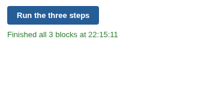

# Sequential Workflow Execution

A button in the report that runs workflow blocks one after another, in your order, and stops at the first failure.

## The problem it solves

When several blocks are executed together, Omniscope orders them by their connections in the workflow. Some steps have an order the workflow cannot see: a block writes a file or a database table, and another block reads it back; an export must finish before a notification goes out.

The Sequential Workflow Execution view executes each block as a separate job and starts the next only when the previous one has finished. The status line says which step is running, and where the sequence stopped if one fails. Above, three illustrative steps run in turn.

## Where it earns its place

The examples below are illustrative.

| Team | Steps, in order |
|---|---|
| Data team | Write the cleaned table to the warehouse, then refresh the report that reads it |
| Finance | Import the ledger, run the checks, then publish the pack |
| Operations | Export the pick list, then email the depot |

## How to use it in Omniscope

1. Give the users who should press the button the **Workflow Execution via APIs** permission on the server.
2. In the report, add a view and choose **Sequential Workflow Execution**.
3. Type the block names in **Blocks to execute**, in order, separated by commas.
4. Set **Button text**, and choose whether to **Refresh from source**.

## Why do this in Omniscope

- **Order the workflow cannot infer.** Steps linked only through a file or a database run in the order you list, from the report, with no external scheduler or script to chain them.
- **Stops safely.** If a step fails, is cancelled or cannot start, the later steps are not run, and the view says which step stopped the sequence.
- **Easy to adapt.** The sequencing is a short loop in the view's own JavaScript, so retrying a step, pausing between steps or skipping one is a small edit in the View Designer.

## Data and options

No data is needed; the view can sit on any report tab.

| Option | What it does |
|---|---|
| Blocks to execute | Block names in order, separated by commas (required) |
| Button text | The label on the button |
| Refresh from source | Applies to each step |
| Show job state | Show which step is running (errors always show) |

## Tested

Mock harness with a stand-in for the Workflow REST API: three blocks requested one at a time in the given order, each only after the previous job finished; a failing middle step stops the sequence before the last; a block name not in the workflow; filtering (sends nothing); a 120 by 60 pane; empty data; no blocks set (button disabled, with a message); and six steps; and a reload of the view in the middle of a run (the sequence carries on).
