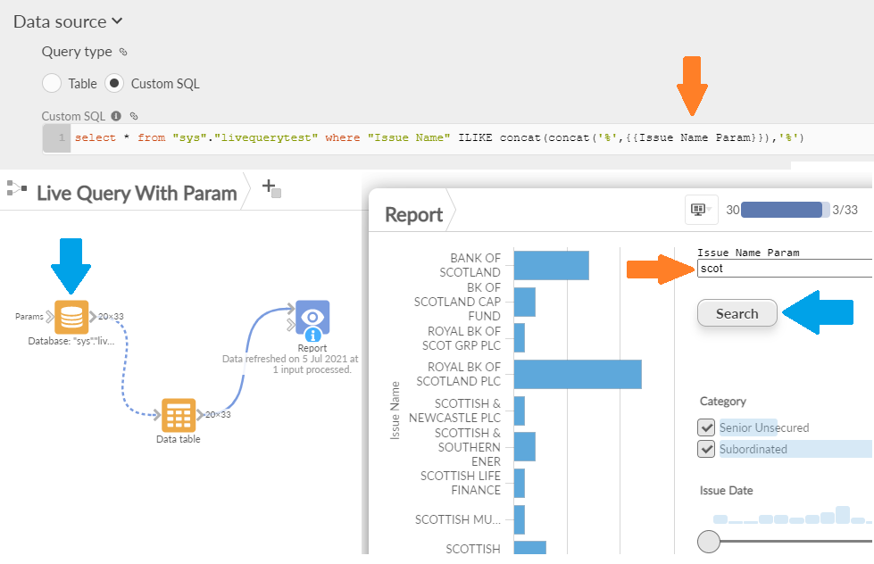

#  Set Parameters and Execute

Inputs for the project's parameters and a button that executes workflow blocks with the values typed in. Report viewers can change a threshold, a region or a date and re-run the workflow, without opening it.

The view calls the project's [Workflow REST API](https://help.visokio.com/support/solutions/articles/42000073133-workflow-execution-rest-apis): `GET <project>.iox/w/param/` to read the parameters, then on the button `POST <project>.iox/w/execute` with the blocks and the new parameter values in one request, and `GET <project>.iox/w/job/<job id>/state` once a second until the job ends.

## Use case

- What-if reports: change a growth rate, a price or a cut-off, execute, and read the result in the other views.
- Parameterised extracts: a region, a customer or a date range fed to a database query or an API block.

## Data

None: the view does not read the report's data, and filters do not affect it. The values it shows are the project's parameters.

## Settings

- **Blocks to execute**: block names separated by commas, for example `Report`. Leave empty to execute the whole workflow.
- **Button text**: the text on the button (default "Execute").
- **Parameters to show**: parameter names separated by commas, in the order to show them. Leave empty to show all the project's parameters. Names that are not parameters of the project are listed under the inputs.
- **Refresh from source** (default on): the blocks reload their data from the sources. Off: data already loaded upstream is reused where possible, which is quicker when only a filter or formula uses the parameter.
- **Show job state** (default on): shows the job's progress under the button. Errors are shown whether or not this is on.
- **Parameter cell width (px)** (200), **Input width (px)** (100), **Label size (px)** (13): the layout of the inputs. Cells wrap onto more rows as the view narrows and are never wider than the view.

## Values

Each input starts with the parameter's current value. Number parameters are sent as numbers (thousands separators are ignored; text that is not a number is refused with "Enter a number for ..."); other parameters are sent as typed. All the shown parameters are sent with each execution.

## Requirements

The viewer's user needs the **Project parameters access via APIs** permission (to read the parameters) and **Workflow Execution via APIs** (to execute) on the Omniscope server. Both are off by default.

## Interaction

Type values, then press the button. It stays disabled, with a spinner, until the job ends. Values typed into the inputs are kept when the report is filtered or the view resized. If Omniscope reloads the view while the job runs (it does when a block the view reads is executed, or a parameter it reads changes), the view picks the job up again and shows its progress and result. The result stays shown for two minutes after such a reload.

The view has nothing to select. A click on empty space clears the report's selection, as in other views; a click on an input or the button does not.

## Related views

[Switch Param and Execute Workflow](../switchparamandexecute) sets one parameter from a list of values; [Lambda Workflow Execution](../lambdaworkflowexecution) runs with the values in a copy of the project, leaving the project's own parameters unchanged.

## Third-party libraries

None: the view is plain HTML and JavaScript and needs nothing beyond Omniscope's custom view API.
