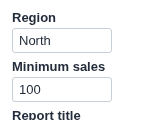

# Set Parameters and Execute

Inputs for the project's parameters, and a button that runs the workflow with them. What-if analysis from the report.

## The problem it solves

Project parameters drive a workflow: a threshold in a filter, a rate in a formula, a region in a database query. Changing one normally means opening the workflow, editing the parameter and executing the blocks.

The Set Parameters and Execute view shows the parameters you choose as inputs in the report, filled with their current values. Change them, press the button, and the view sets the parameters and executes the blocks in one request. Above, an illustrative Region and Minimum sales.

## Where it earns its place

The examples below are illustrative.

| Team | Parameters |
|---|---|
| Finance | Growth rate, exchange rate, budget year |
| Pricing | Discount, price floor, product line |
| Sales operations | Region, minimum deal size, date from |
| Data team | Model threshold, sample size |

## How to use it in Omniscope

1. Create the project parameters in the workflow and use them in blocks (a filter, a formula, a query).
2. Give the users who should change them the **Project parameters access via APIs** and **Workflow Execution via APIs** permissions.
3. In the report, add a view and choose **Set Parameters and Execute**.
4. Set **Parameters to show** and **Blocks to execute** (usually the Report block).

## Why do this in Omniscope

- **One request, one consistent result.** The new values and the execution go to the server together, and the other views in the report are rebuilt from the workflow's output with those values.
- **Typed.** Number parameters are sent as numbers and anything that is not a number is refused before it reaches the workflow.
- **Yours to change.** The inputs are built in plain JavaScript from the documented parameter endpoint, so offering a drop-down list instead of a text box, or adding a range check, is an edit in the View Designer.

## Data and options

No data is needed. The inputs are the project's own parameters.

| Option | What it does |
|---|---|
| Parameters to show | Names, in order; empty shows all |
| Blocks to execute | Block names; empty runs the whole workflow |
| Button text | The label on the button |
| Refresh from source | Reload from the sources, or reuse loaded data |
| Show job state | Show the job's progress |
| Parameter cell width, Input width, Label size | Layout of the inputs |

## Tested

Mock harness with a stand-in for the Workflow REST API: inputs filled with the current values; the request sends the blocks and every shown parameter, numbers as numbers (including "1,500"); a value that is not a number is refused and nothing is sent; a name that is not a parameter is reported; a refused permission; typed values survive filtering; a 160 by 120 pane; a project with no parameters; no settings (all parameters, whole workflow); and 60 parameters; and a reload of the view in the middle of a run (the view resumes and shows the result).

