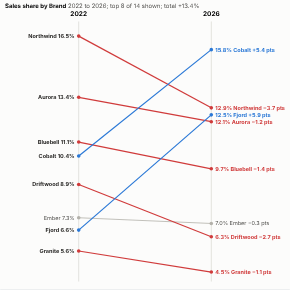

#  Slope Chart

Before and after, for many items at once. Each item is a line from its value in one period to its value in another, so rises, falls and changes of order read at a glance. Gainers are blue, losers red and items that barely move grey, so the movers stand out. Compare values, shares of the total or ranks; labels are spread to avoid overlap.

## Use case

Market share and brand performance, product or store league tables, survey scores this year against last, before and after an initiative, cost lines between two budgets, any "what changed between then and now" story for a board pack or a presentation.

## Data

Items, periods and a measure, aggregated by Omniscope. By default the first and last periods in the data are compared; set From and To for others.

## Settings

- **Items**: what to compare, e.g. Brand.
- **Periods**: e.g. Year. Dates work too; group them by unique values or a period.
- **Measure**: e.g. sum of Sales.
- **From**, **To**: optional periods, typed as they appear in the data (e.g. 2022).
- **Show**: values, share of the total in each period, or rank.
- **Items shown**: the largest items (default 15).
- **Flat below %**: relative changes smaller than this are grey (default 5%).
- **Start at zero**: start the value axis at zero; turn off to spread small differences.

## Reading the chart

Labels on the left give each item's starting value; labels on the right give the end value and the change: percentage change for values, percentage points for shares, and places gained or lost for ranks. Thin connectors link a label to its point when labels had to be moved apart. The heading gives the change in the total.

## Interaction

Hover a line for both values, ranks, shares and the change. Click a line to select that item, so other views filter or highlight to match; click again or click empty space to clear.

## Motion

When the view first draws, and when its data, options or filters change, the lines draw across, then the points and labels appear. Hovering and selecting do not replay it. The animation is skipped when the viewer's system asks for reduced motion.

## Third-party libraries

Loaded from the jsDelivr CDN when the view opens, so the browser showing the report needs internet access:

- [D3](https://d3js.org) 7.9.0, ISC licence

## About this view

This view carries the `visokio-agents` tag. It is one of a set of community examples built by Visokio's agents, to extend Omniscope's core views with popular, specialist and more unusual use cases, and to show what anyone, people or agents, can build on Omniscope. It is tested by automated tests and was run on a real Omniscope server. It was not reviewed by Omniscope's core team, so it is not on a par with Omniscope's core views, which have years of manual, functional and unit tests behind them.

The sample data in `sample-data/` is invented for the demo.
