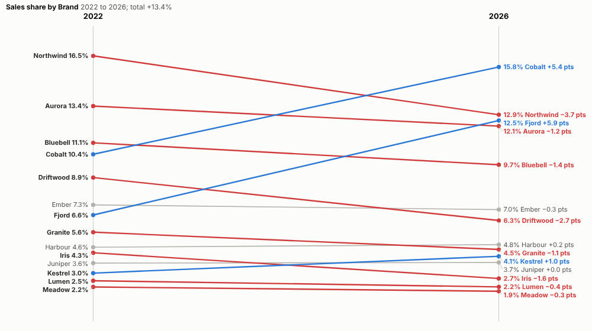
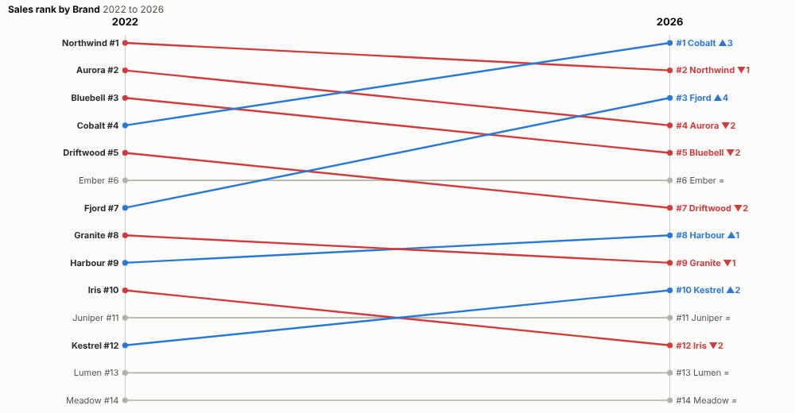
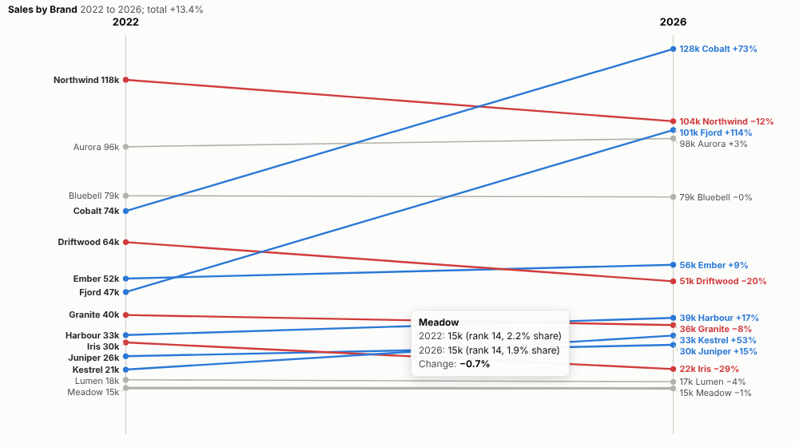
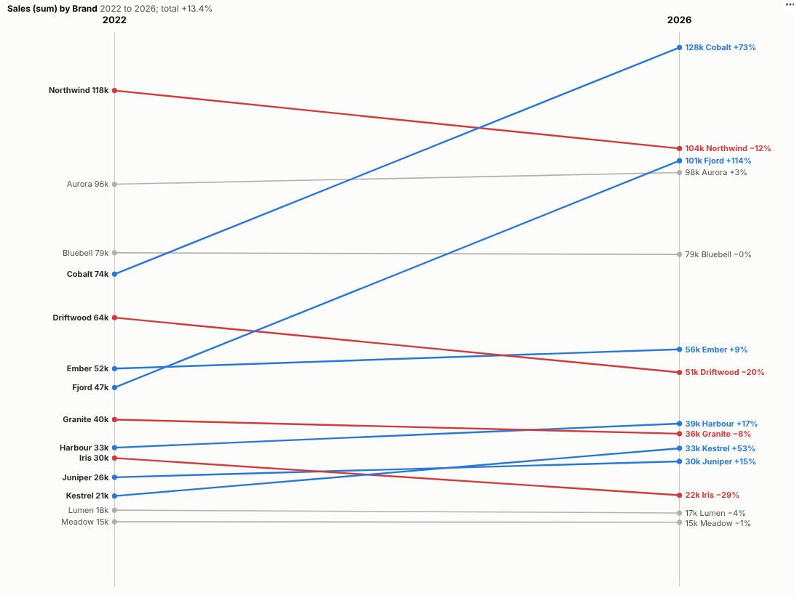

# Slope Chart

What changed between then and now? Every item's start and end on one chart, with the winners, the losers and the reshuffles obvious at a glance.

## The problem it solves

"How has our market changed since 2022?" A table of two columns hides the story, a clustered bar chart makes the eye jump between pairs, and a line chart over every year adds noise when only the start and the end matter. A slope chart shows the change between two points for many items directly. It is fiddly to build by hand because the labels collide.

The Slope Chart view draws it from any items, periods and measure, spreads the labels automatically and colours the movers. In the illustrative brand data above, two challengers, Cobalt and Fjord, take share from the leader, Northwind, while most brands barely move. By rank, Cobalt rises three places to first and Fjord four places to third:

## Where it earns its place

The examples below are illustrative.

| Team | Items | Comparison |
|---|---|---|
| Marketing and strategy | Brands, segments | Market share then and now |
| Sales | Products, stores, regions | This year against last year |
| HR | Survey questions, teams | Engagement score this wave against last |
| Finance | Cost lines | Budget against outturn |
| Public sector | Areas, services | Outcomes before and after a programme |

## How to use it in Omniscope

1. Bring the data into a workflow with items, a period field and a measure.
2. Connect it to a Report block, add a view and choose **Slope Chart**.
3. Set **Items**, **Periods** and **Measure**; set **From** and **To** if you want periods other than the first and last.
4. Choose values, shares or ranks in **Show**.
5. Click a line to select that item and see its detail elsewhere in the report.

## Why do this in Omniscope

- **Next quarter's slide already drawn.** The periods are prepared and joined in the workflow, so the chart redraws on refresh and nobody re-keys values into a presentation.
- **Values, shares and ranks from the same rows.** One click apart, and the tests check each against an independent calculation.
- **A brand's line opens its detail.** Clicking a line selects that item for the other views, and report filters redraw the slope for a channel or region.
- **House style is editable.** The flat threshold is a setting; the gainer and loser colours and the label spacing are in its code for a designer to change.

## Data and options

Items, periods and a measure.

| Option | What it does |
|---|---|
| Items, Periods, Measure | What, when and how much |
| From, To | Optional periods to compare |
| Show | Values, share of total or rank |
| Items shown | Largest items drawn |
| Flat below % | Grey for small changes |
| Start at zero | Value axis from zero |

## Tested

- Mock harness: changes, ranks and shares checked against an independent calculation, chosen From and To periods, the item limit, hover, selection, clearing, filtering to one channel, a narrow layout, a single period, empty data and unconfigured options.
- Real Omniscope server: installed through the Edit View API and configured in a report.

