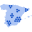
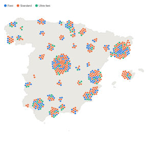

#  Spain Force Dot Density Map

One dot per item on an outline map of Spain, with dots in a crowded place pushed apart so that none hides another. The size of a cluster then shows how many items share a town, where markers placed at their exact locations would pile up into one.

## Use case

Seeing where things are and how many there are in each place: sites, customers, shops, incidents or survey responses in Spain. Colour by a category (type, channel, status) to see how the mix changes from place to place.

## Data

One record per item, with a latitude and a longitude in decimal degrees (west of Greenwich is negative). Omniscope aggregates by the Split grouping, so with one record per item each dot shows that record's position. The view shows up to 10,000 dots.

The map covers mainland Spain, the Balearic Islands, Ceuta and Melilla. Dots outside the map's frame (for example in the Canary Islands) are not drawn, and a note at the bottom right counts them, together with any records that have no location.

## Settings

- **Split**: one dot per value of this grouping, for example Charging point.
- **Dot latitude**, **Dot longitude**: the position of each dot, for example the mean of Latitude and the mean of Longitude.
- **Colour** (optional): colours the dots by category. Use a text field with the **Singleton** function (for example Charger type), which gives each dot its one value, or blank when a dot's records have several.
- **Dot radius (pixels)** (optional): the radius of each dot. If it is empty, the dots get smaller as their number grows, from 4 pixels down to 1.2.
- **Tooltip value** (optional): a figure shown in a dot's tooltip, for example the sum of Sessions per month.
- **Tooltip label** (optional): the label for the Tooltip value. If it is empty, the measure's name is used.
- **Pane X**, **Pane Y** (optional): one map per value, side by side or one above the other.

## How the dots are placed

Each dot is pulled towards its location and pushed away from its neighbours until they no longer overlap, so a dot can sit a little away from its exact position in a busy area; the tooltip has the exact coordinates. With more than 1,500 dots the view takes fewer steps to place them, so a large dataset does not hold up the report.

Colours follow the category's name, not its rank, so filtering the report does not recolour the dots. A key above the map appears when there are 10 categories or fewer and room for it.

## Interaction

Hover a dot for its Split value, Tooltip value, colour category and coordinates. Click a dot to select its Split value (for a histogram grouping, the dot's range); the other dots fade. Click it again, or click away from the dots, to clear the selection.

## Third-party libraries and data

- [D3](https://d3js.org) 7.9.0, ISC licence, loaded from the jsDelivr CDN when the view opens, so the browser showing the report needs internet access.
- The map outline, `spain_peninsula.json`, is the Spain feature of [Natural Earth](https://www.naturalearthdata.com)'s Admin 0 countries, which is in the public domain. It is part of the view's files.

The sample data in `sample-data/` is invented for the demo.
