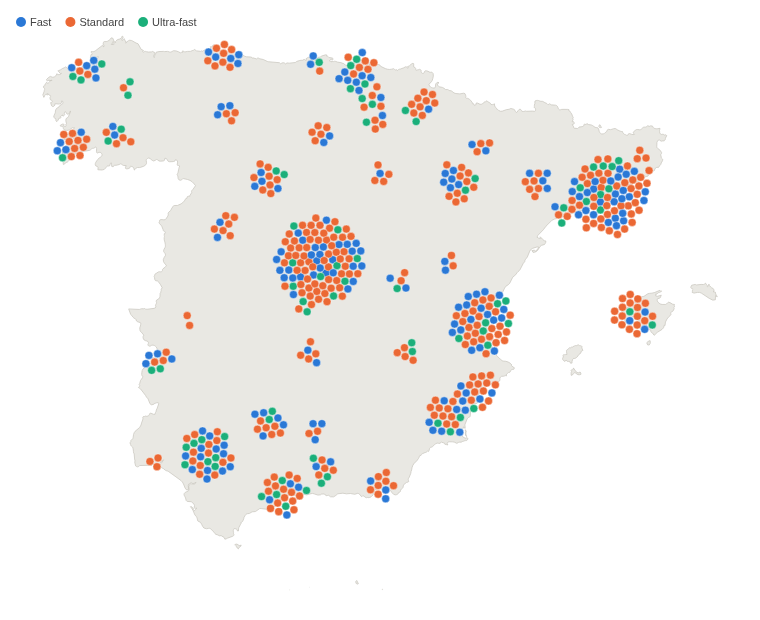
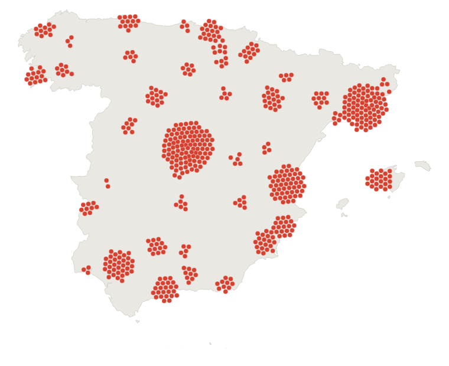
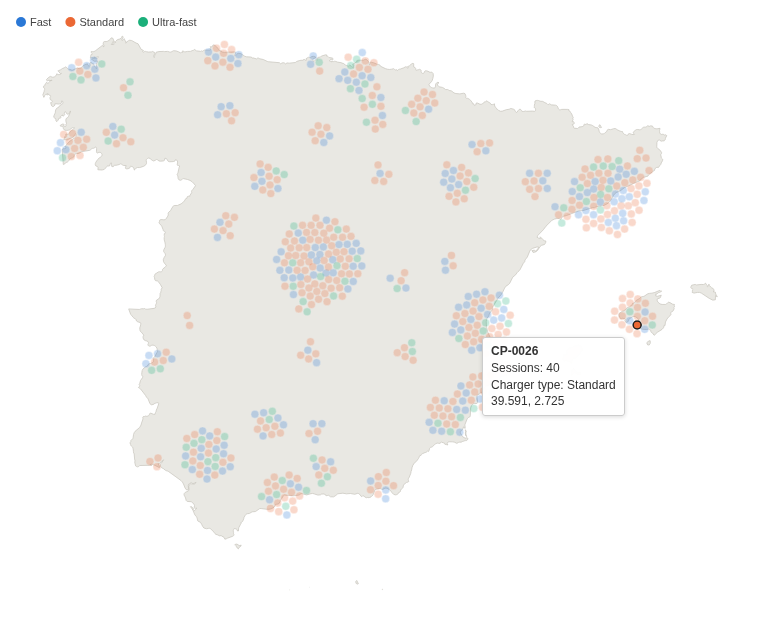

# Spain Force Dot Density Map

Every site, customer or incident in Spain as its own dot, none hidden behind another. How many there are in each place, at a glance.

## The problem it solves

A map with a marker per item answers "where?", but in a city a hundred markers sit on the same spot and look like one. Heat maps and clusters show "how many?" but hide the individual items and their categories.

This view gives every item its own dot and pushes dots apart until none overlaps, so a busy town becomes a wide disc of dots and a quiet one a few. In the illustrative network above (600 invented charging points), Madrid and Barcelona have the largest clusters, and colour shows the mix of charger types in each town. In a single colour the map reads as a count by place:

## Where it earns its place

Omniscope's built-in Map view places each marker at its exact position on a background map, which is right when the exact position matters; in a dense area the markers overlap. Use this view when the question is how many items each place has and what kind they are, and every item should stay visible and clickable.

The examples below are illustrative.

| Team | One dot per | Colour |
|---|---|---|
| Operations | Site, depot, charging point | Type, status |
| Sales | Customer, shop | Channel, segment |
| Field service | Incident, visit | Priority, outcome |
| Research | Survey response | Answer |

## How to use it in Omniscope

1. Bring the data into a workflow, one record per item with a latitude and a longitude, and connect it to a Report block.
2. Add a view and choose **Spain Force Dot Density Map**.
3. Set **Split** to the item, for example Charging point, and **Dot latitude** and **Dot longitude** to the mean of Latitude and of Longitude.
4. Optionally set **Colour** to a category with the Singleton function, and a **Tooltip value**.
5. Click a dot to select its item in the rest of the report.

## Why do this in Omniscope

- **One dot per record of the workflow's output.** The dots come from the report's own query, one per Split value, so their number matches a table of the same data, and the map follows every filter in the report.
- **Dot to record.** A click on a dot selects that site in the other views of the report, for example a table of its sessions, like a built-in view.
- **Stable colours, no tile server.** Each charger type keeps its colour whatever the filters, and the map outline is one of the view's own files, so the view needs no map service.
- **A different country in the View Designer.** The outline is a GeoJSON file next to the view's code; replace it with another region's outline to make the same view for another country.

## Data and options

One record per item with a latitude and a longitude; up to 10,000 dots.

| Option | What it does |
|---|---|
| Split | One dot per value |
| Dot latitude, Dot longitude | Position, in decimal degrees |
| Colour | Category colour, with a key |
| Dot radius (pixels) | Fixed dot size; empty sizes the dots to their number |
| Tooltip value, Tooltip label | A figure in the tooltip, and its label |
| Pane X, Pane Y | One map per value |

## Tested

Mock harness: one dot per charging point (600), the colour key, the tooltip's figures, selecting a point and a histogram range, clearing by clicking the dot again and by clicking away, filtering to one region (98 dots, colours unchanged), a fixed dot radius, dots outside the map and without a location counted in a note, a 180 by 150 pane (the map fits), 10,000 dots placed in under 3 seconds, empty data and unset options.

