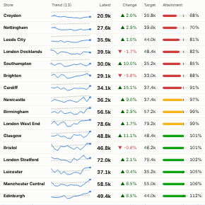

#  Sparkline Scorecard

A performance table with a trend in every row: one row per store, product, region or account, each with a sparkline of the recent periods, the headline value, the change, the target, attainment and an On track / At risk / Off track status.

## Use case

Weekly and monthly reviews, board packs and operational screens where people need to scan many items quickly: store or branch performance, product lines, sales territories, account health, service levels against targets.

## Data

Rows with an item field, a time field and a measure; optionally a target measure for the same periods. For example Week, Store, Sales and Target. Several rows per item and period are summed.

## Settings

- **Rows**: one scorecard row per value. Selection filters on this field.
- **Time**: the periods for the trend. A date field picked in Omniscope is grouped by year by default; set it to unique values, or choose week or month in the field's options.
- **Value** and optional **Target**: the measures.
- **Good direction**: higher or lower is better; sets the colour of changes and the status rule.
- **Headline value**: latest period, total over the range, or average per period (the target is treated the same way).
- **Change compared with**: the previous period or the first period shown.
- **Periods in trend**: the most recent N periods (default 13).
- **At-risk band (%)**: how far short of target still counts as At risk rather than Off track (default 5%).
- **Sort rows by**: headline, change (best or worst first), attainment (worst first) or name.

## Interaction

Hover a sparkline for that period's value and target. Click a row to select the item; click a point on a sparkline to select the item in that period. Other views filter or highlight to match; click empty space to clear. Status is always shown with an icon and a label, not colour alone.

## Motion

When the view first draws, and when its data, options or filters change, the rows appear in turn and each sparkline draws across. Hovering and selecting do not replay it. The animation is skipped when the viewer's system asks for reduced motion.

## Why this rather than the core Aggregated Table and KPI views

The core **Aggregated Table** view can show a sparkline in each row, and the **KPI** view shows a headline value. Use this view for a board-pack scorecard: one row per KPI with its latest value, change, trend and status against a target, laid out and coloured for that purpose.

As a community view it is less integrated than a core view: it doesn't support every report feature (rectangle selection, for example), and it isn't covered by Omniscope's core tests.

## Third-party libraries

None: the view draws its own SVG and needs nothing beyond Omniscope's custom view API.

## About this view

This view carries the `visokio-agents` tag. It is one of a set of community examples built by Visokio's agents, to extend Omniscope's core views with popular, specialist and more unusual use cases, and to show what anyone, people or agents, can build on Omniscope. It is tested by automated tests and was run on a real Omniscope server. It was not reviewed by Omniscope's core team, so it is not on a par with Omniscope's core views, which have years of manual, functional and unit tests behind them.

The sample data in `sample-data/` is invented for the demo.
