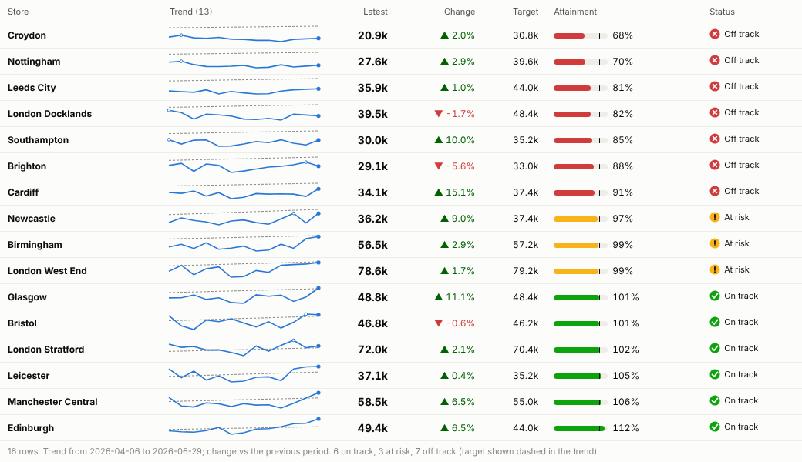
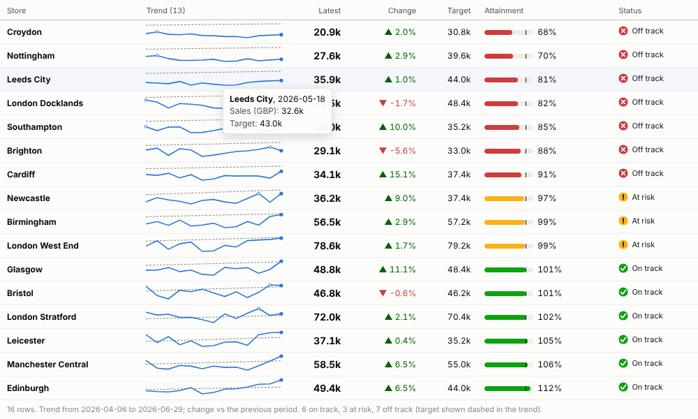
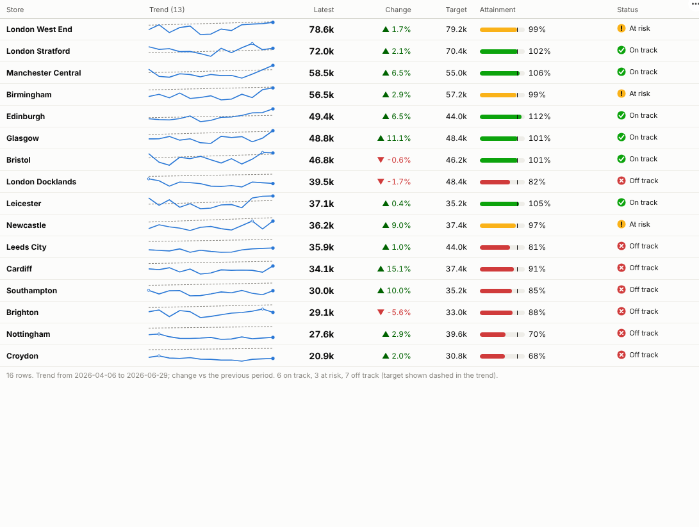

# Sparkline Scorecard

The weekly review on one screen: every store, product or region with its trend, its number, its change and whether it is on track, sorted so the problems are at the top.

## The problem it solves

Performance reviews run on tables, and tables are slow to read. A column of numbers tells you this week's figure but not whether it is a blip or a slide; a separate chart per item takes a page each. Managers end up asking the same three questions about every row: is it on target, is it getting better, and should I worry?

The Sparkline Scorecard answers all three in a single row. Each item has a small trend line (with the target dashed behind it), the headline value, the change with its direction, attainment against target and a status with an icon and a label. Sorted by attainment, worst first, the stores that need attention are at the top of the page. In the illustrative data above, seven stores are off track this week, and the trend lines show which have been sliding for a quarter and which just had a bad week.

## Where it earns its place

The examples below are illustrative.

| Function | Rows | Value and target | Review question |
|---|---|---|---|
| Retail and hospitality | Store, branch, site | Sales, covers, conversion | Which sites are behind plan, and is it getting worse? |
| Sales | Territory, rep, account | Bookings against quota | Who needs support this month? |
| Operations and service | Team, queue, depot | Calls answered, on-time deliveries against service level | Which teams are missing their service level? |
| Finance | Cost centre, product line | Spend against budget (lower is better) | Where is spend running over budget? |
| Public sector and healthcare | Ward, practice, service | Activity against plan, waiting list size | Which services are off trajectory? |

## How to use it in Omniscope

1. Connect data with an item, a period and a measure to a Report block; join targets or budgets in the workflow so they sit on the same rows.
2. Add a view and choose **Sparkline Scorecard**.
3. Set **Rows** (for example Store), **Time** (for a date, choose unique values, weeks or months), **Value** and, optionally, **Target**.
4. Choose the **Good direction**, the **Headline value** and how many **Periods in trend** to show; sort by attainment to put the problems first.
5. Click a row to select that store across the rest of the report, or a point on its trend to see that week in detail.

## Why do this in Omniscope

- **Targets joined on the same keys as the actuals.** Quotas and service levels are joined in the workflow, so attainment is worked out one way in every report, and the Monday review starts from the latest refresh.
- **From the row to the reason.** Selecting a store narrows the product, staffing and customer views beside it; a point on its sparkline selects just that week.
- **Each regional manager, their own stores.** The report's permissions and filters decide which rows appear (exercised with 400 rows over 104 weeks).
- **Status rules you can rewrite.** The At risk band is a setting; for a rule such as three weeks in a row below target, the status logic is open to edit in the View Designer.

## Data and options

An item, a period and a measure; optionally a target measure.

| Option | What it does |
|---|---|
| Rows, Time, Value, Target | The items, periods and measures |
| Good direction | Higher or lower is better |
| Headline value | Latest, total or average |
| Change compared with | Previous or first period |
| Periods in trend, At-risk band, Sort rows by | Presentation and status rule |

Tested with 400 rows over 104 weeks.

## Tested

- Mock harness: latest week against target sorted by attainment, sparkline hover, row and row-in-period selection, clearing, filtering to one region, a narrow view, totals without a target, monthly grouping with averages, empty data, unconfigured options, and 400 rows over 104 weeks.
- Real Omniscope server: installed through the Edit View API and configured in a report.

