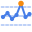
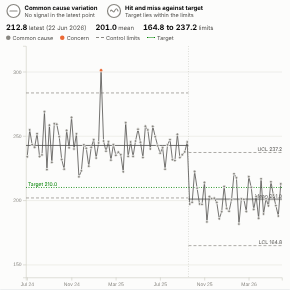

#  SPC Control Chart

Statistical process control (XmR) chart: plots a measure over time with its mean and control limits, flags special-cause variation with the standard run rules, and says in words whether the latest point shows improvement or concern and whether the process will reliably meet a target.

## Use case

Telling signal from noise in operational measures: waiting times, infection rates, defect rates, call handling, on-time delivery. Common in healthcare board reporting and in manufacturing and service quality.

## Data

One value per time point. Either row-level data with a measure (for example mean of Wait minutes) and a date field grouped by week or month, or a pre-aggregated table with one row per period.

## Settings

- **Time**: the time axis (a date, a date grouped by week or month, or a sequence number).
- **Value**: the measure to monitor.
- **Improvement is**: Higher values, Lower values, or Neither. Special-cause points are coloured blue for improvement and orange for concern (violet when neutral); common cause is grey.
- **Target**: optional target line. With an improvement direction the view gives an assurance verdict: will consistently meet, will consistently miss, or hit and miss.
- **Baseline points**: calculate limits from the first N points only (0 uses all).
- **Recalculate limits at**: comma-separated time points (for example `2025-10-06`) where the process changed; limits are recalculated from each.
- **Shift rule / Trend rule**: run lengths (defaults 7 and 6).
- **Show moving range chart**, **Show one and two sigma bands**.
- **Pane X / Pane Y**: one chart per department, site or product.

## Calculations

Mean of the points; average moving range (mR-bar) of consecutive differences; control limits at mean plus or minus 2.66 times mR-bar; moving range limit at 3.267 times mR-bar. Rules: a point outside the limits; a run of 7 or more on one side of the mean; 6 or more consecutive increases or decreases; two of three consecutive points beyond two sigma on the same side.

## Interaction

Hover for each point's value, limits and any rule it breaks. Click a point or drag across several to select those periods (other views filter or highlight to match). Click elsewhere to clear.

## Motion

When the view first draws, and when its data, options or filters change, the run chart draws from left to right and the points appear. Hovering and selecting do not replay it. The animation is skipped when the viewer's system asks for reduced motion.

## Third-party libraries

Loaded from the jsDelivr CDN when the view opens, so the browser showing the report needs internet access:

- [D3](https://d3js.org) 7.9.0, ISC licence

## About this view

This view carries the `visokio-agents` tag. It is one of a set of community examples built by Visokio's agents, to extend Omniscope's core views with popular, specialist and more unusual use cases, and to show what anyone, people or agents, can build on Omniscope. It is tested by automated tests and was run on a real Omniscope server. It was not reviewed by Omniscope's core team, so it is not on a par with Omniscope's core views, which have years of manual, functional and unit tests behind them.

The sample data in `sample-data/` is invented for the demo.
