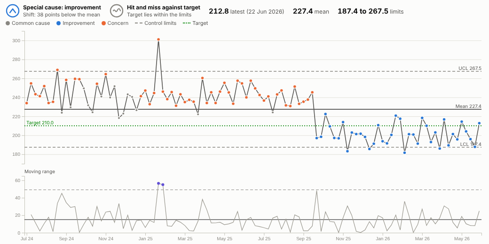
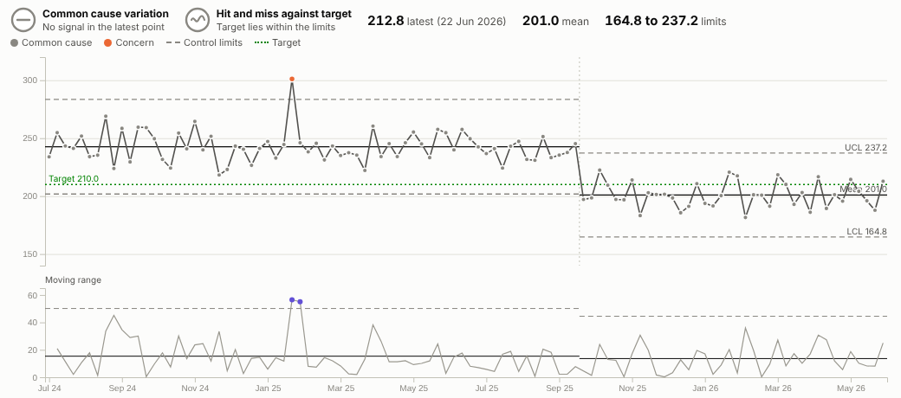
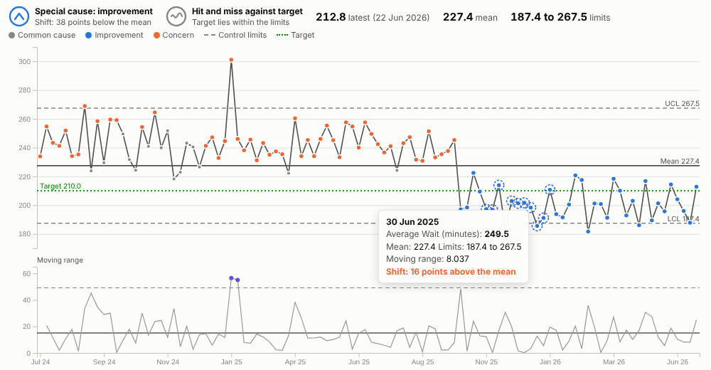
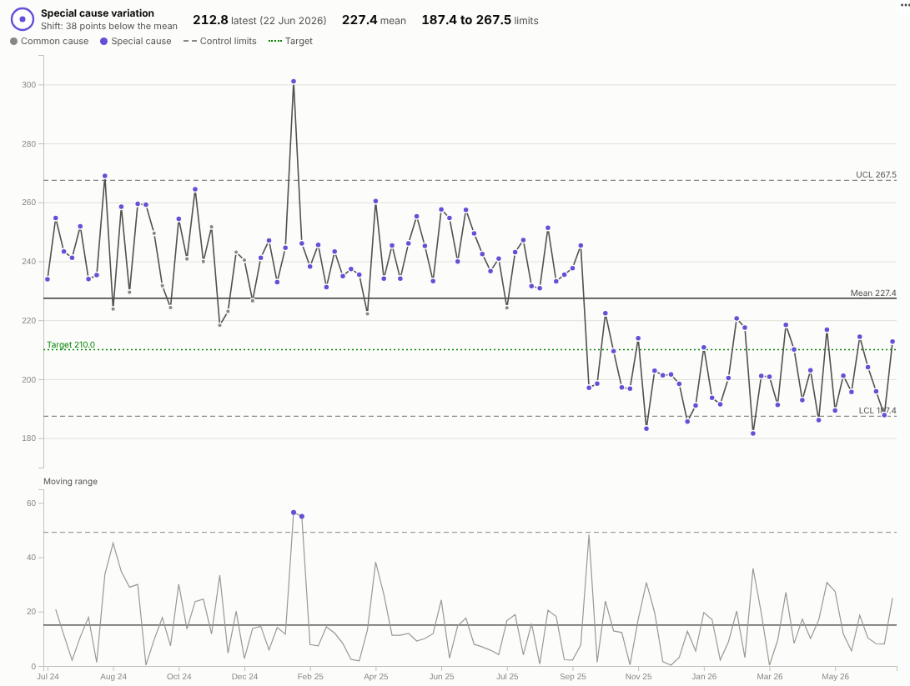

# SPC Control Chart

Stop reacting to every wiggle. See which changes in a measure are real, which are noise, and whether the process will hit its target, with the statistics done for you.

## The problem it solves

A red-amber-green table or a comparison with last month invites the wrong conversation. One bad week triggers an action plan; a genuine, sustained improvement goes unnoticed because it is "only a few minutes". Statistical process control is a widely used answer: plot the measure over time with limits that describe its normal variation, and treat only the patterns that break those limits as signals.

The SPC Control Chart does this in an Omniscope report. It calculates the mean and control limits (XmR method), applies the common run rules, colours each special-cause point as improvement or concern according to which direction is good, and summarises the result in two plain-English verdicts: what the latest data shows, and whether the target is reliably achievable. When a process genuinely changes, the limits can be recalculated from that point:

In the illustrative emergency department, the first chart shows a run of 38 weeks below the mean from October 2025, a clear improvement (the weeks before it show as concern, because they sit above a mean that includes the improved period). With the limits recalculated from the change, as above, one bad week in January 2025 is the only concern point, and the new process is stable around 201 minutes; a 210-minute target is still "hit and miss" because it sits inside the new limits.

## Where it earns its place

The examples below are illustrative.

| Sector | Measure | Improvement is |
|---|---|---|
| Healthcare | Waiting times, length of stay, infections per 1,000 bed days, falls | Lower |
| Manufacturing | Defect rate, fill weight, cycle time, scrap | Lower, or neutral around a set point |
| Contact centres and service | Average handling time, first-contact resolution, abandonment rate | Depends on the measure |
| Logistics | On-time delivery percentage, pick accuracy | Higher |
| IT operations | Incidents per week, time to resolve, page load time | Lower |

## How to use it in Omniscope

1. Load the data in a workflow. Row-level data works directly; or add an **Aggregate** block to produce one row per week or month.
2. Add a view and choose **SPC Control Chart**.
3. Set **Time** (for example Arrival date grouped by week) and **Value** (for example the mean of Wait minutes).
4. Set **Improvement is** and, if there is one, a **Target**. If the process changed on a known date, add it to **Recalculate limits at**.
5. Use Pane X or Pane Y to get one chart per department or site, each with its own limits.

## Why do this in Omniscope

- **The same rules on every ward's chart.** Every chart uses the same XmR calculations and run rules, rather than spreadsheet templates that drift apart between teams.
- **Weekly limits from the raw readings.** An Aggregate block rolls readings up to weeks or months in the workflow, and the chart redraws from that output on each refresh, so the board pack and the operational screen agree.
- **From a signal to the shift behind it.** Select the weeks that broke a rule; the other views narrow to those weeks, so which shift, ward or product is one click away.
- **Panes for comparison.** The same chart for every site or line, side by side, each with its own limits.
- **Add your organisation's rule.** The run rules and the 2.66 and 3.267 constants are visible in the view's script; add a fifth rule in the View Designer if your quality team uses one.

## Data and options

| Option | What it does |
|---|---|
| Time, Value | The axis and the measure (one value per time point) |
| Improvement is | Higher, lower or neutral; drives the colours and verdicts |
| Target | Target line and the assurance verdict |
| Baseline points | Limits from the first N points |
| Recalculate limits at | Time points where the process changed |
| Shift rule, Trend rule | Run lengths (7 and 6 by default) |
| Show moving range chart, Show sigma bands, Pane X, Pane Y | Presentation |

Tested with 2,000 daily points.

## Tested

- Mock harness: weekly date histogram (the same range format the real Query API returns), rebased limits, monthly proportion with a target, hover, range selection and clearing, filtering from another view, a small view size, empty data, unconfigured options, and 2,000 points.
- Real Omniscope server: installed through the Edit View API and configured in a report on a weekly summary table.

