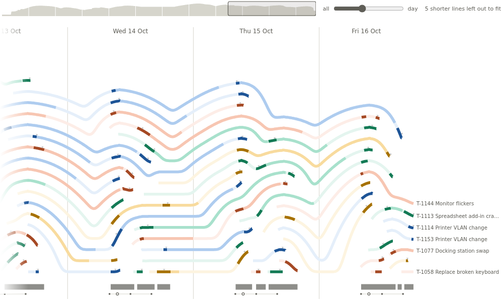
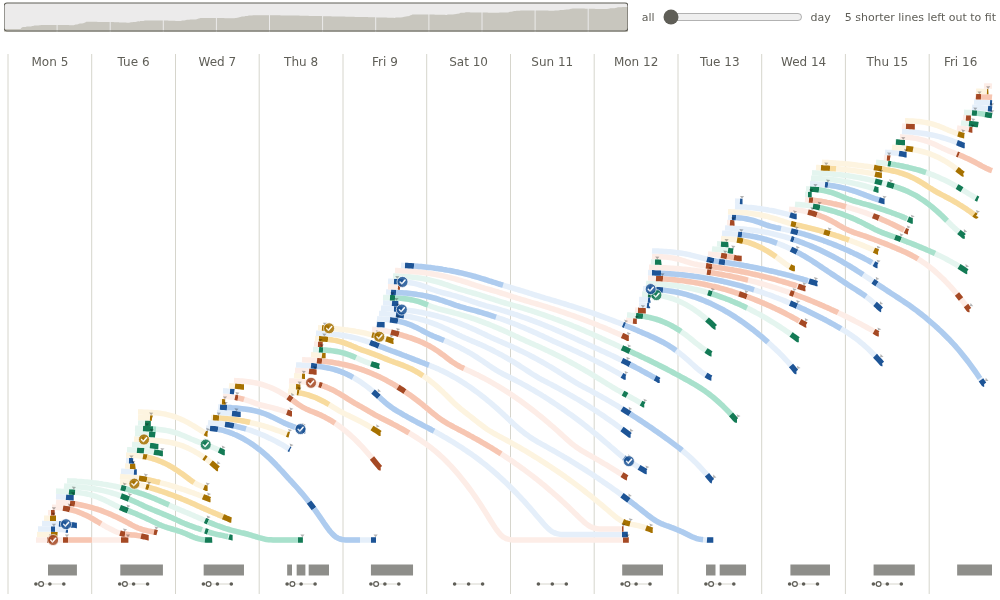
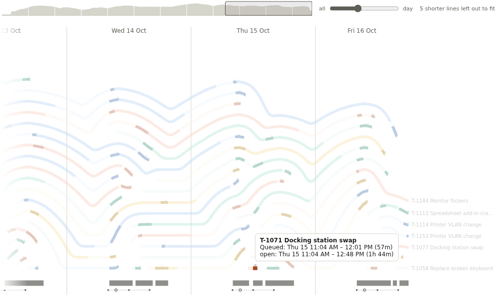

# Strata

Things that open and close - tickets, sessions, projects, patients on a ward - as a stack of lines over time. How much was open at each moment, and what each one was doing.

## The problem it solves

A timeline with one bar per item gives every ticket its own row, so a busy fortnight needs hundreds of rows and the eye cannot see how many were open at once. A line chart of the open count shows the load but loses the items.

Strata stacks the lines that are open at each moment, the longest-lived on top, so the height of the stack is the load; each line rests on the ones beneath and drapes down where one of them ends. Along each line, stretches are drawn strong, medium or faint. In the illustrative service desk above (120 invented tickets), strong is a ticket being worked, medium waiting on the requester and faint waiting in the queue, and the small triangles are replies. Zoomed out to the whole fortnight, the stack shows each day's tickets arriving and the quiet weekend:

## Where it earns its place

The examples below are illustrative.

| Team | One line per | Strong / medium / faint | Moments |
|---|---|---|---|
| Service desk | Ticket | Being worked / waiting on requester / queued | Replies, escalations |
| Hospital ward | Patient stay | Treatment / observation / waiting | Tests, discharge decision |
| Software | Pull request, session | Active work / review / idle | Commits, merges |
| Projects | Project | Delivery / on hold / planning | Milestones |
| Customer success | Onboarding | Calls / waiting on the customer / scheduled | Emails |

## How to use it in Omniscope

1. Bring the data into a workflow, one row per stretch of time, and connect it to a Report block.
2. Add a view and choose **Strata**.
3. Set **Layer** to the item, for example Ticket, and **Start** and **End** to date fields.
4. Optionally set **Label**, **Colour by**, **Emphasis** (2, 1 or 0 per row) and **Emphasis names**, and **Moment time** for rows that mark a moment.
5. Point at a line for its stretches; click it to select that ticket's rows in the rest of the report.

## Why do this in Omniscope

- **Composed in the workflow, filtered in the report.** The stretches, replies and escalations can come from separate tables, appended and joined in the workflow; a filter on a team or a date in the report reaches every row, and a filter that keeps part of a line shortens it to that part.
- **Row by row from the query engine.** The view asks Omniscope's query engine for the stretch rows through the report's filters, every time the data or the filters change, so the lines are the same rows a table of that data shows.
- **A line to its rows.** A click on a line selects its ticket in the other views of the report, for example a table of its stretches or a chart of its replies.
- **Your own vocabulary.** Emphasis is a number per row, so a formula in the workflow decides what is strong, medium or faint, and Emphasis names put the team's own words in the tooltip.

## Data and options

One row per stretch of time; up to 50,000 rows.

| Option | What it does |
|---|---|
| Layer | One line per value |
| Start, End | Each row's stretch (dates) |
| Label, Colour by | The line's name, and lines sharing a colour |
| Emphasis, Emphasis names | Strong (2), medium (1) or faint (0) per row, and what the tooltip calls them |
| Moment time, Moment kind | Rows that are moments on their line, and their kind |
| Foot line, Working-day marks, Daily meeting | The heavy line along the foot, and the working-day marks under it |
| Stacking, Line labels, Opening | How lines are stacked and named, and how the view opens |

## Tested

Mock harness: the stack, overview and moments drawn for 120 tickets; zooming out to the whole range; pointing at a line (tooltip with the ticket, its stretch named by Emphasis names, and when it was open); selecting a ticket and clearing by clicking empty space; filtering to one team; the three fields alone; a 320 by 200 pane; about 19,000 rows (2,000 tickets, the lines that do not fit counted beside the slider); empty data, unset fields and Start equal to End.

